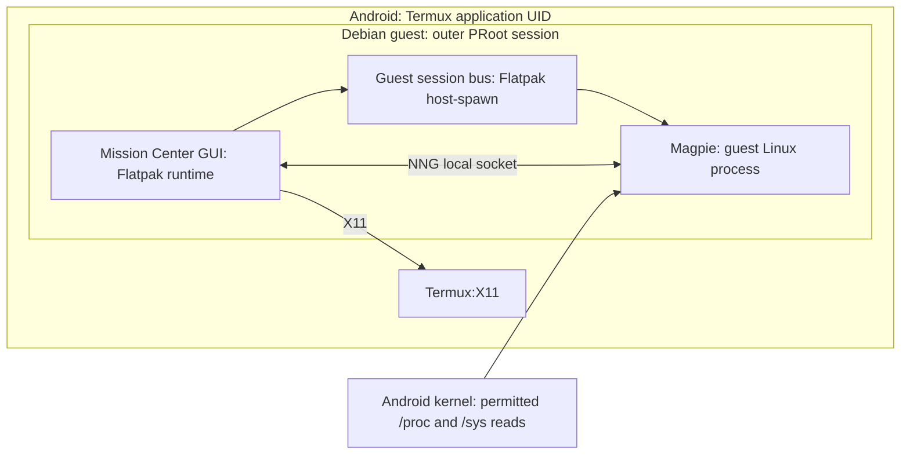

# Mission Center on Termux/PRoot: full assessment

Raw capture paths beginning with `temp/` refer to local files excluded from Git.
See the [privacy notes](privacy.md).

**Native port:** Mission Center 1.2.0 now builds and runs natively
with on-demand Shizuku CPU/process/sensor reads. See the [implementation and
device verification](mission-center/VERIFICATION.md). The PRoot findings below
remain the historical assessment of that different configuration.

**Native follow-up:** the [Shizuku investigation](termux-procstat-shizuku-investigation.md)
demonstrates native delivery of live CPU counters through a persistent reader
that responds only to explicit requests, with no independent polling or copied
file. A native Mission Center port is a separate build task; the PRoot cost and
decision below do not establish native performance.

**Decision: not adopted, because of CPU load.** Mission Center later ran on the phone under a forked PRoot with compatibility shims and a Shizuku-supplied `/proc/stat`. Over 60 seconds, though, it used about 65% of one core and 110 MB. About a quarter of a core of that was PRoot's tracer alone. The user chose to fall back to native Termux's `xfce4-taskmanager`, at 5–8% of one core and about 30 MB, which has CPU and memory graphs and live per-process CPU and memory. Its total CPU covers Termux's processes only. Measurements and the decision are in the [native migration report](termux-native-migration.md#whole-device-cpu-counters-through-shizuku). The rest of this document is kept as the historical assessment.

**Runtime update:** the physical rig reproduced static guest `/proc/stat` and changing per-process CPU ticks. htop renders but shows per-process CPU as N/A and zero global bars. The profile adds `livecd-top`, using monotonic time and PID ticks; a one-core fixture measured about 99% with readable RSS. SIGTERM worked, while SIGSTOP did not stop CPU ticks. Stock Flatpak 1.16.6 installed the GNOME 50 runtime, but Mission Center application installation failed twice with `statx didn't return all required fields: No data available`. No Mission Center GUI, Magpie, process-tree, or measurement acceptance is claimed. The fork/shim route remains untested. See the [device report and raw logs](termux-device-validation.md) and working profile (since removed). The recommendation below is historical: the implementation uses the small monitor instead of making Mission Center a core dependency. This failure does not prove the workaround cannot run the application.

Assessed as an expansion of the [Termux/PRoot retrofit report](termux-proot-analysis.md#process-monitoring-and-mission-center). Scope: unrooted Android, native-architecture Debian (normally arm64), Termux:X11, and the existing PRoot/Flatpak compatibility work. The historical sections below are a source assessment and proposed device procedure. No Android device was available during that review; the subsequent report supplies the later installation/counter tests, without Mission Center launch, accuracy, performance, or battery-life acceptance.

**Recommendation: use guest `htop` as the baseline monitor, and add Mission Center only if live per-process CPU% is required.** Of the two monitors reviewed, only Mission Center computes per-process CPU without `/proc/stat`, which Android denies to apps. That one feature has to justify the whole Flatpak route, because Mission Center is the profile's only remaining Flatpak. If it is adopted, trial the matching Flatpak, decline additional setup, and validate the process view before investing in other telemetry. Its useful target is identifying a busy guest application, inspecting accessible process memory, and stopping a disposable process owned by the Termux UID. Full Android task management and parity with the liveCD's hardware views are outside this target.

There are three independent acceptance questions: does the GTK window render, does Magpie connect and keep responding, and are the readings genuine and useful? Passing one does not establish the next. In particular, **the overall CPU graph cannot work on Android 8 or later: apps cannot read `/proc/stat`, and PRoot launchers either leave it unreadable or substitute static data.** Per-process CPU has a separate implementation and can remain useful. Separately, **the Processes tree omits reparented processes**, because Mission Center roots it at the lowest visible PID.

## Evidence and version boundary

The application findings follow these pinned sources, rather than mixing release and development implementations:

| Component | Reviewed version/source | What this establishes |
| --- | --- | --- |
| Flathub recipe | [Commit `b8e92ea742e6ccce1521f20db28adb284f30b473`](https://github.com/flathub/io.missioncenter.MissionCenter/blob/b8e92ea742e6ccce1521f20db28adb284f30b473/io.missioncenter.MissionCenter.json) | Selects Mission Center 1.2.0, GNOME runtime 50, and aarch64 build inputs. This is recipe evidence; check the installed ref and deployment separately. |
| Mission Center | [Release commit `193e3729367035cf184da004c3246efe79d5c53e`][mc] | GUI requirements, collector launch, error handling, process-tree construction, and settings. |
| Magpie | [Submodule commit `a5272b3c1d853caa4044b737cf49257bfc4c86f2`][magpie] | Linux collection backends, optional-service fallbacks, and process calculations. |
| Flatpak workaround | [Commit `792b0ebe6487ce8adb431232fcc03b3cd15dcadc`][workaround] | An existing launch mechanism to adapt; its reported application tests do not establish Mission Center support. |
| PRoot-Distro statistics handling | [Commit `737306f53fc86213db0ce0ac3e76aa3fda8dcb90`, `sysdata.py`][sysdata] | Supplies fixed substitutes where particular real kernel files are blocked or missing. Inspect the installed launcher's behavior too. |
| htop | [Tag `3.4.1`][htop-machine], the Trixie version | The comparison baseline: its `/proc/stat` startup requirement and per-process CPU calculation. |
| Android platform | [`hidepid=2` change][hidepid]; [Android 8 `/proc` restriction as reported by a monitor app][anothermonitor] | Other UIDs' processes are hidden, and apps cannot read `/proc/stat`. |

The sources establish possible mechanisms and specific failure paths. Statements below about the combined Android configuration are engineering inferences until the device checks pass. Record the Android build, Termux/Termux:X11 builds, PRoot version, guest packages, installed Flatpak commit, and wrapper revision alongside any result.

## What actually runs where



For a native guest installation the GUI starts `missioncenter-magpie` directly. The Flatpak uses `/app/bin/missioncenter-spawner`, which calls `flatpak-spawn --watch-bus --host`. Here, **host means the Debian guest outside the inner Flatpak environment**, with the same outer PRoot context; it must not resolve to an unrelated Termux/Bionic execution environment. The bundled Linux collector needs compatible libraries and path translation. [Client launch][client], [spawner][spawner]

The GUI communicates with Magpie through NNG over a local socket. The normal Flatpak address is `ipc://$HOME/.var/app/io.missioncenter.MissionCenter/data/magpie.ipc`; the native route uses a generated path under `/tmp`. Both processes must resolve the socket to the same underlying file, using the same guest home and permissions. A shared X11 socket alone does not establish this. The client retries initial connection for roughly 15 seconds before displaying a fatal error. [Socket and startup implementation][client]

Mission Center does not require GNOME Shell itself to display a GTK window. Keep the report's GNOME desktop if wanted, but diagnose Mission Center from a terminal in the existing display/bus session. Adding another desktop or a complete init system is not a prerequisite for this test. Termux:X11 documents sharing the guest temporary directory or arranging the equivalent mapping; adapt this into the selected outer launcher. [Termux:X11 instructions](https://github.com/termux/termux-x11#using-with-proot-environment)

## Packaging choices and effort

| Route | Assessment for this profile | Main cost or limitation |
| --- | --- | --- |
| ARM64 Flatpak in Debian | First candidate if Mission Center is adopted; it then also introduces the Flatpak workaround to the profile. | Matching toolkit is supplied; host-spawn, deployment paths, shim handling, and IPC still need validation. |
| Current native build in stock Trixie | A separate packaging project. | Release 1.2.0 requests GTK's `gnome_50` feature set and libadwaita 1.9. Trixie supplies GTK 4.18 and libadwaita 1.7. Installing generic development packages does not resolve this gap. |
| Native build in a guest with matching libraries | Plausible alternative if that guest is already justified. | Removes the inner Flatpak launch boundary; kernel data restrictions remain. Verify the complete build dependency set and collector. |
| Older pinned native release | Possible fallback after auditing that exact release. | Different collector, requirements, features, and maintenance obligations. The 1.2.0 findings cannot simply be carried backward. |
| Direct Termux/Bionic port | Outside the initial retrofit. | Requires a separately validated Android build of the GUI and collector. A glibc Linux executable is not made Bionic-compatible by copying it into Termux. |

The toolkit comparison follows [release dependencies](https://gitlab.com/mission-center-devs/mission-center/-/blob/193e3729367035cf184da004c3246efe79d5c53e/Cargo.toml), [Trixie GTK](https://packages.debian.org/trixie/libgtk-4-1), and [Trixie libadwaita](https://packages.debian.org/trixie/libadwaita-1-0). Prefer native architecture throughout; adding x86 translation would introduce another source of overhead and failure without improving access to Android statistics.

The incremental effort would be moderate if a Flatpak foundation already existed for other applications. In this profile it does not: Parsec and Gear Lever are excluded, so Mission Center is the only existing overlay that needs Flatpak, and the whole Flatpak setup and runtime storage count against it. Collector-specific integration can raise the cost further. The comparison with a guest process monitor is in [static compatibility data](#static-compatibility-data-is-a-measurement-problem): `htop` provides everything retained here except live per-process CPU%. No reliable storage, RAM, frame-rate, or power budget can be given without measuring the selected deployment on the device.

## Telemetry and control assessment

| Feature | Source behavior | Expected handling on unrooted Android |
| --- | --- | --- |
| Overall and per-core CPU utilization | Uses changes in `/proc/stat` counters. | Unsupported on Android 8+. The page shows 0% when the file is unreadable, and NaN after the first sample when it is a static substitute. Core names/counts do not prove live measurements. |
| CPU frequency, temperature, power, topology | Separate kernel/sysfs queries. | Device-dependent extras. A working usage column does not establish these readings. |
| Uptime | This Magpie release uses `clock_gettime(CLOCK_BOOTTIME)`. | Potentially useful Android boot uptime, not guest session age. A fake `/proc/uptime` does not by itself invalidate this particular field. |
| System memory and swap | Reads `/proc/meminfo`; additional zram details use sysfs. | Useful candidate if real/readable. Describes visible device memory, not RAM allocated to a PRoot VM. Missing zram details do not invalidate all basic memory fields. |
| Memory module type, slots, speed | Invokes `udevadm` for DMI information. | Usually outside the phone target; accept absent details without adding a udev service. |
| Process list and tree | Enumerates `/proc`, reads PID `stat`, command line, executable link, and task entries. | Principal target, with a known gap: the tree omits reparented processes (see [below](#the-process-tree-starts-at-the-lowest-visible-pid)). Expect accessible Termux-owned processes and possibly incomplete labels. Determine coverage on the device. |
| Per-process CPU | Uses PID user/kernel ticks, system tick rate, and elapsed monotonic time. | Can remain meaningful independently of system `/proc/stat`. Verify with a controlled workload and record the core-scaling preference. |
| Per-process memory | Uses a hybrid proportional-memory calculation when available; falls back to resident pages from `statm`. | Useful candidate; fallback RSS and shared memory mean sums need not equal device memory usage. Zero can mean inaccessible data. |
| Per-process disk I/O | Uses PID `io` byte counters and elapsed time. | Conditional; missing access can become zero. Test separately from the drive page. |
| App grouping and icons | Matches accessible processes to installed desktop applications. | Expect imperfect grouping for Termux-native programs and Android APKs. App rows aggregate usage from every matched process but list child processes only when they are in the tree. Raw process visibility is the acceptance target. |
| Terminate, kill, suspend, resume | Sends Unix signals; attempts elevation after a failure. | Test only a disposable owned process. Guest root does not authorize control of other Android apps. A failed action need not be fixed by installing an elevation agent. |
| Per-process network traffic | Launches `nethogs` separately. | Omit; accept missing traffic and its error indication. |
| Network adapters and throughput | NetworkManager/system-bus-backed collection has empty-cache fallbacks. | Accept unavailable views; Android network use is not made observable by merely installing NetworkManager. |
| Drives, SMART, eject | Drive enumeration depends on UDisks. | Omit from the target. A normal file manager working in the guest does not establish block-device access. |
| GPU utilization and process accounting | NVTOP plus other graphics-information paths. | Optional and generally constrained by Android's driver interfaces. Rendering the GUI with acceleration is separate. |
| Fans | Looks for hwmon fan inputs. | Accept absent entries. A phone may have no compatible fan interface. |
| Battery | Supports UPower and a direct `/sys/class/power_supply` fallback. | Some fields may work when readable; no need to require UPower first. Units, names, history, and coverage still need validation. |
| Services | Tries supported service backends and can select none. | Accept unavailable services; do not introduce systemd/OpenRC just to populate this page. |

These distinctions follow the pinned [CPU][cpu], [CPU clocks/counts][cpu-system], [memory][memory], [process][processes], [process memory][process-memory], [signal][signals], [app grouping][apps], [network][network], [drive][disks], [GPU][gpus], [fan][fans], [battery][battery], and [service][services] implementations. Missing optional data is not automatically fatal, but a panic, repeated collector restart, or stalled request in the combined environment would be a real compatibility defect.

### Static compatibility data is a measurement problem

The reviewed PRoot-Distro [statistics code][sysdata] leaves a real file alone if it can read it; otherwise it can bind fixed substitutes for `/proc/stat`, `/proc/uptime`, `/proc/loadavg`, and `/proc/vmstat`. The substitute CPU list follows the host's CPU IDs, while its counters remain fixed. This explains how ordinary tools can start without measuring real utilization.

Magpie's [CPU tick calculation][ticks] divides changes in busy/kernel/idle counters by their total change. With a static file, the first sample reports the substitute's fixed average and every later sample divides zero by zero, giving NaN. Without a readable file, the [CPU collector][cpu] logs an error and reports 0% on every refresh. Neither result reflects the device.

The workaround's [outer entry script][entry] directly invokes its PRoot binary and does not apply PRoot-Distro's statistics bindings. The same rootfs may therefore expose a readable substitute through one launcher and a permission error through another. Inspect the actual launch arguments and compare Termux-side and guest-side files. Removing a substitute does not unlock the real kernel data.

Mark the overall CPU page unsupported and retain only verified per-process readings. Do not label the sum of visible process usage as whole-device CPU utilization: Android work, inaccessible processes, and other accounting are missing.

Other proc-based monitors do not avoid the problem and can be worse. [htop 3.4.1][htop-machine] exits at startup unless `/proc/stat` is readable and contains `btime`, so it needs the static substitute. With that substitute, its [per-process CPU%][htop-process] is N/A, because it divides PID ticks by the system CPU period from `/proc/stat`. Its `TIME+` column, cumulative CPU time from the same PID counters, still works and identifies a busy process by its growth. That, plus the process list, memory, and signals, is the baseline Mission Center must improve on.

### The monitoring boundary is the Android UID

PRoot presents a guest filesystem and can emulate identity; it does not allocate independent RAM or create an Android-wide administrative identity. Android's UID and SELinux checks continue to apply to native guest code. Visible processes can include other workloads under the Termux UID, including another guest; do not interpret them as belonging exclusively to this Debian installation. [Android application sandbox](https://source.android.com/docs/security/app-sandbox)

This also affects controls: an owned process outside the intended guest may still be signalable, while another Android app is protected. Validate process actions against a known PID. Merged parent/child statistics can include helper processes and can obscure the workload being examined, so compare individual rows during validation.

### The process tree starts at the lowest visible PID

The Apps page [chooses][tree-root] the smallest visible PID as the root of its Processes section and renders only that process's descendants; the root row itself is not shown. On Linux the root is PID 1, which covers everything except kernel threads. On Android, `hidepid=2` hides PID 1, so the root is whichever Termux-UID process has the lowest PID. That is normally the Termux app process, but after PID wraparound it can be an unrelated process with a small subtree.

When a parent exits, the kernel reparents its children to PID 1 unless a subreaper intervenes. Those processes, and everything they start, then fall outside the rendered tree. Examples are a session `dbus-daemon` started by `dbus-launch`, `pulseaudio --start`, and anything else that daemonizes. The Flatpak helper starts its bus with `dbus-launch` when none exists. D-Bus-activated applications such as Nautilus are children of that `dbus-daemon`, as is Magpie, which is spawned through the D-Bus-activated Flatpak session helper. The header count still includes all of them. App rows [aggregate][app-rows] usage from every matched process, but list child processes only when they are in the tree.

A likely mitigation is starting the session bus with `dbus-run-session`, which keeps `dbus-daemon` as its own child, so that activated processes stay under the Termux app process. The parent report's session supervisor already proposes it. This follows from source; confirm it with the daemonized test process in [step 4](#4-verify-actual-monitoring-behavior).

Android documents restrictions on `/proc/net` from Android 10 onward. A guest package cannot replace those permissions with ordinary Linux capabilities. The reduced networking target is therefore consistent with platform constraints as well as Magpie's missing-service fallbacks. [Android network restrictions](https://source.android.com/docs/security/enhancements#proc-net-filesystem-restrictions)

## Startup requirements, optional setup, and rendering

**Required:** a compatible GUI/runtime and collector, working display, writable application home/cache/data paths, functioning local IPC, and whatever linked shared libraries the selected binaries need. The Flatpak route additionally needs correct deployment metadata and the guest session-bus host-spawn path unless using the manual-collector diagnostic below.

**Optional for this target:** `nethogs`, `sensors-detect`, additional capabilities, polkit elevation, udev rule installation, UDisks, NetworkManager, UPower, and a system service manager. Decline the [first-run setup action][first-run]. Its [setup script][setup] grants `nethogs` capabilities, adds an Intel RAPL powercap rule, triggers udev, and runs sensor detection; it is not Magpie's startup procedure. The Flatpak takes its linked libraries from the GNOME runtime, so the guest needs none of the System Monitor package list. A native build instead needs its linked libraries, such as `libudev`, which is a different dependency from a running daemon. [Native link definition](https://gitlab.com/mission-center-devs/mission-center/-/blob/193e3729367035cf184da004c3246efe79d5c53e/src/meson.build)

For rendering diagnostics, pass `GDK_BACKEND=x11` and `GSK_RENDERER=cairo` into this app through the validated Flatpak helper. GTK documents Cairo as its fallback renderer; this does not prove acceptable performance on the phone. Once stable, compare a supported accelerated renderer using the same workload. Do not install GPU telemetry tools merely to fix GTK rendering. [GTK renderer options](https://docs.gtk.org/gtk4/running.html#GSK_RENDERER)

The Flatpak manifest clears `LD_PRELOAD`, and collector launch removes it too. This does not conflict with the compatibility helper. Its [shim][shim] works around Android failures in bubblewrap's own sandbox setup: `O_TMPFILE`, `/proc/self` after `pivot_root`, user-namespace map files, `linkat`, and `/.flatpak-info`. The [wrapper][wrapper] preloads it into `bwrap` itself, and the fork's [README][fork-readme] advises unsetting `LD_PRELOAD` inside the container when it causes library errors. Do not inject the shim into Magpie: a guest-built glibc library does not belong in a different runtime or a musl collector. [Manifest][manifest], [client][client]

The workaround emulates namespace operations and mount mappings through PRoot, so conventional Flatpak namespace isolation must not be assumed. Android's application sandbox remains the outer permission boundary. Magpie also intentionally runs outside the inner Flatpak environment to inspect guest-visible processes. Evaluate this as the compatibility arrangement described in the parent report, including its changed isolation properties. [Workaround syscall implementation](https://github.com/jjtseng93/termux-proot-for-flatpak/blob/792b0ebe6487ce8adb431232fcc03b3cd15dcadc/src/syscall/enter.c)

## Device validation procedure

These are diagnostic steps for a prepared guest, not a tested installer. Stop after a failed dependency boundary and resolve it before treating later steps as evidence. Keep the same user, home, display, bus, and outer PRoot launcher throughout.

### 1. Establish what data is accessible

In Termux, record `termux-info` and `proot --version`. In Debian, record `dpkg --print-architecture`, `/etc/os-release`, and `flatpak info io.missioncenter.MissionCenter` after installation. A guest `uname` can itself be emulated, so retain Android-side platform details too.

Run the following in both Termux and Debian, keeping the results labelled by environment:

```sh
for mc_sample in 1 2; do
    date -u
    for mc_path in /proc/stat /proc/meminfo /proc/uptime /proc/loadavg; do
        printf '\n%s\n' "$mc_path"
        head -n 8 "$mc_path"
    done
    if [ "$mc_sample" = 1 ]; then sleep 2; fi
done

for mc_name in stat statm status io; do
    printf '\n/proc/%s/%s\n' "$$" "$mc_name"
    head -n 8 "/proc/$$/$mc_name"
done
```

Record permission errors rather than hiding them. Check changing cumulative CPU counters, not just that a file exists. Inspect the launcher's bindings to identify substitutes; two similar memory samples alone are not proof of static data. Repeat the relevant PID reads for the workload used below, since access to the diagnostic shell does not prove every process is readable.

### 2. Separate Flatpak, host-spawn, and collector failures

First validate a small application through the report's Flatpak route. Then use the same helper, installation scope, and session to open a shell in Mission Center's runtime and test host execution. In the following examples, `./flatpak_helper/run.sh` is the **pinned, adapted helper in the guest checkout**, not a file supplied by this repository. It must preserve the existing desktop bus and support forwarding `flatpak run` options as arguments.

```sh
./flatpak_helper/run.sh --command=sh io.missioncenter.MissionCenter
```

Inside that diagnostic shell:

```sh
printf '%s\n' "$HOME" "$DISPLAY" "$DBUS_SESSION_BUS_ADDRESS"
cat /.flatpak-info
flatpak-spawn --host /bin/sh -c 'cat /etc/os-release; command -v flatpak'
```

Confirm that the returned OS and paths belong to the intended guest. `flatpak-spawn --host` uses `org.freedesktop.Flatpak` on the session bus; a running D-Bus daemon or working file portal alone does not establish this service. Confirm the `Instance`/`app-path` in `/.flatpak-info` resolves to the active guest deployment. Mission Center reads that field to locate its bundled collectors. [Flatpak host-spawn reference](https://docs.flatpak.org/en/latest/flatpak-command-reference.html#flatpak-spawn), [deployment lookup](https://gitlab.com/mission-center-devs/mission-center/-/blob/193e3729367035cf184da004c3246efe79d5c53e/src/magpie_client/mod.rs)

Test the chosen bundled collector with `--test` in the guest. **That flag returns before collection or socket startup**: it checks executable compatibility, not monitoring functionality. If both bundled collectors fail that test, the GUI [falls back][client] to a plain `missioncenter-magpie` on the host, which the guest does not provide. The spawner then exits and the GUI restarts it repeatedly, re-running both tests each time, until its 15-second connection window ends with a fatal error. For the ordinary GUI launch, retain the terminal output, decline additional setup, and check Magpie remains responsive rather than repeatedly restarting. [Collector argument handling](https://gitlab.com/mission-center-devs/gng/-/blob/a5272b3c1d853caa4044b737cf49257bfc4c86f2/src/main.rs)

### 3. Use the existing manual-collector option when needed

Release 1.2.0 recognizes `MC_DEBUG_MAGPIE_PROCESS_SOCK`: it connects to that address and skips its normal collector-spawn thread. This is an existing diagnostic path, not a newly proposed source patch. It can isolate host-spawn problems while retaining the matching Flatpak GUI/runtime. It still requires a runnable Linux collector, shared paths, genuine data, and explicit collector lifecycle management. Treat the environment variable as a pinned implementation detail. [Debug connection behavior][client]

In guest terminal A, with the app closed:

```sh
MC_APP=io.missioncenter.MissionCenter
MC_DEPLOYMENT=$(flatpak info --show-location "$MC_APP")
MC_DATA_DIR="$HOME/.var/app/$MC_APP/data"
MC_COLLECTOR="$MC_DEPLOYMENT/files/bin/missioncenter-magpie-glibc"
mkdir -p "$MC_DATA_DIR"
chmod 700 "$MC_DATA_DIR"
"$MC_COLLECTOR" --test
```

If the glibc binary cannot run, explicitly select and test `missioncenter-magpie-musl` from the same deployment. Do not continue until one succeeds. Then start it in the foreground in that terminal:

```sh
MC_MAGPIE_HW_DB="$MC_DEPLOYMENT/files/share/missioncenter/hw.db" \
RUST_LOG=info \
"$MC_COLLECTOR" --addr "ipc://$MC_DATA_DIR/magpie.ipc"
```

In guest terminal B, using the same user/home and prepared desktop session:

```sh
./flatpak_helper/run.sh \
    --env=MC_DEBUG_MAGPIE_PROCESS_SOCK="ipc://$HOME/.var/app/io.missioncenter.MissionCenter/data/magpie.ipc" \
    --env=GDK_BACKEND=x11 \
    --env=GSK_RENDERER=cairo \
    io.missioncenter.MissionCenter
```

If this works while automatic startup fails, investigate the guest bus/host-spawn path, deployment metadata, and environment handling. It does not establish that automatic startup has been fixed. If both fail, examine collector output and whether the socket path identifies the same underlying file. Close the GUI and stop the foreground collector with Ctrl-C afterward. Avoid parallel instances using that fixed socket; inspect an existing listener before clearing a stale socket. Re-resolve the deployment after an update and keep GUI/collector versions matched.

### 4. Verify actual monitoring behavior

Use two terminals so the workload can remain active while watching its row. This ten-second, single-worker CPU load needs only ordinary shell tools:

```sh
yes > /dev/null &
MC_TEST_PID=$!
printf 'CPU test PID: %s\n' "$MC_TEST_PID"
sleep 10
kill "$MC_TEST_PID"
wait "$MC_TEST_PID" 2>/dev/null || :
```

The known PID should appear, accumulate CPU time, then disappear. Compare its readable `stat` counters across samples or a monitor reading those PID counters. Record whether percentages represent one core or total machine capacity. A rise in that row does not validate the system CPU chart. Allow several refreshes; a new process needs successive samples.

For memory, run a known guest application and open a representative document, comparing its PID memory with accessible `statm`/mapping data. If Python 3 is already installed, a small controlled allocation is another option; avoid attributing normal device-wide cache/reclaim variation to a precise guest memory limit. Verify that changing a workload changes its own row, and document the memory accounting method.

Check tree coverage with a process whose parent has exited. The terminal workload above descends from the Termux app process, so it cannot reveal the [root-selection gap](#the-process-tree-starts-at-the-lowest-visible-pid):

```sh
setsid -f sleep 120
pgrep -n -x sleep
```

The detached `sleep` should appear in the Processes section, not only in the header count. Repeat for a D-Bus-activated application such as Nautilus and for Magpie itself, and record how the session bus was started. Missing rows confirm the gap.

Test terminate/suspend/resume only on a separate disposable `sleep 120` process whose PID was recorded. Verify its state or exit from the originating terminal; a dismissed context menu is not proof of success. Do not test by stopping the guest shell, desktop, PRoot tracer, or another workload.

### 5. Verify sustained use and integration

Run idle, CPU-load, and ordinary app-switching sessions; compare responsiveness and visible collector/tracer CPU with Mission Center closed. Repeat using the default renderer and Cairo if both work. A practical initial setting is a 2–5 second update interval, then adjust from measurements. The release's active key is `app-update-interval-u64` in 50 ms increments (40 = 2 seconds, 100 = 5 seconds); the similarly named integer key is deprecated. [Settings schema][schema]

Polling many process files adds filesystem calls to a syscall-traced session; software rendering can add another CPU cost. The monitor therefore changes the workload it measures. CPU spent in the outer PRoot tracer may not be attributed to the guest application whose calls caused it. Compare the whole session under equivalent Android foreground/background conditions, and record any thermal slowdown during longer runs. The direction of these costs follows [PRoot-Distro's performance limitations](https://github.com/termux/proot-distro#limitations); their size needs device measurements.

Confirm preferences survive relaunch, the collector stops cleanly, menu launch uses the validated helper, and no stale bus/socket breaks a second launch. Recheck after Flatpak/runtime/PRoot upgrades and after Android backgrounds/resumes the session. Closing a view is not proof its collector work has stopped: the GUI refresh loop requests multiple datasets. Measure the whole session, including PRoot and any software renderer, rather than only the displayed GUI row. [Refresh loop](https://gitlab.com/mission-center-devs/mission-center/-/blob/193e3729367035cf184da004c3246efe79d5c53e/src/magpie_client/mod.rs)

## Repository adaptation

| Existing file or behavior | Treatment in a future PRoot profile |
| --- | --- |
| [System Monitor package list](https://github.com/cnshing/debian-livecd/blob/cd769287d6511b90d54ad7682416b201e4c44e2f/overlays/System%20Monitor/packages/mission-center.yaml) | Omit entirely. It lists additional-setup tools and hardware services only, and the Flatpak supplies its own libraries. Install `htop` as the baseline monitor; add `flatpak` only when Mission Center is adopted. |
| `htop` desktop entry | Debian's entry runs `htop` in a terminal, so its menu launch depends on the guest's terminal action described in the parent report. |
| [Flatpak installation hook](https://github.com/cnshing/debian-livecd/blob/cd769287d6511b90d54ad7682416b201e4c44e2f/overlays/System%20Monitor/lb/hooks/normal/2500-install-mission-center-flatpak.hook.chroot.overlay.tmpl) | Reuse the app ID; install through the validated guest workflow and chosen scope. The existing `flatpak-chroot` is live-build plumbing. |
| [nethogs PATH hook](https://github.com/cnshing/debian-livecd/blob/cd769287d6511b90d54ad7682416b201e4c44e2f/overlays/System%20Monitor/lb/hooks/normal/2960-link-nethogs.hook.chroot.overlay.tmpl) | Omit when process network traffic is excluded. A symlink does not supply capabilities. |
| [Application keyfile](https://github.com/cnshing/debian-livecd/blob/cd769287d6511b90d54ad7682416b201e4c44e2f/overlays/System%20Monitor/filesystem/live_installed/etc/skel/.var/app/io.missioncenter.MissionCenter/config/glib-2.0/settings/keyfile) | Preserve `apps-page-merged-process-stats=true` after checking the deployed settings backend. Temporarily compare unmerged rows during diagnosis. Copy to an existing user's home explicitly; `/etc/skel` alone does not update it. |
| Desktop entry and launcher | Route normal menu launches through the successful helper, using the existing session bus/home. If the debug route is retained, a small launcher must manage its collector and cleanup. |
| [LiveCD monitor feature description](https://github.com/cnshing/debian-livecd/blob/cd769287d6511b90d54ad7682416b201e4c44e2f/docs/configuration.md#system-monitor) | Keep its full desktop meaning; describe the reduced PRoot feature set in its own profile documentation. |

This assessment changes documentation only. It does not install wrappers, alter the liveCD overlay, supply Android permissions, or claim a working Termux profile.

## Acceptance and stopping criteria

| Result | Decision |
| --- | --- |
| Stable collector/IPC, useful accessible process list including daemonized processes, changing validated per-process CPU/memory, working preferences and relaunch | Accept as an optional Termux/guest workload monitor, with the demonstrated feature limits recorded. |
| Above passes, but reparented processes are missing from the tree | Accept only with a session bus that keeps activated processes in the tree, or record the gap; the Apps rows and header count still cover them. |
| Above passes, but overall CPU/hardware/network/services are absent or invalid | Accept the reduced target if those views are not required; explicitly mark them unsupported. |
| Manual collector works; automatic host-spawn fails | A modest launcher workaround is a candidate. Record the debug-interface dependency and update/cleanup checks before offering it as integrated. |
| Window opens but data is synthetic, stale, empty, or unresponsive | Launch demonstration only; monitoring acceptance fails. |
| Useful process/memory data is blocked, repeated crashes remain, or repairs require a new privileged telemetry bridge/toolkit stack solely for this app | Defer Mission Center and the Flatpak route for this profile. Keep `htop` for accessible processes and memory, accepting cumulative CPU time instead of CPU%, or use Android tools for the required Android-level data. |
| Window opens and the collector works, but per-process CPU% is not live | Mission Center adds nothing over `htop`; remove it and the Flatpak route. |

The unresolved work is device validation, followed only by the small integration changes demonstrated necessary. Better graphics drivers, another proc-based UI, or more desktop daemons cannot be assumed to recover information that Android does not expose.

[mc]: https://gitlab.com/mission-center-devs/mission-center/-/tree/193e3729367035cf184da004c3246efe79d5c53e
[magpie]: https://gitlab.com/mission-center-devs/gng/-/tree/a5272b3c1d853caa4044b737cf49257bfc4c86f2
[manifest]: https://github.com/flathub/io.missioncenter.MissionCenter/blob/b8e92ea742e6ccce1521f20db28adb284f30b473/io.missioncenter.MissionCenter.json
[workaround]: https://github.com/jjtseng93/termux-proot-for-flatpak/tree/792b0ebe6487ce8adb431232fcc03b3cd15dcadc
[sysdata]: https://github.com/termux/proot-distro/blob/737306f53fc86213db0ce0ac3e76aa3fda8dcb90/proot_distro/sysdata.py
[entry]: https://github.com/jjtseng93/termux-proot-for-flatpak/blob/792b0ebe6487ce8adb431232fcc03b3cd15dcadc/enter_rootfs.sh
[shim]: https://github.com/jjtseng93/termux-proot-for-flatpak/blob/792b0ebe6487ce8adb431232fcc03b3cd15dcadc/flatpak_helper/flatpak-preload.c
[wrapper]: https://github.com/jjtseng93/termux-proot-for-flatpak/blob/792b0ebe6487ce8adb431232fcc03b3cd15dcadc/flatpak_helper/bwrap_wrapper.sh
[fork-readme]: https://github.com/jjtseng93/termux-proot-for-flatpak/blob/792b0ebe6487ce8adb431232fcc03b3cd15dcadc/README.md
[tree-root]: https://gitlab.com/mission-center-devs/mission-center/-/blob/193e3729367035cf184da004c3246efe79d5c53e/src/apps_page/mod.rs#L312
[app-rows]: https://gitlab.com/mission-center-devs/mission-center/-/blob/193e3729367035cf184da004c3246efe79d5c53e/src/table_view/models.rs#L301-320
[htop-machine]: https://github.com/htop-dev/htop/blob/3.4.1/linux/LinuxMachine.c#L765-L785
[htop-process]: https://github.com/htop-dev/htop/blob/3.4.1/linux/LinuxProcessTable.c#L1679-L1683
[hidepid]: https://android.googlesource.com/platform/system/core/+/c39ba5a
[anothermonitor]: https://github.com/AntonioRedondo/AnotherMonitor#retrieving-processes-info-since-android-oreo-80-api-26-august-2017
[client]: https://gitlab.com/mission-center-devs/mission-center/-/blob/193e3729367035cf184da004c3246efe79d5c53e/src/magpie_client/client.rs
[spawner]: https://gitlab.com/mission-center-devs/mission-center/-/blob/193e3729367035cf184da004c3246efe79d5c53e/src/magpie_client/spawner.rs
[first-run]: https://gitlab.com/mission-center-devs/mission-center/-/blob/193e3729367035cf184da004c3246efe79d5c53e/src/first_run_dialog.rs
[schema]: https://gitlab.com/mission-center-devs/mission-center/-/blob/193e3729367035cf184da004c3246efe79d5c53e/data/io.missioncenter.MissionCenter.gschema.xml
[setup]: https://gitlab.com/mission-center-devs/gng/-/blob/a5272b3c1d853caa4044b737cf49257bfc4c86f2/platform-linux/bin/missioncenter-magpie-setup-linux
[cpu]: https://gitlab.com/mission-center-devs/gng/-/blob/a5272b3c1d853caa4044b737cf49257bfc4c86f2/platform-linux/src/cpu/mod.rs
[ticks]: https://gitlab.com/mission-center-devs/gng/-/blob/a5272b3c1d853caa4044b737cf49257bfc4c86f2/platform-linux/src/cpu/ticks.rs
[cpu-system]: https://gitlab.com/mission-center-devs/gng/-/blob/a5272b3c1d853caa4044b737cf49257bfc4c86f2/platform-linux/src/cpu/system.rs
[memory]: https://gitlab.com/mission-center-devs/gng/-/blob/a5272b3c1d853caa4044b737cf49257bfc4c86f2/platform-linux/src/memory.rs
[processes]: https://gitlab.com/mission-center-devs/gng/-/blob/a5272b3c1d853caa4044b737cf49257bfc4c86f2/platform-linux/src/processes/mod.rs
[process-memory]: https://gitlab.com/mission-center-devs/gng/-/blob/a5272b3c1d853caa4044b737cf49257bfc4c86f2/platform-linux/src/processes/mem_hybrid.rs
[signals]: https://gitlab.com/mission-center-devs/gng/-/blob/a5272b3c1d853caa4044b737cf49257bfc4c86f2/platform-linux/src/processes/manager.rs
[apps]: https://gitlab.com/mission-center-devs/gng/-/blob/a5272b3c1d853caa4044b737cf49257bfc4c86f2/platform-linux/src/apps.rs
[network]: https://gitlab.com/mission-center-devs/gng/-/blob/a5272b3c1d853caa4044b737cf49257bfc4c86f2/platform-linux/src/network/mod.rs
[disks]: https://gitlab.com/mission-center-devs/gng/-/blob/a5272b3c1d853caa4044b737cf49257bfc4c86f2/platform-linux/src/disks/mod.rs
[gpus]: https://gitlab.com/mission-center-devs/gng/-/blob/a5272b3c1d853caa4044b737cf49257bfc4c86f2/platform-linux/src/gpus/mod.rs
[fans]: https://gitlab.com/mission-center-devs/gng/-/blob/a5272b3c1d853caa4044b737cf49257bfc4c86f2/platform-linux/src/fan/mod.rs
[battery]: https://gitlab.com/mission-center-devs/gng/-/blob/a5272b3c1d853caa4044b737cf49257bfc4c86f2/platform-linux/src/battery.rs
[services]: https://gitlab.com/mission-center-devs/gng/-/blob/a5272b3c1d853caa4044b737cf49257bfc4c86f2/platform-linux/src/services/mod.rs

The round 2 valid-layout bubblewrap probe (`temp/docs/evidence/proot/bubblewrap-valid-layouts-round2.txt`) supersedes the earlier bare invocation as compatibility evidence; the earlier command omitted necessary filesystem binds. It does not change the independently reproduced stock Flatpak installation failure.
