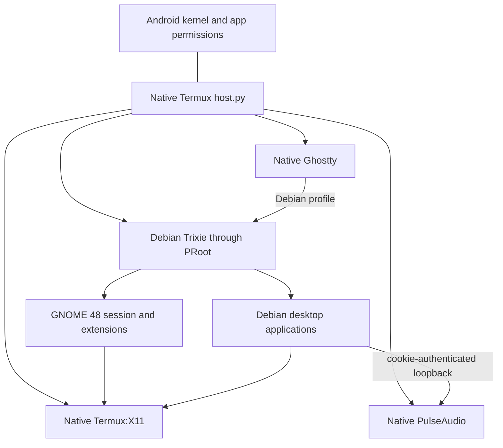
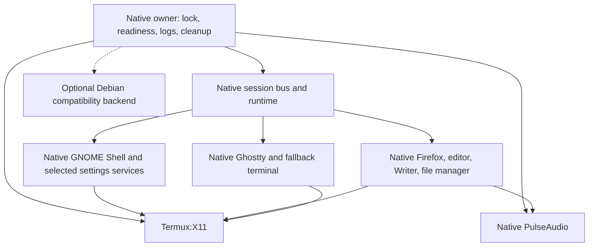

# Migrating the Termux desktop from PRoot to native Termux

Raw capture paths beginning with `temp/` refer to local files excluded from Git.
See the [privacy notes](privacy.md).

**Implementation follow-up:** the [native profile](native/README.md)
now implements GNOME 48/X11, a native session manager, native Nautilus and the
application stack without PRoot. See its [device verification](native/VERIFICATION.md)
for the actual acceptance boundary. Shell/Mutter/GJS use a repaired, pinned
community binary bundle; a complete source rebuild of that stack remains open.
The tested phone now selects native Termux as the default and leaves Debian
stopped on disk as optional recovery data. Native startup does not use PRoot.
The subsequent [native GPU follow-up](native/GPU-VERIFICATION.md)
adds Turnip + Zink on the Note10+'s Adreno 640, using an EGL/GLES compositor path.
The assessment and package snapshot below describe the investigation that led
to this implementation.

This is an investigation and migration proposal; it does not install a new desktop or change the current launcher. The existing Debian desktop remained running throughout the device probes.

**Revised** after an [independent verification](termux-native-migration-verification.md). The revision records the user's current GNOME 48 preference, adds the official removal of Termux's Mutter package and the GNOME 48 source recipes that survive it, adds steady-state PRoot measurements, and corrects smaller errors. Section 13 lists every change.

**Subsequent implementation:** the user reopened native playback EQ.
An opt-in [EasyEffects/AutoEq Termux port](audio/README.md) now builds
local Android-native packages, with [device verification](audio/VERIFICATION.md).
Its PipeWire graph feeds the existing Termux PulseAudio server; Android output
selection remains delegated to that layer. This is separate from the GNOME
migration, and does not change the historical package snapshot below.

**Subsequent implementation:** the user requested native GSConnect. An opt-in
[port](gsconnect/README.md) now runs GSConnect 62's daemon and settings window
on official Termux's `cjs`, with [device verification](gsconnect/VERIFICATION.md).
It does not need a native GNOME Shell and was tested without one, so its Shell extension has not run natively.

**Subsequent implementation:** the user asked whether the Serein Discord client's voice could work natively. An opt-in
[microphone](mic/README.md) now reaches the native desktop's PulseAudio through Termux:API's permission, with [device verification](mic/VERIFICATION.md).
The native desktop also starts with a silent default source, because the speaker monitor was otherwise recorded as a microphone.
That test covered Serein's audio engine on Bionic. The later
[full-client package](serein/README.md) records its build and runtime status separately.

**Subsequent implementation:** the user requested native browsers with the live CD's
extensions. An opt-in [port](browsers/README.md) installs Firefox, Chromium and Google Chrome,
with [device verification](browsers/README.md). Google publishes no Bionic Chrome, so
Chrome runs Google's arm64 glibc build on Termux's glibc, which is native but not Bionic. None of the
three has a working sandbox here.

**Subsequent implementation:** the user asked to port the Mixtapes YouTube Music player. An
opt-in [port](mixtapes/README.md) builds it on the phone from a pinned commit, with
[device verification](mixtapes/VERIFICATION.md). The app runs on Bionic. Only its optional helper
for uploaded songs is a glibc program, because V8 publishes no Android library. Signed-out browsing,
playback, downloads and GNOME Shell's media controls were tested; nothing that needs an account was.

## Recommendation

**Proceed with an opt-in native GNOME/X11 prototype targeting GNOME 48, reusing existing porting work. Keep the verified Debian/PRoot profile as the supported fallback until the native profile passes equivalent acceptance checks.** A complete migration is technically credible, but it is not a change from `proot-distro login` to a different command. It changes the application ABI, package sources, filesystem paths, session implementation, and update responsibilities.

**User preference:** for now, a native desktop limited to GNOME 48 is acceptable, because GNOME 48 currently matches the upstream Debian Trixie base of this live CD repository. This is a current preference, not a permanent requirement. Revisit it when the live CD's Debian base moves to a newer GNOME.

**User decision:** the process monitor falls back to native Termux's `xfce4-taskmanager` instead of Mission Center, because of CPU load. Over 60 seconds, Mission Center under PRoot used about 65% of one core and 110 MB; `xfce4-taskmanager` used 5–8% and about 30 MB (section 7). It keeps the CPU and memory graphs and live per-process CPU and memory, and needs neither Shizuku nor the redirect shim. The accepted limitation is that its total CPU figure covers only the processes Termux can see, not Android or other apps.

The additional resources materially improve the feasibility assessment:

- [Gass-OS/GNOME-Termux](https://github.com/Gass-OS/GNOME-Termux) supplies actual Android-native GNOME 48 binaries. Its published installer and release have significant integration gaps, detailed below. It establishes an existing native port, not a replacement already validated for this repository.
- **GNOME 48 source recipes exist, but none are maintained.** Official Termux kept its Mutter 48.1 recipe in `disabled-packages/` when it removed the package, and the closed [PR #24585](https://github.com/termux/termux-packages/pull/24585) contains GNOME Shell 48.1, gnome-session 48.0, settings-daemon 48.1 and GJS 1.84.1 recipes (section 4.3).
- [Termux packaging PR #32883](https://github.com/termux/termux-packages/pull/32883) provides GNOME 49 recipes, Android patches, Nautilus, settings daemons, and a Shepherd-based session manager. It is the most complete and most recently tested recipe set found. It was **open and unmerged** when inspected, it re-adds the X11 Mutter that official Termux removed, and a contributor in its own discussion doubts it will be merged.
- Official Termux repositories already publish most of the ordinary applications needed here. GNOME Shell, Mutter, the GNOME session stack, and Nautilus are absent from the inspected official repositories. Mutter's absence is deliberate: Termux removed its Mutter 48.1 package on 2026-08-28 because Mutter is abandoning X11. The community work supplies the missing pieces.
- **Anland is deferred by the user's project constraint:** reconsider only after a stable 6.0 release demonstrably removes the compositor repatching requirement. Its current custom compositor route is not part of the proposed migration. This is an adoption gate, not a verified promise about a future release.

In line with the user's preference, build the prototype as a GNOME 48 stack:
- Mutter from the official disabled 48.1 recipe.
- Shell, gnome-session and the settings daemon from the PR #24585 recipes, refreshed against current Termux and ideally raised to the guest's 48.7.
- GNOME-Termux's Shell 48 build and the GNOME 49 PR's newer Android patches as references.

Staying on 48 also keeps the current extension versions. Treat the GNOME 49 PR as the fallback if the 48 stack cannot be made coherent; that moves the native profile one release ahead of the live CD. Do not switch the default to either on source evidence alone. Xfce is an available fallback if native GNOME fails its gates, rather than a prerequisite for going native.

The expected gains are much cheaper file and path operations (about 18–125× cheaper natively in a steady-state probe, section 7), simpler application launches and filesystem access, and working ordinary process suspension. Migration will **not** grant Android root, restore whole-device CPU statistics by itself (native programs are denied `/proc/stat` exactly as PRoot guests are; a Shizuku helper restores it for either backend, section 7), make Linux hardware services available, automatically fix Ghostty's close-button defect, or supply normal desktop browser/Flatpak isolation.

## 1. Scope, method, and evidence limits

The baseline is the current working tree, including the untracked `termux/` implementation and existing assessment documents. Relevant sources were read directly: setup, guest setup, host controller (`src/host.py`), session manager (the PRoot files have since been removed), package manifests, themes, GPU wrappers, validators, application/lifecycle exercises, and the round 2 verification. Earlier assessments are historical where the later verification supplies stronger evidence.

External investigation included official package indexes, the complete Termux package-recipe tree, source recipes and patches, the supplied GNOME-Termux project, other GNOME porting attempts, and upstream display documentation. Broader searches found the GNOME 49 packaging PR and Anland; their primary sources were then inspected rather than treating demonstrations or search snippets as acceptance evidence.

| Evidence | What was checked | What it establishes |
| --- | --- | --- |
| Existing device verification | Round 2's fresh installation, applications, extensions, lifecycle and documented defects | Acceptance baseline for the current profile; not a native-profile result |
| Current repository source | Launcher, session, setup, settings, helpers and checks | Concrete code that must change or can be reused |
| Official ARM64 package indexes | Main and X11 indexes; 4,219 distinct published package names; 227 selected names retained | Availability and dependency metadata at collection time; not successful launches |
| Official source tree | `docs/proot/termux-packages` commit `6016cd09beca14724c14876f0850de8c8239dcd8`, complete non-truncated tree | Recipe presence/absence and reviewed build choices |
| Community source | Gass-OS commit `42a890c7603609d1c6a7e6edf9cd05c084923d8f`; GNOME 49 PR head `b3c8d5907eb221aaa8306449e4209cf4bbeee3b8`; GNOME 48 PR #24585 head `77ae9db667103a2ea7575c8f23a497754796951a` | Specific implementations and integration risks, not this phone's compatibility |
| Published GNOME-Termux release | Downloaded v48.1 archive, checked SHA-256, inspected members and ELF metadata on the PC | Genuine Android-native binaries, archive layout and missing bundled dependencies; no downloaded code was executed |
| New physical-device probes | Native identity, `/proc/stat`, disposable workload signals, ten native command launches and ten Debian entries | Narrow measured differences on the existing Note10+ rig |
| Revision checks | `disabled-packages/` recipes and their commit history, PR #24585 recipes, PR #32883 discussion, GJS/SpiderMonkey requirements, steady-state PRoot probe | GNOME 48 source availability, official stance on X11 Mutter, per-operation PRoot cost |
| Shizuku probes | Native and shell-UID identity and file labels, namespace availability, a shell-UID `/proc/stat` copier, native programs through a redirect shim, PRoot tracer cost under Mission Center | Whether going native changes `/proc/stat` access, and how live counters would reach native programs |

Source/index hashes, selected dependency metadata, community revisions, archive inventory, and probe outputs are in the evidence directory (`temp/docs/evidence/migration/README.md`). Indexes were inspected over HTTPS; this was not an APT package-signature validation or installation.

The original recipe inventory covered the published main and X11 recipe folders only. The revision added `disabled-packages/`, where the official Mutter 48.1 recipe now lives.

No native GNOME, native Nautilus, native browser, native Writer, or Anland session was installed or tested during this investigation. No source build of the community PRs or of the disabled Mutter recipe was performed. Effort estimates below are engineering estimates, not measured delivery times.

## 2. What the current implementation actually does

This profile is already a hybrid. The native Termux side runs Termux:X11, PulseAudio, Ghostty, and `host.py`. Debian Trixie under PRoot supplies GNOME Shell 48.7, Mutter 48.7, GJS 1.82.3, gnome-session 48, XSettings, eight enabled extensions, Nautilus, Firefox ESR, GNOME Text Editor, Writer, and most helpers.

Important implementation boundaries:

- `setup.sh` installs native host packages, creates/reuses an arm64 Trixie guest, and runs `guest-setup.sh` there. It explicitly requires GNOME 48 and guest home `/home/desktop`.
- `host.py:guest()` constructs every PRoot entry. Startup repeatedly enters Debian to inspect session readiness, retrieve Shell's PID, and leave the overview. Native Ghostty's Debian shells use further PRoot entries.
- `session.py` owns private runtime state, a compatibility bus at the system-bus address, and a real user session bus. The compatibility bus supplies messaging, not logind, NetworkManager, UDisks, or privileged services.
- A private Unix control socket lets guest menu/file-manager actions ask the native owner to open Ghostty or stop the session. JSON and argument arrays preserve unusual directory names.
- The default desktop uses **llvmpipe software rendering**. The optional `livecd-gpu` wrapper changes selected Debian applications to isolated glibc Mesa libraries. Native Ghostty remains on software rendering.
- Setup and the running desktop share a lock. Updates require a stopped session. Process ownership and reuse of an existing X server are deliberate lifecycle behavior worth retaining.

The round 2 verification (since removed) establishes fresh setup in about 28 minutes, start-and-stop cycles of about 37–39 seconds in the repeated lifecycle exercise (its timer runs from `start` until the stop finishes; a fresh guest's first start took about 37 seconds), eight active extensions, and working core application checks. Those figures include the existing hardware, software-rendering policy and readiness checks. They are not measurements of PRoot overhead alone.

## 3. What “native” changes

Native Termux packages target Android's Bionic libc and the Termux prefix, normally `/data/data/com.termux/files/usr`. Debian applications target glibc and conventional `/usr`, `/etc`, `/lib` and `/home` paths. Both already execute ARM64 instructions on the same Android kernel; the current guest is not emulating an x86 processor. PRoot adds syscall interception, path translation and guest compatibility behavior. Removing it removes those mechanisms, not the Android security model. [Termux execution environment](https://github.com/termux/termux-packages/wiki/Termux-execution-environment), [PRoot-Distro implementation](https://github.com/termux/proot-distro#how-proot-distro-works)

Consequences for this repository:

1. Reinstall applications as native Termux packages or build Android-compatible ports. Copying Debian `.deb` executables or glibc libraries into `$PREFIX` is not a migration.
2. Reuse documents, images, font files, compatible themes and reviewed configuration data. Rebuild compiled caches and platform-specific modules.
3. Replace fake guest identities with Termux's actual app UID. A named `desktop` user no longer describes native process ownership.
4. Audit shebangs and hardcoded paths. `/usr/bin/python3`, `/bin/bash`, `/usr/local/lib/livecd` and `/tmp/livecd-host` are guest paths, not interchangeable native paths.
5. Keep native launcher/linker settings scoped to the relevant processes. GNOME's custom `LD_LIBRARY_PATH` and GI paths must not leak into arbitrary Android commands or every host shell.

A glibc compatibility prefix or a rooted chroot could avoid some porting work, but each is a different target. Neither is assumed by this proposal, whose destination is native Termux/Bionic without root or PRoot.

## 4. Existing work that can be reused

### 4.1 Gass-OS/GNOME-Termux: real native port, incomplete installation contract

The supplied project is relevant. Its tracked distribution includes Shell, Mutter, GJS, SpiderMonkey, typelibs, schemas and GNOME resources. Its README identifies Shell 48, Mutter 48.1 and GJS 1.85.1, with software rendering as its current baseline. [Project overview](https://github.com/Gass-OS/GNOME-Termux/tree/42a890c7603609d1c6a7e6edf9cd05c084923d8f)

Independent static inspection of its **published v48.1 archive** confirmed an AArch64 Shell executable requesting `/system/bin/linker64` and `libc.so`. That is Android/Bionic linkage, not a Debian/glibc binary disguised by a launcher. Its embedded Meson project metadata identifies **Shell 48.0** despite the archive/release's 48.1 label. [Release](https://github.com/Gass-OS/GNOME-Termux/releases/tag/v48.1), local ELF audit (`temp/docs/evidence/migration/gnome-termux-release-audit.json`)

The archive SHA-256 is `f89f8ab20ff82dd5336d756171000285c8beabee9e3f73c5d74e4046c02ab391`, matching both the downloaded checksum and GitHub asset metadata. It is 3,629,256 bytes compressed and contains 590 members, including a Shell build directory and custom GJS runtime files. Its checksum establishes which artifact was inspected; it does not establish dependency completeness.

| Finding | Evidence | Migration implication |
| --- | --- | --- |
| Repository installer targets a different release | `install-gnome-termux.sh` hardcodes v48.0 and a `48.0-native-termux` filename; the release API returned only v48.1 | The documented default installation does not select the available release |
| Archive directory contract differs | Installer expects an extracted `GNOME-Termux/`; inspected archive contains `GNOME-Termux-48.1-aarch64/` | Updating the URL alone would not repair installation |
| Documented local-archive argument is not implemented by that installer | README shows an archive positional argument; inspected script never reads `$1` | Do not rely on that command as an offline or pinned installation path |
| Release depends on a package Termux has since removed | Archive manifest requests `mutter` and the archive lacks the Mutter libraries. Official Termux still published Mutter 48.1 when the release appeared (2026-08-14) and removed it on 2026-08-28 | A fresh installation today cannot obtain the runtime from that manifest; Mutter must be built, for example from the official recipe kept in `disabled-packages/` (section 4.3) |
| Other required runtime libraries are unavailable | Bundled `libgjs.so` needs `libmozjs-128.so`, absent from the archive; official `spidermonkey` is 140. `gnome-shell-calendar-server` needs `libecal-2.0`, `libedataserver-1.2` and `libical-glib`; official Termux has no `evolution-data-server`, and its `libical` is built with `-DLIBICAL_GLIB=false` | No fresh-install dependency closure has been demonstrated |
| Launchers have incompatible assumptions | Repository-generated launcher uses display `:1`; archive scripts use `:0` and `$HOME/GNOME-Termux`; tracked distribution environment contains an author's test-directory path | Choose and rewrite one environment contract; do not concatenate the examples |
| Global process cleanup conflicts with this project's owner model | Launchers use broad `pkill` for GNOME/X11 and sometimes global Pulse cleanup | Existing managed Debian sessions and unrelated native clients can be terminated |
| Archive installer writes into shared native locations | Copies GJS to `$PREFIX`, replaces Shell symlinks, recompiles global schemas, and moves a Pulse D-Bus policy file | An experimental install is not isolated merely because its build tree is in `$HOME` |
| Packaging scripts are not complete source-build instructions | One stages prebuilt runtime files; another expects an existing `package/GNOME-Termux` tree; their archive formats/layouts differ | Reproducible packaging should not be confused with rebuilding the GNOME port from published patches |

These findings come from the [pinned installer](https://github.com/Gass-OS/GNOME-Termux/blob/42a890c7603609d1c6a7e6edf9cd05c084923d8f/install-gnome-termux.sh), [runtime packager](https://github.com/Gass-OS/GNOME-Termux/blob/42a890c7603609d1c6a7e6edf9cd05c084923d8f/package-gnome-termux.sh), [second packaging script](https://github.com/Gass-OS/GNOME-Termux/blob/42a890c7603609d1c6a7e6edf9cd05c084923d8f/package/build-package.sh), tracked distribution environment, and the locally inspected release archive. They are source/archive findings; no failing device installation was attempted.

The tracked `dist/` tree contains more runtime libraries than v48.1's release archive. Therefore the release gaps do **not** prove that no complete native runtime can be assembled. They do mean that a maintainer must identify a coherent dependency set, repair packaging and paths, and test it from a fresh host. Combining arbitrary files from these layouts without checking ABI compatibility would exchange one reproducibility problem for another.

For a prototype, stage the runtime privately, inventory ELF dependencies recursively, and adapt our existing owner instead of running upstream cleanup scripts. Before making it a supported dependency, obtain or reconstruct the exact source patches and build instructions, pin the full dependency set, and establish updates for Shell/Mutter/GJS/SpiderMonkey. The supplied Shell 48.0 and Mutter 48.1 are older point releases than the guest's Shell and Mutter 48.7. The user's preference accepts GNOME 48, so this is a point-release gap rather than a major-version mismatch, but the bug fixes between 48.0 and 48.7 would be lost unless the build is updated.

### 4.2 GNOME 49 packaging PR: most complete recipe set, one release ahead of the live CD

[PR #32883](https://github.com/termux/termux-packages/pull/32883) was opened October 23 and remained unmerged when inspected. The author reports a full session device test. Its 110 changed files include recipes and patches, not just a screenshot or a binary archive. The inspected head is `JesusChapman/termux-packages@b3c8d5907eb221aaa8306449e4209cf4bbeee3b8`.

The concrete value is visible in the code:

- [Mutter 49.8 recipe](https://github.com/JesusChapman/termux-packages/blob/b3c8d5907eb221aaa8306449e4209cf4bbeee3b8/x11-packages/mutter/build.sh) enables X11 and disables logind, udev and the hardware-native backend. Its Android patches address paths, library linkage and unavailable interfaces.
- [Shell 49.3 recipe](https://github.com/JesusChapman/termux-packages/blob/b3c8d5907eb221aaa8306449e4209cf4bbeee3b8/x11-packages/gnome-shell/build.sh) disables systemd, polkit, NetworkManager and selected integrations; accompanying patches handle GDM/accounts assumptions and session readiness.
- [Settings-daemon recipe](https://github.com/JesusChapman/termux-packages/blob/b3c8d5907eb221aaa8306449e4209cf4bbeee3b8/x11-packages/gnome-settings-daemon/build.sh) disables systemd/elogind, gudev, rfkill, WWAN and NetworkManager integration. This is userland adaptation, not a booted GNOME operating system.
- [gnome-session-shepherd](https://github.com/JesusChapman/termux-packages/blob/b3c8d5907eb221aaa8306449e4209cf4bbeee3b8/packages/gnome-session-shepherd/build.sh) supplies a user-session implementation using Guile and GNU Shepherd. This avoids starting from an empty custom session manager.
- [Nautilus 49.3 recipe](https://github.com/JesusChapman/termux-packages/blob/b3c8d5907eb221aaa8306449e4209cf4bbeee3b8/x11-packages/nautilus/build.sh) provides an actual native file-manager path, including Android path/identity fixes and its dependency set.

This route changes the earlier package-only conclusion: **native GNOME does not require inventing an entire port here.** It requires adapting, building, packaging and validating existing work. A PR's reported success is not equivalent to published official binaries or this project's acceptance results.

Integration still includes:
- coherent dependency builds;
- shared native-library updates: the PR modifies two packages that are already official, `libical` (to enable its GLib bindings) and `guile` (to add a `WAIT_ANY` fix);
- extension versions for GNOME 49;
- a trimmed service set, dconf defaults and lifecycle ownership;
- a private package/artifact update policy.

The PR's `gnome` metapackage selects additional applications and services; use explicit profile requirements after dependency review rather than assuming its entire selection matches this project. Its LocalSearch recipe builds with `-Dlandlock=disabled`, which addresses the Landlock failure seen in the guest (section 7).

Official packages may never arrive. Termux maintainers removed X11 Mutter in August 2026 (section 4.3). In the PR's own discussion, contributor `sabamdarif`, who tested it, wrote on 2026-10-24 that they don't think it will be merged "until we find some way to keep it up to date", because keeping an old GNOME 49 working would need many backports. Plan for indefinite private ownership of this stack rather than a hand-off to official packages.

The same discussion records runtime details to test in stage 2. Another tester (`Collalaoo`, 2026-10-25) started GNOME Shell 49.3 on Termux:X11 only after three changes:
- setting `MESA_LOADER_DRIVER_OVERRIDE=swrast` (they report that `llvmpipe` alone crashed in `cogl_renderer_connect`);
- using Termux:X11's `-legacy-drawing` option;
- running `dbus-daemon --system`.

Nautilus first aborted until `libstemmer` was installed, and the recipe now depends on it. These are single reports, not verified here.

GNOME 49 is one major release ahead of the live CD's Debian GNOME 48. Under the user's current preference that is not a goal in itself, so this route is the fallback if the GNOME 48 stack (section 4.3) cannot be made coherent.

### 4.3 GNOME 48 from source: the disabled Mutter recipe and PR #24585

Two unmaintained sources together cover most of a GNOME 48 stack:

- **Official Mutter 48.1 recipe.** Termux published `x11-packages/mutter` 48.1 until commit [`739766d`](https://github.com/termux/termux-packages/commit/739766d051e45e360ec3e65f58df153b4f5fc688) moved it to [`disabled-packages/mutter`](https://github.com/termux/termux-packages/tree/6016cd09beca14724c14876f0850de8c8239dcd8/disabled-packages/mutter) on 2026-08-28. The commit message is "rmpkg(x11/mutter): X11 support abandoned", and it says the package cannot be updated further because Mutter is no longer an X11 window manager.
  - The recipe keeps six Android patches and disables logind, udev and the native backend.
  - All its direct dependencies are still published.
  - The GNOME 49 PR's Mutter patches 0001–0006 carry the same names, so the 49 recipe grew from this one.
- **[PR #24585](https://github.com/termux/termux-packages/pull/24585) ("[WIP] GNOME Shell").** It was opened 2025-05-02 and closed without merging on 2026-01-30.
  - Its head [`77ae9db`](https://github.com/termux/termux-packages/tree/77ae9db667103a2ea7575c8f23a497754796951a) has recipes for GNOME Shell 48.1, gnome-session 48.0, gnome-settings-daemon 48.1 and GJS 1.84.1.
  - It also has recipes for GDM, polkit, accountsservice and related services that this profile does not need.
  - PR #32883 describes itself as a continuation of this work. Neither is official support.

Open problems for this route, all to be settled in stage 1:

- **GJS and SpiderMonkey:** GJS 1.84 requires `mozjs-128`, but official `spidermonkey` is now 140, which GJS 1.86 and later use. GNOME Shell 48.7's build only requires GJS ≥ 1.81.2. A newer GJS, such as the 49 PR's 1.87.1, may therefore build with Shell 48, but nobody has shown that it runs. The alternative is a private `mozjs-128` beside the official 140. The guest currently uses GJS 1.82.3.
- **CJS data point:** official Termux publishes `cjs` 140.2, a GJS fork on SpiderMonkey 140, and [GSConnect runs on it](gsconnect/README.md#why-this-runs-on-cjs). That is not a Shell runtime, because Shell links GJS itself. Its `GjsPrivate` typelib also has a defective `handle-method-call` signature, so check any JS-exported D-Bus object in a native stack.
- **Staleness:** both sources predate the current Termux tree and need refreshing against current libraries.
- **Point release:** the recipes are 48.0–48.1. Matching the guest's 48.7 means raising the versions and re-checking the patches.
- **Maintenance:** nobody maintains this stack. It would be a frozen X11 stack built privately, as the 49 route probably would be too (section 4.2).

In exchange, this route matches the live CD's GNOME major version and the current extensions, which declare Shell 48. That is the user's present preference.

### 4.4 Anland: recorded for later, excluded from the implementation plan

[Anland's native guide](https://github.com/lfdevs/anland-termux/blob/140fb636942aa99f83e56bbfb355723a8ca0a2c1/docs/user-guide.md) describes a different display architecture: an Android display APK, native daemon, custom Mutter backend and optional patched Xwayland. Its GNOME session helper includes user-session, compatibility-bus and XSettings handling. These are useful references for a future Wayland investigation.

The user explicitly requires waiting for **6.0 stable without compositor repatching**. Accordingly, there is no Anland installation, dependency, compositor fork or milestone in the current migration. When that gate is met, verify the actual release behavior, F-Droid-compatible APK path, GNOME/extension versions, Ghostty through Xwayland, input/clipboard, audio, and performance before revisiting the architecture. Current documentation is not evidence that the future gate has been satisfied.

### 4.5 Official Xfce route: fallback with a different user experience

The official [`xfce4` recipe](https://github.com/termux/termux-packages/blob/6016cd09beca14724c14876f0850de8c8239dcd8/x11-packages/xfce4/build.sh) and [Termux:X11 instructions](https://github.com/termux/termux-x11#running-graphical-applications) provide a much simpler package-based desktop route. LXQt and MATE packages also exist. This is a useful fallback if maintaining the GNOME port proves disproportionate.

Choosing Xfce would replace ArcMenu/Dash to Panel, GNOME tiling, DING, appearance synchronization and GNOME settings with Xfce equivalents. It should be a conscious product decision, not described as preserving the current desktop. Keep it outside the first GNOME parity prototype unless a gate fails or the user chooses the changed experience.

## 5. Application and feature compatibility

The native package snapshot is linked in packages.tsv (`temp/docs/evidence/migration/packages.tsv`), with dependencies in packages.json (`temp/docs/evidence/migration/packages.json`). “Official” below means the inspected main/X11 ARM64 indexes, including architecture-independent entries. It does not mean runtime accepted on this phone. An absent same-name recipe for a published subpackage is not evidence of missing source.

| Current component | Native route found | Assessment |
| --- | --- | --- |
| GNOME Shell/Mutter 48 | Official disabled Mutter 48.1 recipe; PR #24585 Shell 48.1 recipe; Gass-OS 48 runtime; GNOME 49 PR as fallback | Feasible from existing work; highest shared integration/maintenance cost; GJS/SpiderMonkey pairing for 48 unresolved |
| gnome-session 48 | Existing direct-Shell approach, PR #24585's gnome-session 48.0, or the 49 PR's Shepherd session | Rework session ownership/readiness; do not copy Debian gnome-session binaries |
| XSettings/settings daemons | PR #24585 (48.1) or GNOME 49 PR (49.1) | Retain the needed userland services; hardware management stays Android-owned |
| Eight enabled extensions | Install versions compatible with chosen native Shell | Staying on 48 keeps the current extension versions; metadata, helpers, settings schemas and patched Shell APIs still need tests |
| Nautilus | GNOME 49 PR (49.3); absent official | Native route exists; as an application it need not match Shell 48. Thumbnails/indexing and Python extension packaging remain separate concerns |
| File-manager fallback | Official Thunar 4.20.10 and Tumbler 4.20.2 | Lower integration cost if Nautilus is deferred; changes UX |
| Ghostty | Official 1.3.1; already native and verified | Keep; native shell/menu paths simplify, close-button defect remains open |
| GNOME Terminal | Official 3.60.0 | Native fallback is available; package disables its Nautilus extension/search provider |
| GNOME Text Editor | Official 51.0 | Keep as an application on a GNOME 48/49 desktop; GTK app and Shell versions need not match |
| Firefox ESR | Official native Firefox 159.0 | Similar application workflow, different release/update channel; migrate data cautiously. Extensions and sandbox state are in the [browser port](browsers/README.md) |
| Chromium | Official 156.0.8078.47 | Optional; [browser port](browsers/README.md) adds extensions and repairs its menu entry; its status page reports no sandbox |
| Google Chrome | Google's arm64 `.deb` on Termux's glibc, in the [browser port](browsers/README.md) | Subsequent opt-in addition; native but not Bionic, with Debian libraries in a private directory; no sandbox |
| Writer/LibreOffice | Official LibreOffice 26.8.2.2-1 | Ordinary office route exists; package split, integration and defaults differ from Debian |
| mpv | Official **`mpv-x`** 0.41.0-7 for graphical playback | Use the X11-enabled variant; plain `mpv` is not an equivalent package |
| ffmpegthumbnailer | Official 2.4.1 (the index also lists 2.4.0, which `packages.tsv` recorded) | Utility exists; automatic previews require file-manager integration tests |
| PulseAudio | Already native | Retain sink ownership; native applications can use the existing Unix endpoint after testing |
| EasyEffects / AutoEq playback EQ | Subsequent local native port of EasyEffects 7.2.5 and LSP LV2; AutoEq parametric-preset importer | [Implementation and measured signal tests](audio/VERIFICATION.md); opt-in packages, not an official `pkg install easyeffects` candidate; hardware routing stays with Termux PulseAudio |
| Process monitor | Official `xfce4-taskmanager` 1.6.0 (project decision); keep `livecd-top.py` for terminal use | Live per-process CPU and memory at 5–8% of one core, without Shizuku or the shim. Its total CPU covers Termux's processes only (section 7) |
| WhiteSur/Colloid/wallpapers | Reuse pinned data and reviewed CSS | Rewrite install destinations and caches; test newer native GTK separately |
| Broad fonts | Native packages plus explicit font assets | Exact Debian manifest is not portable; see section 6 |
| Mission Center/Flatpak | Not pursued because of CPU load (project decision). No official main/X11 package; the Flatpak route that runs under a forked PRoot cannot move to native, because the kernel has no user namespaces | Current setup does not depend on either |
| GSConnect | Subsequent local port of GSConnect 62 onto official `cjs` 140.2 | [Implementation and device tests](gsconnect/VERIFICATION.md); opt-in local package; daemon and settings window only; its Shell extension has not run on a native Shell |
| Mixtapes | Subsequent local build from a pinned upstream commit | [Device tests](mixtapes/VERIFICATION.md); opt-in local package, signed-out use only; optional glibc helper for uploaded songs; WebKit sign-in has no sandbox |
| Privileged settings/remote desktop/AppImages | Existing exclusions remain | Migration does not itself establish support or reopen scope; playback EQ and GSConnect were separately reopened by the user and implemented as the opt-in prototypes above |

Several package details prevent plausible but incorrect substitutions:

- [`mpv-x`](https://github.com/termux/termux-packages/blob/6016cd09beca14724c14876f0850de8c8239dcd8/x11-packages/mpv-x/build.sh) enables the graphical paths and conflicts with plain `mpv`. The [main mpv recipe](https://github.com/termux/termux-packages/blob/6016cd09beca14724c14876f0850de8c8239dcd8/packages/mpv/build.sh) disables X11, OpenGL and Vulkan. Both inspected recipes disable Android Media NDK decoding, so native migration is not evidence of hardware video decoding.
- [LibreOffice's recipe](https://github.com/termux/termux-packages/blob/6016cd09beca14724c14876f0850de8c8239dcd8/x11-packages/libreoffice/build.sh) enables GTK3 and disables GTK4, dconf and Skia, and does not bundle fonts. Test Writer editing/saving and available icon styles instead of transferring Debian integration expectations wholesale.
- [Chromium's recipe](https://github.com/termux/termux-packages/blob/6016cd09beca14724c14876f0850de8c8239dcd8/x11-packages/chromium/build.sh) explicitly documents unresolved sandbox constraints. The later [browser port](browsers/README.md) audited this: native Firefox reports `MOZ_SANDBOX` off, and Chromium's status page reports no sandbox. The present guest's `MOZ_FAKE_NO_SANDBOX` workaround should not be blindly exported into native applications.
- Native GTK 4.24.1/libadwaita 1.10 differ from guest GTK 4.18.6/libadwaita 1.7.6. CSS that works in the guest may need revision even if Shell remains 48. The official [GTK recipe](https://github.com/termux/termux-packages/blob/6016cd09beca14724c14876f0850de8c8239dcd8/x11-packages/gtk4/build.sh) still enables X11; modern GNOME applications do not require migrating the desktop to Wayland.

### Extension parity

| Existing extension/function | Native GNOME plan |
| --- | --- |
| ArcMenu | Matching Shell version; preserve menu preferences, app discovery, keybinding and first-login behavior |
| Dash to Panel | Matching version; verify grouping for native applications and both terminal profiles |
| DING desktop icons | Test separate native GJS process, desktop directory, launch/open behavior and file-manager assumptions |
| AppIndicator | Check tray/service visibility with selected native applications |
| User Themes | Resolve shell theme from native data paths |
| NoAnnoyance | Verify focus/window activation on the selected patched Shell |
| Tiling Assistant | Test actual window placement and shortcuts; extension state alone is insufficient |
| `livecd-appearance@local` | Update its Shell metadata, native theme paths and GTK4 import ownership; retain user-CSS precedence |

The current custom appearance metadata declares only Shell 48. Do not bypass extension compatibility checks globally to claim GNOME 49 support. Select matching releases or port and test the affected code. The native PR does not include this repository's extension configuration or acceptance evidence.

## 6. Fonts and appearance need an explicit migration

The open [fonts.yaml](../overlays/Desktop%20Environment+Tweaks/packages/fonts.yaml) selects Noto, Noto Color Emoji, DejaVu, Unifont and Hanazono. `guest-setup.sh` installs it with recommendations, adding broad Noto families. Round 2 found coverage for U+20000 and U+2A700, with **no covering font for U+30000**. Native migration must preserve the demonstrated coverage without expanding that claim.

The inspected official native indexes publish `ttf-dejavu` and `otf-noto-sans-cjk`; they do not publish the five Debian names or obvious Unifont/Hanazono/Cantarell equivalents under the queried names. Android system fonts can supply additional families: `ghostty +list-fonts` on the current host lists Android and DejaVu families. That is enumeration, not rare-character or shaping acceptance. Native `fc-list` was not installed during this audit. Native inventory (`temp/docs/evidence/migration/native-inventory.json`)

A practical font plan is:

1. Define a font-asset manifest separate from Debian package names, recording upstream/source-package versions, hashes, file destinations and license files. Font files are data and can be reused without compiling them for Bionic.
2. Reuse or obtain the required Noto/emoji/Unifont/Hanazono/Cantarell files from pinned sources, preserving licenses. Avoid depending on whatever font versions a phone vendor happens to ship.
3. Install profile-owned font data in a supported user font location, rebuild native fontconfig caches, and retain normal native fallback directories. Install `fontconfig-utils` for diagnostics.
4. Test actual selected fonts and visible text in Ghostty, the editor, file manager and Writer. Include U+20000, U+2A700, U+2B740, U+2CEB0, U+30000, emoji, and representative complex-script shaping. Record distinct font files so aliases do not inflate coverage counts.

Use the existing pinned WhiteSur/Colloid archives and attributed wallpapers, but change installers to explicit native/user destinations. `themes.sh` currently assumes root, Debian `/usr/share`, `/var/cache`, dconf system directories and a GNOME 48 extension path. It cannot be run unchanged in Termux.

Keep the profile's owned GTK4 import behavior and existing-user-CSS precedence. Test native GTK3, native GTK4/libadwaita, Shell styling and Ghostty window styling separately. A successful Shell theme is not proof that every application uses the same CSS or settings bus.

## 7. Which existing defects change, and which remain

| Current limitation | Expected effect of removing PRoot | Evidence/confidence |
| --- | --- | --- |
| PRoot entry/path-translation cost | Removed for native programs | Measured below: path syscalls about 85–125× and file create/delete about 18–27× cheaper natively; whole-application gains unmeasured |
| SIGSTOP ineffective for guest workload | Native owned-process stop/resume works on this rig | Newly repeated native probe; existing verification reproduces guest failure |
| Blocked `/proc/stat` and misleading global CPU bars | Remains blocked for native programs. The Shizuku helper restores it for either backend, but natively each program must be redirected; there is no binding | Native probe returned `EACCES`; same UID and SELinux domain as the guest; redirect shim tested (below) |
| htop CPU reporting | Native package alone shows static 0% meters and N/A per-process CPU; live with the Shizuku helper and redirect shim | Tested (below) |
| Ghostty close button leaks client/shell | May remain, especially native shell mode | Ghostty already runs natively; guest removal is not a diagnosis of its defect |
| Nautilus automatic thumbnails | Could improve, but not guaranteed | PRoot filesystem behavior is removed; kernel/sandbox/library restrictions remain |
| LocalSearch failure on kernel lacking Landlock | Not fixed by changing libc or removing tracer | Same Android kernel; the GNOME 49 PR's LocalSearch already builds with `-Dlandlock=disabled`; a 48 stack needs the same or indexing disabled |
| Mission Center installation failure through Flatpak | A later experiment ran the Flatpak under a forked PRoot with compatibility shims, not yet written up in the repository. That route does not carry over to native, and Mission Center is no longer pursued because of its CPU load | Measured at about 65% of one core; native `xfce4-taskmanager` replaces it (below) |
| Firefox reduced sandbox | Requires separate native-browser assessment | Android app sandbox remains; desktop child-process sandbox is a separate layer |
| Audio Unix-protocol failure across host/guest | Guest/native boundary disappears for native apps | Retest native Unix Pulse; existing guest TCP result does not predict native failure |
| CPU-heavy software rendering/heat | Remains until renderer changes | llvmpipe is still CPU rendering; native does not mean GPU accelerated |
| Android lifecycle/child-process policies | Remain applicable | Native processes are still Android app children; Android 12+ needs separate acceptance |
| X11 companion port 7892 | Unchanged by guest removal | Same Termux:X11 build and listener behavior |
| Missing privileged services/hardware management | Remains | App UID, kernel and SELinux permissions do not change |

The native htop [access patch](https://github.com/termux/termux-packages/blob/6016cd09beca14724c14876f0850de8c8239dcd8/packages/htop/access-procstat-file.patch) and [recipe](https://github.com/termux/termux-packages/blob/6016cd09beca14724c14876f0850de8c8239dcd8/packages/htop/build.sh) explicitly retain a static `/proc/stat` substitute, so native htop alone shows 0% meters and N/A per-process CPU. With the Shizuku helper and the redirect shim described below, it showed live values. Keep `livecd-top`'s per-PID ticks/monotonic-time algorithm as the baseline that needs no Shizuku, and label its scope as readable Termux processes.

Do not count removing a failing guest application as fixing its required workflow. If thumbnails, process monitoring or browser functionality matters, reproduce it with the native replacement and record the resulting limitation or pass.

### New device measurements

The phone remained the established Galaxy Note10+, Android 11, kernel 4.14, ARM64. A disposable native Python workload accumulated ticks 28 → 58 while busy, stayed at **58 in state T** after SIGSTOP and a 0.3-second wait, then reached **88 in state R** after SIGCONT. Native `/proc/stat` returned permission denied. The same desktop owner/Shell PIDs were reported before and after. Raw probes (`temp/docs/evidence/migration/device-probes.json`)

Ten sequential subprocess launches per path, inside one native Python process, gave:

| Operation | Median | Observed range |
| --- | ---: | ---: |
| Native `$PREFIX/bin/true` | 7.69 ms | 7.28–11.31 ms |
| `proot-distro login debian --shared-tmp --user desktop --work-dir /home/desktop -- /usr/bin/true` | 366.26 ms | 338.36–385.77 ms |

This measures approximately **359 ms of extra command-entry cost in that comparison**, including the PRoot-Distro launcher, environment setup and PRoot entry. It does not isolate steady-state syscall overhead. It is not a 48× application-speed claim, a browser benchmark, a desktop startup forecast or a battery result. The measurements used a running desktop, fixed order and no thermal control. A repeat during verification measured 17–19.5 ms native and 480–484 ms through PRoot-Distro, so absolute values vary with phone load.

The entry cost does not show what work inside a running guest costs. A steady-state probe ran the same Python loop inside one running Debian PRoot process and natively, twice in each of two sessions, with the desktop running (script (`temp/docs/evidence/migration/steady-state-probe.py`), output (`temp/docs/evidence/migration/steady-state-probe.txt`), [first session](termux-native-migration-verification.md)):

| Operation | Inside PRoot | Native | Ratio |
| --- | ---: | ---: | ---: |
| `os.stat` on the home directory, per call (20,000 calls) | 471–676 µs | 5.3–5.6 µs | about 85–125× |
| Create and delete a file, per pair (2,000 pairs) | 2.35–3.47 ms | 0.12–0.14 ms | about 18–27× |
| Run `true`, median of 50 | 12.9–15.7 ms | 8.3–10.2 ms | about 1.5–1.6× |

Path-heavy work, such as browsing large folders, building software or starting programs that read many files, pays the PRoot cost on every path operation. This is the strongest measured reason to go native. It is still a micro-benchmark: application-level gains depend on how much of each workload is path syscalls, and they remain to be measured (section 10).

### Whole-device CPU counters through Shizuku

**Follow-up investigation:** [native request-driven access](termux-procstat-shizuku-investigation.md)
now works through a persistent Shizuku+ connection, without the periodic copier
described below. The user's clarified preference is to read only when Mission
Center requests a sample. The prior PRoot measurements remain historical; a
complete native Mission Center port has not yet been built or benchmarked.

A later experiment restored the real `/proc/stat` to the current PRoot desktop with a small helper started through Shizuku. Going native does **not** make that helper unnecessary: native Termux programs are denied the file just as PRoot guests are. Probe output (`temp/docs/evidence/migration/shizuku-procstat-probe.txt`)

**Why native is still denied.** PRoot does not run guest programs under a weaker identity. It runs them as the Termux app, and native programs are the Termux app too. Both use the Termux app identity in the SELinux domain `untrusted_app_27`. `/proc/stat` is readable by everyone according to its file mode (`0444`), but it is labelled `proc_stat`, and Android's policy does not let that app domain read it. The same applies to `/proc/loadavg` and `/proc/uptime`. Shizuku can read them only because its server is started through ADB and runs as the `shell` UID, in the `shell` domain. Removing PRoot changes neither side of that check.

**What carries over unchanged.** The helper (source (`temp/docs/evidence/migration/procstat-copy.c`)) runs as `shell` and rewrites copies of the three files in `/data/local/tmp/livecd-procstat/` every 500 ms. It costs about 0.28% of one core and 2.5 MB, whichever backend reads the copies, and native Termux can read them directly. It still needs Shizuku started again after each reboot.

**What changes is delivery.** PRoot swaps files at the system-call level, so one `--bind` per file reaches every guest program unmodified. Native Termux has no equivalent. The kernel has no user namespaces (`unshare(CLONE_NEWUSER)` returns `EINVAL`), and the app cannot create a mount namespace (`EPERM`). Each native program has to be pointed at the copies instead. A short `LD_PRELOAD` shim (source (`temp/docs/evidence/migration/procstat-redirect.c`)) rewrites opens of the three paths. Placed ahead of Termux's own `termux-exec` preload, it worked on the phone:

| Native program | Without the shim | With the shim |
| --- | --- | --- |
| htop 3.5.3 (Termux-patched) | Per-core meters 0.0% from the static fallback file; per-process CPU% N/A | Live per-core meters and per-process CPU% |
| Python and coreutils `cat` reading `/proc/stat` | Permission denied | Live counters |
| procps `ps` %CPU and `uptime` load average | Already correct | Unchanged |
| procps `vmstat` | Fails: also needs `/proc/vmstat` | Still fails; the helper does not copy `/proc/vmstat` |
| `top` | Termux's `top` is a wrapper that clears `LD_PRELOAD` and runs Android's own `/system/bin/top`; shows 0% user | Not reachable |

The shim only covers programs that open files through Termux's C library. Statically linked programs, programs that make raw system calls (Go programs, for example) and anything run from `/system/bin` bypass it. A native session would set it once in the session owner's environment so the whole desktop inherits it.

**Native task managers that bypass the shim.** The shim also misses Termux packages that work around the denial in their own way. Two of the X11 GUI task managers in the native repositories do, and both have CPU graphs and per-process CPU and memory columns. Probe output (`temp/docs/evidence/migration/task-manager-probe.txt`)

| Native task manager | Termux's own workaround | Stock behaviour | With the shim | Fix found |
| --- | --- | --- | --- | --- |
| xfce4-taskmanager 1.6.0 | On Android 9 and later it never opens `/proc/stat`. It takes total CPU time from the boot clock and adds up the processes the Termux UID can see | Showed 6% while the whole device was 10.7% busy. Per-process CPU and memory are correct for Termux processes | Unchanged; a tracing build logged no `/proc/stat` open | None without rebuilding; Android and other apps are out of its reach |
| mate-system-monitor 1.28.1 | Its `libgtop` build rewrites every `/proc/stat` reference to a static file, `$PREFIX/var/libgtop/stat` | 0.0% on all eight cores. Per-process % is 0 for idle processes and a clipped "80…" for busy ones. Load average 0.00 | Only load average became live | Pointing `$PREFIX/var/libgtop/stat` at the helper's copy gave live per-core graphs and per-process %. A package upgrade restores the static file |

`lxtask` reads `/proc/stat` without a Termux patch, so the shim should reach it; it and `plasma-systemmonitor` were not tested. A shim that only matches literal `/proc` paths is therefore not a complete native answer: each monitor's own workaround needs checking, and some need their own redirect or a rebuild.

**Cost of each task manager.** Each one ran alone at its default settings, with the screen off. After 10–20 seconds of settling, every process it started was measured over 60 seconds:

| Task manager | Runs as | CPU, % of one core | PSS | RSS |
| --- | --- | ---: | ---: | ---: |
| xfce4-taskmanager | Native | 5.0–8.3 | 28–30 MB | 43–49 MB |
| mate-system-monitor, Resources tab | Native | 3.7–4.7 | 38 MB | 53 MB |
| mate-system-monitor, Processes tab | Native | 8.6 | 47 MB | 54 MB |
| Mission Center 1.2.0, default page | Forked PRoot and Flatpak | 65.4 (PRoot tracer 24.0, window 23.8, Magpie 17.3) | 110 MB | 147 MB |

PSS shares each library page among the processes using it, so it is the fairer memory figure; RSS sums count shared libraries more than once. A monitor reading the helper's copy also pays the helper's 0.28% of one core. Mission Center collects much more than the other two and refreshes differently, so this is not a like-for-like ranking. It does show that PRoot's tracer alone costs more than either native task manager in total.

**Decision (project): use native `xfce4-taskmanager`.** Mission Center's CPU load rules it out: about 65% of one core, roughly 8–13 times `xfce4-taskmanager`'s 5–8%. `xfce4-taskmanager` keeps the graphs and the per-process CPU and memory columns. It needs neither Shizuku nor the shim, because its Termux patch never reads `/proc/stat`. The trade-off is accepted: its overall CPU figure is Termux's share of the phone, not whole-device load (it showed 6% when the device was 10.7% busy). It already runs on the current PRoot desktop's display, started from Termux with `DISPLAY=:0 dbus-run-session -- xfce4-taskmanager`, so the choice does not wait for the migration. The Shizuku helper and shim stay documented as the route to whole-device figures if they are wanted later, through htop or a fixed `mate-system-monitor`.

**Mission Center natively** (not pursued; kept for reference). The Flatpak route that now works under PRoot cannot move to native. It depends on a forked PRoot faking the namespaces and mounts that bubblewrap asks for, and this kernel has no user namespaces to give it. A native Mission Center would be a source build. Native GTK 4.24.1 and libadwaita 1.10 are newer than the GTK `gnome_50` feature set and libadwaita 1.9 that release 1.2.0 requests, which Debian Trixie cannot supply ([assessment](termux-mission-center-assessment.md)). So the toolkit is not the obstacle. The unported part is Magpie, its Rust collector, which has not been built against Termux's C library. That was not attempted.

**Efficiency.** Native also removes PRoot's per-call cost from monitors. With Mission Center 1.2.0 running under the forked PRoot, the PRoot process tracing it used **24.7%** of one core over 60 seconds. That is more than Magpie itself (18.2%) and about as much as the Mission Center window (24.1%). A monitor opens many small `/proc` files on every refresh, which is the path-heavy pattern the steady-state probe found 85–125× cheaper natively. The shim adds one string comparison per open. A whole native monitor was not measured.

## 8. Proposed native architecture

Keep one native owner and add an explicit backend choice. The first implemented native backend should be GNOME/X11. Preserve the Debian backend and its evidence during transition.

The backend interface should provide setup, session command/environment, readiness, shell/terminal launch, validation and shutdown. It should not spread `if native` conditions across every GNOME D-Bus call. The currently installed `livecd` command has no backend option; any interface described here is proposed, not ready to run.

| Current file/behavior | Migration action |
| --- | --- |
| `setup.sh` | Separate shared host prerequisites from backend installation; keep the stopped-session lock and old backend selection |
| `guest-packages.txt` | Keep for Debian; add a distinct native manifest and a pinned community-package manifest |
| `guest-setup.sh` | Retain as Debian setup; implement native destinations, data installation and settings without `useradd`/`sudo`/Debian alternatives |
| `host.py:guest()` | Put behind the Debian backend; native commands use argument arrays directly |
| `host.py:run()` | Reuse display/audio readiness, owner lock and cleanup; delegate GNOME session startup/readiness; avoid global `pkill` |
| `session.py` | Separate environment publication/joining from GNOME-specific session implementation; use native Python and GI paths |
| `session.json` | Publish correct native HOME/runtime/bus and PID-birth identity; keep atomic writes and stale-environment rejection |
| Native GNOME session | Adapt PR's Shepherd session or an explicitly supervised minimal session; preserve autostart/session-manager behavior needed by Shell and applications |
| Compatibility system bus | Retain only if selected components need it; private endpoint with no claim of privileged services |
| Terminal bridge | Keep for optional guest actions/control; native file-manager/menu actions can call native terminal wrappers directly |
| `guest-terminal.py` / `nautilus-terminal.py` | Keep for Debian; native Nautilus needs a compatible extension package or another reviewed action; Thunar can use a native custom action |
| `90-proot.conf` | Split portable appearance/preferences from backend service/lock restrictions; build native dconf defaults/locks in an explicit profile |
| `themes.sh` / appearance extension | Reuse assets and ownership rules; update destinations, schemas, Shell metadata and native GTK CSS |
| `gpu-setup.sh` / `gpu-launch.sh` | Keep guest-specific; add an independent native driver wrapper using Bionic libraries |
| `livecd-top.py` | Reuse algorithm; change interpreter/install path and native menu/terminal integration |
| `validate.py` | Split shared checks from Debian/GNOME-version/path assertions; preserve meaningful failure reporting |
| `rig.sh` and application/lifecycle exercises | Select backend explicitly; retain unique screenshots and separate evidence directories |

### Session and process ownership

Preserve the existing protections: one owner, setup/session exclusion, readiness based on real display and bus state, logs, PID birth-time checks, and bounded cleanup of owned processes. Native session supervisors and D-Bus activation can detach children from their original process groups; verify cleanup with actual process inventories rather than assuming `killpg` catches everything.

Give each backend separate state, runtime and settings profiles. For the initial prototype allow only one desktop on a display and prevent conflicting Pulse ownership. Do not run GNOME-Termux's broad cleanup alongside the current profile. A separate X11 display does not isolate shared `$PREFIX` libraries or same-UID services.

Native menus and file-manager actions no longer need to ask a host bridge to escape PRoot. They can pass an actual native directory to Ghostty. Preserve argument-safe handling for spaces, Unicode, quotes and shell metacharacters. If an optional Debian shell remains, continue resolving its directory inside Debian; native `/data/data/.../home` and guest `/home/desktop` are different namespaces.

Do not copy the current habit of a separate settings bus for every Ghostty launch without a decision: in a native desktop, joining the desktop session bus can improve settings/application integration. Standalone recovery terminals still need an independent launch path. Test both contexts and document which bus owns appearance and activation.

### Graphics and media

Start with the existing software-rendering policy to isolate the migration from a driver change. Native GNOME removes PRoot overhead around rendering but llvmpipe still does the rendering on the CPU.

The official [Mesa recipe](https://github.com/termux/termux-packages/blob/6016cd09beca14724c14876f0850de8c8239dcd8/packages/mesa/build.sh) includes Zink and an ARM Freedreno Vulkan build with KGSL support. This supplies a credible native driver route for the rig's Adreno 640, subject to validation. The existing guest driver archive contains Debian/glibc libraries and cannot be reused by loading them into native Ghostty or Shell.

One tester of the GNOME 49 PR needed `MESA_LOADER_DRIVER_OVERRIDE=swrast` and Termux:X11's `-legacy-drawing` option before Shell started (section 4.2); check both during stage 2. Scope driver variables per command. A GPU experiment must clear the launcher's software overrides and record the actual renderer. Validate Shell, Ghostty, browser and mpv separately; an accelerated `glxinfo` result is insufficient. Capture sustained frame behavior, memory, heat and recovery before making acceleration the default.

### Security and Android integration

Both backends already have Termux's effective Android permissions; the guest `desktop` identity does not protect host SSH keys or other same-UID data as a separate Android user would. Native migration changes filesystem organization and accidental-write exposure, not a strong PRoot security boundary.

Keep private runtime permissions, avoid broad network audio access, and retain Android's lock as the reliable device lock. Validate native GNOME's lock behavior before enabling it; removing PRoot does not install GDM. Retain the current lock/idle overrides until an unlock path is accepted.

Android storage permissions, document-provider access, IME, clipboard, audio routing, Doze, background activity launch and process limits remain separate integration work. Keep applications and executable environments in Termux's private filesystem. Shared Android storage is appropriate for selected documents, not a replacement for Unix metadata or a native package prefix.

Termux's [Android 12+ process warning](https://github.com/termux/termux-app#readme) applies to native desktop children too. The current Android 11 rig cannot establish compatibility with those newer policies. Termux:X11's [shared-UID variant](https://github.com/termux/termux-x11#avoiding-slowdowns) has signing/source requirements; changing the Termux APK source is a separate backup/migration decision, not a required step in this report.

## 9. User data, package updates, and rollback

Migration should copy reviewed user data into a new native profile while keeping the Debian originals intact.

| Data | Treatment |
| --- | --- |
| Documents, Desktop, Downloads, Templates | Copy selected files with collision checks and checksums; update XDG directories to native locations |
| Relative/absolute symlinks | Inventory and resolve intentionally; guest absolute paths may be meaningless natively |
| dconf preferences | Export relevant subtrees; load only keys supported by the chosen schemas; preserve essential native locks |
| Ghostty appearance | Reuse common appearance settings; rewrite command, directory and session integration |
| GTK CSS/themes/icons/wallpapers | Copy compatible data, preserve attribution/licenses, rebuild native caches and owned links |
| Fonts | Install through the explicit asset manifest described above |
| Firefox profile | Back up and test migration on a copy; channel/version changes can affect profiles; keep guest profile available |
| LibreOffice profile | Migrate selectively after version/integration review; do not overwrite native defaults blindly |
| Python modules/virtualenvs | Recreate for native Python/Bionic; do not copy Debian compiled extensions or entire environments |
| `.desktop` entries, MIME defaults, openers | Regenerate for native executables and paths; verify actual handlers |
| Caches, sockets, PID files, compiled settings caches | Rebuild; do not import live runtime state |
| Debian rootfs/package database | Preserve for fallback; never merge into native `$PREFIX` |

Separate XDG configuration/data/state directories reduce preference collisions. They do **not** isolate packages: the new GNOME recipes may replace shared libraries or require modified dependencies within `$PREFIX`. Back up native Termux data and package configuration while stopped, capture a package/version manifest and available artifacts, inspect dependency changes before applying them, and prove a restore path. Switching a launcher flag alone cannot undo a native-library upgrade.

For release engineering, pin community source revisions, application versions/archives where feasible, build-toolchain inputs, theme/font hashes and dependency manifests. Maintain the Debian source manifest separately. Termux is rolling, so indefinite single-library pinning against an otherwise updated native prefix can also break compatibility. Test a coherent update set rather than promising that either live APT profile is bit-for-bit reproducible.

Rollback has two levels:

1. **Profile rollback:** stop native owned processes, select the preserved Debian backend, and confirm its validation passes. This is sufficient only if shared host packages remain compatible.
2. **Host rollback:** restore the pre-migration Termux environment if shared libraries/package changes broke the old host. Keep the rootfs and user-data backup outside the set of files being replaced.

Delete no Debian guest or original user data during prototype acceptance. Eventual removal is a separate retirement step after normal use and recovery have passed.

## 10. Staged implementation and acceptance gates

| Stage | Deliverable | Gate before proceeding |
| --- | --- | --- |
| 0. Preserve baseline | Stopped-session backup plan, current package/source inventory, reproducible baseline commands | Debian fallback and restoration procedure understood; no package changes required for this report |
| 1. Select/build GNOME runtime | Pinned GNOME 48 stack, per the user's current preference: disabled official Mutter recipe plus refreshed PR #24585 recipes, ideally raised to 48.7. Fall back to the pinned GNOME 49 PR set if 48 cannot be made coherent | GJS/SpiderMonkey pairing settled (private `mozjs-128`, or a newer GJS shown to run Shell 48); recursive ELF/GI/schema dependency closure; clean installation reproduction; no hidden author-local paths |
| 2. Add native owner/session backend | Native GNOME on Termux:X11 with software rendering, private state and minimal required services | Startup/readiness, ten start/stop cycles, Shell-crash recovery, safe mode and no unrelated-process cleanup |
| 3. Port desktop behavior | Compatible extensions, appearance, wallpapers, font manifest, menus, native terminals | Functional extension parity, first login, shell exit/close behavior, unusual paths and essential lock behavior |
| 4. Migrate applications/data copies | Native file manager, editor, Firefox, Writer and mpv-x | Required workflows pass with saved output and visible UI evidence |
| 5. Compare daily use | Measured old/new performance, resource use, Android input/storage/clipboard and longer sessions | Benefits justify integration/maintenance cost; remaining limits explicitly accepted |
| 6. Switch default | Native selected by default with documented fallback | Native acceptance complete; Debian fallback still works after shared-package changes |
| Later optional work | Native GPU tuning or other requested extras; Mission Center is dropped for its CPU load | Independent justification and tests; Anland remains gated on stable 6.0 without repatching |

Stage 1 is the first significant uncertainty: community recipes must build as a coherent set against the chosen Termux snapshot. Stop and resolve missing dependencies there before rewriting application workflows. For GNOME 48 the first question is GJS: the recipes that exist expect a SpiderMonkey that official Termux no longer ships (section 4.3). The Gass-OS release inspection already demonstrates why downloading an archive and running `--version` is an insufficient gate.

Minimum acceptance should cover:

- **Identity and dependency independence:** native executables resolve through the native linker and packages; default desktop/application startup does not invoke PRoot. The native profile should still work when the Debian backend is deliberately unavailable through its configuration.
- **Desktop:** actual WM registration, session-manager behavior, required settings services, extension actions, notifications, overview startup and recovery. Eight extension states alone do not prove parity.
- **Files:** browse/create/rename/copy/trash, templates, MIME openers, open-in-terminal and folders with hostile-looking literal names. Test automatic PNG/JPEG/AVIF/video thumbnails separately from converter output and indexing.
- **Applications:** editor type/save/reopen; Firefox local and HTTPS pages plus extension persistence; Writer create/edit/save/reopen and expected formatting; mpv-x visible video, audio monitor activity and synchronization.
- **Fonts/appearance:** the coverage and shaping checks in section 6; style/accent switching, restart persistence, existing user CSS and GTK3/GTK4 differences.
- **Processes:** readable PID CPU/RSS; `xfce4-taskmanager` opens on the native desktop with live per-process CPU and memory, its total CPU treated as Termux's share only; native SIGSTOP/SIGCONT/SIGTERM, window close and shell exit, crash recovery, and no orphaned session/terminal/activation processes.
- **Audio/display:** startup and reuse ownership, display restart, Unix Pulse access, no unnecessary TCP exposure, screenshot evidence and actual renderer identification.
- **Android:** Home/return, screen-off/return, keyboard/IME, clipboard in both directions, approved shared documents and multi-hour use. Reboot/newer-Android behavior needs separate tests rather than inheritance from this rig.
- **Updates and rollback:** refusal to update a running session, preserved user settings, coherent package upgrades, and successful return to the Debian baseline after native testing.

For performance, repeat comparable operations on the same phone/resolution with warm/cold runs and recorded renderer, versions, thermal state and workload order. Measure desktop readiness, application launch, new terminal/tab, file-manager large-directory traversal, an I/O-heavy development task, steady idle/application memory, sustained interaction and energy/heat where measurable. Report distributions and measurement methods; do not convert the command-entry or steady-state microprobes into an application-speed forecast.

## 11. Effort and decision criteria

| Route | Initial effort | Ongoing responsibility | Suitability here |
| --- | --- | --- | --- |
| Keep verified Debian/PRoot | Low incremental | Guest updates, existing launcher and known limits | Best current fallback and reference behavior |
| Native GNOME 48 from the disabled Mutter recipe, PR #24585 and GNOME-Termux | Moderate-to-higher: recipes exist but are disabled or unmerged and need refreshing; GJS/SpiderMonkey pairing unresolved | Private build ownership of a frozen X11 stack; shared-`$PREFIX` update control | **Preferred prototype target** under the user's current GNOME 48 preference; matches the live CD and current extension versions |
| Native GNOME 49 from PR #32883 | Higher, but uses the most complete and most recently tested recipes | Probably permanent private build ownership: official Termux removed X11 Mutter and the PR's merge is in doubt; GNOME 49 extension updates and shared dependency changes | Fallback if the GNOME 48 stack fails stage 1; moves one release ahead of the live CD |
| GNOME-Termux release as-is | Low to download; higher to make complete | Recover source-build contract, repair packaging, pin dependencies | Reference only; inspected release is not a supported drop-in |
| Native Xfce from official packages | Moderate integration; lower porting effort | Official packages plus this profile's settings/launchers | Fallback if a changed desktop is acceptable |
| Native Anland/Wayland | Deferred | Reassess stable 6.0 and absence of repatching, then integration work | Outside current plan by user constraint |
| Native desktop plus selected Debian apps | Moderate-to-higher shared integration | Two package worlds and guest path/session bridge | Useful transition, but incomplete removal of PRoot |

No credible fixed-day estimate follows from package/source inspection. Most existing application work is packaging and integration; the critical path is a coherent native GNOME runtime, session reliability, compatible extensions and shared-library update control. A short bounded prototype should resolve those questions before committing to full migration.

Proceed to a default switch only when the native profile reproduces the required GNOME experience, demonstrates a worthwhile benefit under representative work, and preserves recovery. Keep PRoot for any specifically needed glibc-only application until it has an accepted native replacement. If GNOME integration fails its gates, choose deliberately between continued PRoot and the lower-porting-cost Xfce fallback.

Upstream Mutter removed its X11 backend in GNOME 50. That constrains the lifetime of both native GNOME 48/49 X11 approaches; installing a newer Shell is not a routine update on the same architecture. Termux removed its own X11 Mutter 48.1 package on 2026-08-28 for this reason, so any native GNOME X11 stack is one this project maintains privately. That suits the user's current preference to stay on GNOME 48. When the live CD moves past GNOME 48, though, the native profile can only follow it through a Wayland route, such as Anland once its gate is met. It does not force an immediate Anland migration: the project can maintain a pinned X11 stack while the deferred display route matures. [Mutter 50 release history](https://github.com/GNOME/mutter/blob/50.0/NEWS)

## 12. Investigation outcome

Native Termux is a realistic destination for this desktop, including GNOME, because relevant ports and source recipes already exist. The official package gap is a packaging/support gap, not evidence that native GNOME is impossible. It is, however, a deliberate gap: Termux removed X11 Mutter in August 2026, so this project should expect to build and maintain the GNOME stack itself. The supplied Gass-OS resource is technically relevant, but its current release/installer combination requires repair and does not reproduce this repository's full verified profile.

The concrete next implementation is an isolated, opt-in **native GNOME 48/X11 backend built from pinned existing work**, matching the live CD's GNOME version as the user currently prefers. The GNOME 49 PR is the fallback. Carry forward the current lifecycle protections, applications and broad font requirements. Retain Debian until the native acceptance gates pass. Anland stays deferred under the user's stable-6.0/no-repatching condition.

## 13. Revision history

- **Original assessment:** The report's SHA-256 at that time was `bd6fd5ca1e715bdb755e235781c36a5e33851968780958e3a57b0c9c56f10532`.
- **Revision:** revised after the [independent verification](termux-native-migration-verification.md):
  - Recorded the user's preference that GNOME 48 is acceptable for now, because it matches the live CD's Debian base. The prototype target changed from GNOME 49 to GNOME 48, with GNOME 49 as the fallback (Recommendation, sections 4.2, 4.3, 10, 11 and 12).
  - Added Termux's removal of X11 Mutter 48.1 (commit `739766d`, 2026-08-28) and the recipe kept in `disabled-packages/`. Added the closed PR #24585's GNOME 48 recipes as new section 4.3, which moved Anland and Xfce to 4.4 and 4.5. Added the GJS/SpiderMonkey problem for GNOME 48.
  - Corrected why the GNOME-Termux release lacks Mutter, and added the calendar-server libraries it also cannot obtain (section 4.1).
  - From the GNOME 49 PR: recorded the doubt about its merge, the two official packages it modifies, its Landlock-disabled LocalSearch, and one tester's runtime requirements (sections 4.2, 7 and 8).
  - Relabelled the 37–39 second lifecycle figure as a start-and-stop cycle (section 2).
  - Corrected `ffmpegthumbnailer` to 2.4.1 (section 5).
  - Added steady-state PRoot measurements and the repeat of the entry timing (sections 7 and Recommendation), with new evidence files `steady-state-probe.py` and `steady-state-probe.txt`.
- **Later follow-up:** added the Shizuku `/proc/stat` findings for native Termux:
  - Native programs are denied for the same UID and SELinux reason as the guest. The helper carries over, but delivery needs a per-program redirect instead of a binding. The redirect shim was tested against htop, Python, coreutils, procps and Termux's `top` wrapper. The kernel has no user namespaces, so the Flatpak route cannot run natively. The PRoot tracer's cost under Mission Center was measured (Recommendation, sections 1, 5, 7 and 10).
  - New evidence files: `shizuku-procstat-probe.txt`, `procstat-copy.c`, `procstat-redirect.c` and `htop-capture.py`.
  - Tested two native X11 task managers whose Termux workarounds bypass the shim (`xfce4-taskmanager` and `mate-system-monitor`), and measured their CPU and memory against Mission Center under PRoot (section 7). New evidence files `task-manager-probe.txt`, `measure-group.py` and `cpu-reference.py`; `procstat-redirect.c` gained an optional trace build.
- **GSConnect:** recorded the opt-in native port on official `cjs`, and the CJS data point for the GJS question (introduction and sections 4.3 and 5).
- **Monitor decision:** recorded the user's choice to fall back to native `xfce4-taskmanager` as the process monitor because of Mission Center's CPU load, accepting that its total CPU covers Termux's processes only (Recommendation, sections 5, 7 and 10). The Mission Center assessment, the PRoot analysis and the setup README now point here.
- **Browsers:** recorded the opt-in port of Firefox, Chromium and Google Chrome with the live CD's extensions, including the audit of browser sandboxes that section 5 called for (introduction and section 5).
- **Mixtapes:** recorded the opt-in native port of the Mixtapes player (introduction and section 5).
