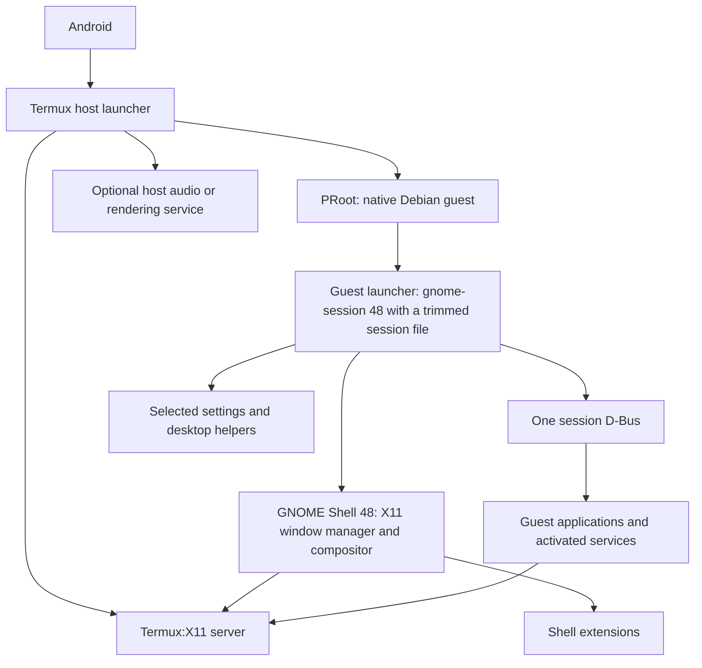

# Termux/PRoot assessment: GNOME, extensions, and desktop integration

**Device validation added:** see the [physical-device results](termux-device-validation.md), setup profile and verification report (both since removed). A reduced GNOME 48 desktop, native Ghostty profiles/bridge, appearance, local applications, Pulse audio, and per-app Adreno acceleration have device evidence. Stock Mission Center installation failed; a small PID-counter monitor supplies live CPU/RSS instead. Native Ghostty's close button can leave a hidden client/shell, while typing `exit` closes cleanly in both modes; GNOME Terminal remains the default fallback. Automatic thumbnails are not accepted for the tested PNG/JPEG/AVIF files. Two Shell crashes during live setup remain an explicit limit; the installer now requires a stopped session. The initial sections below are historical source assessment. Their device-testing caveats are superseded only where the runtime report supplies evidence, and their full acceptance matrix is not a list of completed tests.

The [full GNOME assessment](#full-gnome-and-extension-assessment) below expands the original application retrofit review with an audit of the build, session architecture, all 11 enabled extensions, bundled JavaScript, settings, graphics, Android integration, recovery, and acceptance tests. It includes confirmed local findings and explicitly identifies behavior that still requires an Android device. The original application review is retained for context; the detailed assessment qualifies its earlier generalization that extensions have uniformly low incremental effort. A subsequent adversarial review on the same date checked the GNOME claims against Shell 48.7, ArcMenu 65, gnome-session 48, and gnome-settings-daemon 48 sources. It moved gnome-session ahead of a custom supervisor, made disabling GNOME's screen lock a foundation requirement, added Android's child-process limit, and stated that the X11 architecture ends with Trixie.

Reviewed against [configuration.md](https://github.com/cnshing/debian-livecd/blob/cd769287d6511b90d54ad7682416b201e4c44e2f/docs/configuration.md), [settings.md](https://github.com/cnshing/debian-livecd/blob/cd769287d6511b90d54ad7682416b201e4c44e2f/docs/settings.md), the referenced overlays, and upstream/community implementations. This revision supersedes the earlier assumption that anything unsupported by a conventional PRoot setup should be removed. The original review was a source assessment with no Android device available; subsequent device results are recorded separately above.

Assumptions: unrooted Android; a native-architecture guest, normally Debian arm64; existing compatibility projects may be adapted and pinned; the objective remains modest implementation and maintenance effort. Boot-media, installation, virtual-hardware, and privileged hardware-management features are outside this review. At the user's request, remote desktop and the Gear Lever/AppImage integration overlay are also excluded.

**Recommendation: preserve GNOME and ordinary desktop applications, adapt their startup, and treat Flatpak as a documented candidate rather than an automatic exclusion.** Among the existing overlays, only Mission Center still needs Flatpak in this profile, so adopting the Flatpak route is a decision about that one application. Prefer an existing workaround over rewriting the desktop. Use Android replacements when they preserve the task with materially less integration work. Keep a distinction between a program launching, its intended features working, and its original isolation properties remaining intact.

## How effort should now be assessed

| Effort | Meaning for this retrofit |
| --- | --- |
| Low | Existing compatible package, copied assets/settings, or a small launcher change. No new compatibility mechanism. |
| Moderate | Adapt and configure an existing bridge/wrapper, then check the required workflow. A shared desktop, audio, or Flatpak integration can cover several applications. |
| Higher | Application-specific patches, architecture translation, mismatched runtimes, device-specific driver work, or services whose needed behavior is still unverified. Optional unless the feature matters enough to justify it. |

The first application using a compatibility layer costs more than later applications using the same layer. Conversely, finding an installer does not establish that every application feature works. Recommendations below are engineering judgments based on the inspected implementations; proposed combinations are identified separately from author-reported results.

## What the Flatpak example establishes

[termux-proot-for-flatpak](https://github.com/jjtseng93/termux-proot-for-flatpak) describes an early-stage implementation and reports testing Calculator, GNOME Text Editor, Konsole, KolourPaint, and Falkon. That establishes a useful application-launch route. Mission Center needs its own validation because it launches a separate host-side collector.

There is relevant upstream work too: Termux PRoot merged bubblewrap compatibility changes on June 1, 2026. These emulate namespace-related operations and mount paths sufficiently for some helpers to proceed. The reviewed Termux package recipe targets `5.1.107.101`; its tagged syscall implementation contains namespace interception and mount emulation. Start by checking the installed official version and testing its capabilities before assuming a separate fork is necessary. Upstream bubblewrap support alone does not establish complete Flatpak compatibility. [Upstream change](https://github.com/termux/proot/pull/359), [package recipe](https://github.com/termux/termux-packages/blob/master/packages/proot/build.sh), [tagged implementation](https://github.com/termux/proot/blob/v5.1.107.101/src/syscall/enter.c)

The supplied fork was inspected at commit `792b0ebe6487ce8adb431232fcc03b3cd15dcadc`. It supplies several layers:

- Its [guest entry script](https://github.com/jjtseng93/termux-proot-for-flatpak/blob/792b0ebe6487ce8adb431232fcc03b3cd15dcadc/enter_rootfs.sh) selects an existing rootfs and builds/uses its own PRoot binary. It runs from Termux, not from inside another PRoot session.
- The [launch helper](https://github.com/jjtseng93/termux-proot-for-flatpak/blob/792b0ebe6487ce8adb431232fcc03b3cd15dcadc/flatpak_helper/run.sh) arranges a runtime directory, D-Bus, a compiled preload shim, and Flatpak invocation. It contains `aarch64` library paths and app-specific Falkon flags, so it is not yet an architecture-neutral drop-in launcher.
- Its [bubblewrap installer](https://github.com/jjtseng93/termux-proot-for-flatpak/blob/792b0ebe6487ce8adb431232fcc03b3cd15dcadc/flatpak_helper/install.sh) renames the guest's original executable and substitutes a [wrapper](https://github.com/jjtseng93/termux-proot-for-flatpak/blob/792b0ebe6487ce8adb431232fcc03b3cd15dcadc/flatpak_helper/bwrap_wrapper.sh). The wrapper runs `xdg-dbus-proxy` outside the sandbox, makes the main sandbox wait for the proxy socket through a `/tmp/fpshim-proxy-$PPID` marker and short polling loops, and adds path mappings. That coordination is timing-based; cover it with repeated-launch tests.
- The [preload source](https://github.com/jjtseng93/termux-proot-for-flatpak/blob/792b0ebe6487ce8adb431232fcc03b3cd15dcadc/flatpak_helper/flatpak-preload.c) works around Android failures in bubblewrap's own sandbox setup: `O_TMPFILE`, `/proc/self` after `pivot_root`, user-namespace map files, `linkat`, and the `/.flatpak-info` bind. The wrapper preloads it into `bwrap` itself; applications do not need it, and the fork's [README](https://github.com/jjtseng93/termux-proot-for-flatpak/blob/792b0ebe6487ce8adb431232fcc03b3cd15dcadc/README.md) advises unsetting `LD_PRELOAD` inside the container when it causes library errors. Rebuild it for the selected guest instead of assuming the bundled shared library matches.

The [fork's syscall implementation](https://github.com/jjtseng93/termux-proot-for-flatpak/blob/792b0ebe6487ce8adb431232fcc03b3cd15dcadc/src/syscall/enter.c) strips namespace flags and translates mounts into PRoot path bindings. This permits compatibility without creating the normal kernel namespace boundary. Preserve that distinction when describing the resulting Flatpak support. The helper also explicitly disables Falkon's browser sandbox and GPU path; its reported browser success should not be generalized to unchanged Chromium/Electron applications.

**Reclassification: Flatpak moves from “remove” to “moderate-to-higher shared integration, then validate selected apps.”** Do not make every application use Flatpak when a native package is easier. In this profile the shared cost is not actually shared: Parsec and Gear Lever are excluded, so Mission Center is the only existing Flatpak consumer. Adopt the route only when Mission Center's live per-process CPU is required (see [process monitoring](#process-monitoring-and-mission-center)).

## Revised decisions for useful features

| Feature from the original documents | Revised recommendation | Effort and minimum adaptation |
| --- | --- | --- |
| GNOME Shell | Retain as the first desktop target for the Trixie lifetime | Moderate-to-higher foundation. Start Shell on Termux:X11 through a trimmed gnome-session 48 session, with direct Shell as the fallback. Disable GNOME's screen lock, because nothing can unlock it without GDM. Plan for Android's child-process limit. GNOME 50 removes the X11 backend this design depends on, so leaving Trixie means a new display route or a different desktop. Keep XFCE as the fallback for a demonstrated problem or a post-Trixie guest. |
| ArcMenu, Dash to Panel, tray, desktop icons, NoAnnoyance, tiling | Retain matching-version extensions | Low-to-moderate after Shell works. Correct the bundled accent-extension defects before default enablement. Test DING's separate desktop process, and remember that each helper counts toward Android's child-process limit. Reuse existing extension preferences, and check supported Shell versions rather than assuming a PRoot restriction. |
| WhiteSur, Colloid, accent synchronization, window-button CSS | Retain when supported by the selected versions | Mostly low effort: assets, CSS, extension settings. The custom title-button override is version-specific; pin the theme it targets. Flatpak applications need their own access to compatible themes. |
| Fonts, emoji, antialiasing, font sizes | Retain the existing choices | Low. These are package/data/settings operations. The broad font collection costs storage; it does not require a platform workaround. |
| Wallpapers and attribution | Retain | Low. Reuse existing images and attribution. Do any AVIF conversion while preparing assets, rather than making encoding a phone-side setup step. Verify the image decoder. |
| Nautilus, templates, normal open-in-terminal | Retain | Low for local file operations once the desktop works. Disable the optional GVfs FUSE bridge. Check thumbnails separately. The terminal action is moderate with host-native Ghostty, since it needs the guest-to-host bridge; Debian's gnome-terminal keeps it low. Omit administrative browsing. |
| Flatpak | Optional; currently justified only by Mission Center | Moderate-to-higher first setup. Low incremental cost applies only to later Flatpak applications, and no other existing overlay needs one here. Validate install/update, launch, exports, file access, portals, host-spawn calls, and audio with the chosen wrapper. |
| Ghostty | Prefer the native Termux package, with separate Termux/Debian shell shortcuts and a named fallback terminal | Moderate overall. Package setup and host launchers are low effort, but guest menu/Nautilus actions need a new guest-to-host bridge. Run Ghostty outside PRoot; select either shell through a profile. Termux's Mesa meets the OpenGL 4.3 requirement in software by default; validate responsiveness and the inherited driver environment. Keep Debian's gnome-terminal as the fallback. See the [full assessment](ghostty-termux-assessment.md). |
| elementary Code and theme-sync plugin | Keep if packaging is straightforward | Low with a compatible native package; higher if building the app/runtime. Fix the architecture-specific plugin installation path and confirm the plugin API. A Flatpak build needs a different plugin/theme installation strategy. Mousepad or packaged GNOME Text Editor remain simple fallbacks. |
| LibreOffice and Colibre | Retain | Low-to-moderate package/configuration work. Test normal editing, saving, fonts, dialogs, and GTK integration. No basis for removing ordinary office use just because full OS integration is absent. |
| Thumbnails and image viewing | Retain local previews first | Low-to-moderate. Reuse ffmpegthumbnailer and the audio entry where the file manager supports it. Check modern sandboxed image loaders against the actual PRoot build. Treat network-share previews separately. |
| Firefox, Chromium-family browsers, password/ad-block extensions | Retain a useful guest browser | Low-to-moderate for a compatible native build. Preserve extensions in that browser. Evaluate vendor/architecture availability and browser sandbox behavior separately; do not force three-browser parity. Android browsers are optional substitutes for convenience/performance. |
| Linux media playback | Retain mpv if useful inside the guest | Moderate shared audio/display setup. Software playback is a valid reduced target. Prefer mpv-android for regular mobile playback if Linux hardware-decoding integration adds work. |
| Basic guest audio | Retain | Moderate one-time host/guest bridge. Termux-hosted PulseAudio is an existing route; an Android-capable PipeWire project is another resource. Avoid making audio contingent on normal systemd startup. |
| EasyEffects and OPRA presets | Offer guest-audio EQ as an optional retained feature | Moderate-to-higher. A guest PipeWire graph can feed a Termux audio server. Preserve manual preset selection; defer automatic identification of the Android output device. Android EQ remains the simplest alternative when it covers the required stream. |
| Mission Center | **Superseded:** use native Termux's `xfce4-taskmanager` for live per-process CPU% and memory; Mission Center is not adopted because of its CPU load (about 65% of one core against 5–8%). [Decision and measurements](termux-native-migration.md#whole-device-cpu-counters-through-shizuku). Earlier recommendation: use guest `htop` as the baseline monitor; add Mission Center only when live per-process CPU% is required | Low for `htop`: accessible processes, memory, cumulative CPU time, and signals, but per-process CPU% shows N/A. Moderate-to-higher for Mission Center: the only reviewed monitor with live per-process CPU%, but it carries the whole Flatpak route, its overall CPU page cannot work on Android 8+, and its process tree omits reparented processes. Current native source exceeds Trixie's toolkit versions. See the source audit below and the [full assessment](termux-mission-center-assessment.md). |
| GSConnect | Retain only for a defined peer/workflow | Moderate. Test networking, discovery, and the required plugin. Pairing another physical device is more useful than recreating host-phone notifications inside the same phone. Native KDE Connect may already satisfy the task. |
| Mail/web-app clients | Keep a needed compatible client, or use Android/browser | Packaging and the selected app's engine determine effort. Do not categorically exclude Electron; equally, do not add architecture translation or a separate workaround for every mail provider without a concrete need. |

Android should continue to handle device networking/VPN, battery controls, and physical-device permissions. Native apps still require explicit file sharing for guest-private documents.

## Details that determine whether reuse stays simple

### GNOME settings and startup

The [gnome-in-termux launcher](https://github.com/sabamdarif/gnome-in-termux/blob/main/install-gnome-desktop#L136-L173) is a concrete direct-Shell startup reference. Its broad login-file deletion remains an adaptation to understand, not a requirement to copy blindly. Its archived [README](https://github.com/sabamdarif/gnome-in-termux#readme) records experimental behavior and upgrade breakage. Work from a pinned recipe and record exactly what is needed for the target guest.

A bare Shell process does not establish a complete GNOME session. Decide which settings daemons and autostart processes to launch. Debian packages provide individual components such as `gsd-xsettings`, with autostart definitions. Start the required userland pieces; leave hardware-oriented ones outside the session. [Debian settings-daemon files](https://packages.debian.org/trixie/arm64/gnome-settings-daemon/filelist)

Most of [04-tweaks](../overlays/Desktop%20Environment+Tweaks/filesystem/live_installed/etc/dconf/db/desktop.d/04-tweaks) can therefore be carried forward: font rendering, interface fonts, clock formatting, titlebar actions, focus policy, placement, and supported theme settings. Test input-device preferences through the actual X11 frontend. Reuse the extension enable list after installing compatible versions; do not rewrite working menu, tiling, and accent behavior merely to avoid extensions.

A direct Shell launch does not process XDG autostart entries, own `org.gnome.SessionManager`, or report idle presence. Debian's gnome-session 48 still does all three without systemd, so a trimmed gnome-session session is the first candidate and a hand-written supervisor the fallback; see [section 3](#3-required-session-behavior). Either way, settings helpers and optional audio processes need an explicit start path, and none of this requires emulating a complete init system.

The repository sets no screen-lock or idle defaults, so GNOME's defaults (`lock-enabled=true`, `idle-delay=300`) apply. In this profile, a lock cannot be undone; add the overrides in [section 4](#4-gnome-services-and-settings-coverage) before the first launch.

### Flatpak launch integration

Use one desktop identity, runtime-directory policy, session bus, and file-sharing policy. The fork's entrypoint is an alternative outer PRoot launch, not a nested PRoot command to run inside the guest. Combine it with the desktop's X11/socket mappings if necessary. Check guest user selection and user-vs-system Flatpak installation paths before wiring applications into the menu.

If the supported route requires a helper around `flatpak run`, application menu entries must use it. Installing a Flatpak alone does not update existing launchers automatically. Reuse the desktop's D-Bus session where possible so portals, host-spawn requests, and settings do not end up on disconnected buses.

The fork's bwrap replacement is a guest package-file change; make it reproducible and reassess it on upgrades. Test on the selected official PRoot first, then add only the extra compatibility pieces that the required apps need. Pin a fork when it supplies a demonstrated missing capability. The research establishes source paths to try, not that the fork's helper can be transplanted unchanged onto every official release.

### Process monitoring and Mission Center

The [full Mission Center assessment](termux-mission-center-assessment.md) expands this audit with packaging choices, a feature matrix, static-statistics analysis, the process-tree gap, a manual-collector diagnostic, repository adaptation, and device acceptance steps. It remains a source review; Android runtime behavior has not been validated.

**Source assessment: a guest monitor can show the Termux UID's own processes, their memory, and their cumulative CPU time. No guest monitor can show whole-device CPU utilization; live per-process CPU% is what separates the candidates.** Android hides other UIDs' `/proc` entries (`hidepid=2`) and has denied apps `/proc/stat` since Android 8. PRoot-Distro substitutes static files for blocked entries so that tools can start. [hidepid change](https://android.googlesource.com/platform/system/core/+/c39ba5a), [Android 8 restriction as reported by a monitor app](https://github.com/AntonioRedondo/AnotherMonitor#retrieving-processes-info-since-android-oreo-80-api-26-august-2017), [PRoot-Distro statistics code](https://github.com/termux/proot-distro/blob/737306f53fc86213db0ce0ac3e76aa3fda8dcb90/proot_distro/sysdata.py)

| Monitor | Works on unrooted Android | Does not work | Cost in this profile |
| --- | --- | --- | --- |
| `htop` 3.4.1 (Trixie) | Accessible process list, memory, cumulative CPU time (`TIME+`), signals to owned processes. | Per-process CPU% is N/A: it divides by the system CPU period from `/proc/stat`, which a static substitute leaves at zero. Without a readable `/proc/stat` containing `btime`, it exits at startup. CPU and load meters show the substitute. [Startup reads](https://github.com/htop-dev/htop/blob/3.4.1/linux/LinuxMachine.c#L765-L785), [per-process CPU](https://github.com/htop-dev/htop/blob/3.4.1/linux/LinuxProcessTable.c#L1679-L1683) | Low. A Debian package; it needs the launcher's static `/proc/stat` substitute, which PRoot-Distro provides and the Flatpak fork's launcher does not. |
| Mission Center 1.2.0 (Flatpak) | Process list, memory, and live per-process CPU% and disk I/O, computed from PID counters and elapsed time. | Overall CPU page; reparented processes in the Processes tree; hardware, network, and service pages. | Moderate-to-higher. It is the only existing Flatpak consumer, so it carries the whole Flatpak route plus collector host-spawn and IPC. |

**Decision: use native Termux's `xfce4-taskmanager` as the GUI monitor, and do not adopt Mission Center.** It runs on the same Termux:X11 display as the PRoot desktop. It shows CPU and memory graphs and live per-process CPU% and memory, at 5–8% of one core. Mission Center, measured under a forked PRoot, used about 65% of one core. `xfce4-taskmanager`'s total CPU covers the Termux UID's processes only. [Measurements](termux-native-migration.md#whole-device-cpu-counters-through-shizuku)

**Earlier recommendation, kept for reference: install `htop` as the baseline; to find a busy process, sort by `TIME+` and watch whose time grows. Add Mission Center only if live per-process CPU% is required.** Do not carry the liveCD's [mission-center.yaml](https://github.com/cnshing/debian-livecd/blob/cd769287d6511b90d54ad7682416b201e4c44e2f/overlays/System%20Monitor/packages/mission-center.yaml) into the profile: as its own comment states, it lists only additional-setup tools and hardware services, and the Flatpak takes its libraries from the GNOME runtime.

The rest of this section applies only if Mission Center is adopted. Reduced-function operation is plausible and no mandatory privileged daemon was identified, but compatibility with the PRoot/Flatpak combination remains unverified. This audit follows the release selected by the reviewed [Flathub manifest](https://github.com/flathub/io.missioncenter.MissionCenter/blob/master/io.missioncenter.MissionCenter.json): Mission Center **1.2.0**, commit `193e3729367035cf184da004c3246efe79d5c53e`, GNOME runtime **50**, and ARM64 build sources. Its Magpie submodule is commit `a5272b3c1d853caa4044b737cf49257bfc4c86f2`. The conclusions below refer to those release sources, rather than assuming current development code matches older installed versions.

#### Additional setup can be skipped

The first-run dialog has a close action independent of its setup action. Its setup script grants capabilities to `nethogs`, installs an Intel RAPL powercap udev rule, reloads/triggers udev, and runs `sensors-detect`. These are additional telemetry operations, not the GUI's launch procedure. Close the dialog and omit this setup from the PRoot profile. Fake guest root does not grant Android kernel capabilities. [First-run dialog](https://gitlab.com/mission-center-devs/mission-center/-/blob/193e3729367035cf184da004c3246efe79d5c53e/src/first_run_dialog.rs), [actual setup script](https://gitlab.com/mission-center-devs/gng/-/blob/a5272b3c1d853caa4044b737cf49257bfc4c86f2/platform-linux/bin/missioncenter-magpie-setup-linux)

| Component or feature | Observed behavior in release source | Handling in this profile |
| --- | --- | --- |
| `nethogs` / process network traffic | Runs as a separate task; its errors/exit are logged rather than terminating Magpie. | Omit it and accept missing per-process network traffic. [Process collector](https://gitlab.com/mission-center-devs/gng/-/blob/a5272b3c1d853caa4044b737cf49257bfc4c86f2/platform-linux/src/processes/mod.rs) |
| systemd / OpenRC service listing | Tries available backends and falls back to `ServiceCacheKind::None`. | Accept an empty/unavailable services view; no need to supply an init system for this feature. [Service backends](https://gitlab.com/mission-center-devs/gng/-/blob/a5272b3c1d853caa4044b737cf49257bfc4c86f2/platform-linux/src/services/mod.rs) |
| NetworkManager / overall network views | Missing system bus or failed NetworkManager initialization returns an empty/default cache. | Accept missing network views too, independently of nethogs. Installing NetworkManager does not give it control over Android networking. [Network collector](https://gitlab.com/mission-center-devs/gng/-/blob/a5272b3c1d853caa4044b737cf49257bfc4c86f2/platform-linux/src/network/mod.rs) |
| UDisks / drive enumeration and management | UDisks is optional in the cache, but drive entries depend on it; absent access produces no useful entries. | Accept unavailable drive/SMART/eject features. [Disk collector](https://gitlab.com/mission-center-devs/gng/-/blob/a5272b3c1d853caa4044b737cf49257bfc4c86f2/platform-linux/src/disks/mod.rs) |
| CPU, memory, and processes | Overall CPU uses `/proc/stat` deltas; per-process CPU uses PID ticks and elapsed time; memory reads `/proc/meminfo` and PID files. Failed reads can produce zeros, skipped entries, or unchanged defaults. | Overall CPU cannot work (below). Keep process and memory views after validating them; do not interpret a populated chart as proof of accurate measurements. [CPU collector](https://gitlab.com/mission-center-devs/gng/-/blob/a5272b3c1d853caa4044b737cf49257bfc4c86f2/platform-linux/src/cpu/mod.rs), [memory collector](https://gitlab.com/mission-center-devs/gng/-/blob/a5272b3c1d853caa4044b737cf49257bfc4c86f2/platform-linux/src/memory.rs) |
| Physical GPU monitoring | Failed NVTOP initialization is logged and the GPU count can be zero; Vulkan/GL information has fallback paths. | Accept an absent GPU view. Display acceleration is a separate concern. [GPU collector](https://gitlab.com/mission-center-devs/gng/-/blob/a5272b3c1d853caa4044b737cf49257bfc4c86f2/platform-linux/src/gpus/mod.rs) |

CPU/memory totals refer to the kernel interfaces visible to the process, not an independently allocated PRoot machine. Android restrictions and any PRoot-bound substitute files affect what is visible. Process inspection/control is limited by actual Android permissions; it should not be presented as an Android-wide task manager. Battery, fan, power, and temperature readings are best-effort extras rather than acceptance requirements.

**Overall CPU cannot work.** Under a launcher without substitutes, such as the Flatpak fork's, Magpie's `/proc/stat` read fails and the [CPU collector](https://gitlab.com/mission-center-devs/gng/-/blob/a5272b3c1d853caa4044b737cf49257bfc4c86f2/platform-linux/src/cpu/mod.rs#L80-101) reports 0% on every refresh. Under PRoot-Distro's static substitute, the first sample shows the substitute's fixed average and every later sample divides zero by zero in the [tick calculation](https://gitlab.com/mission-center-devs/gng/-/blob/a5272b3c1d853caa4044b737cf49257bfc4c86f2/platform-linux/src/cpu/ticks.rs#L58-61), giving NaN. Mark the page unsupported. Magpie's [per-process CPU](https://gitlab.com/mission-center-devs/gng/-/blob/a5272b3c1d853caa4044b737cf49257bfc4c86f2/platform-linux/src/processes/mod.rs#L376-388) instead uses PID ticks and elapsed time; validate it with a controlled workload. This release obtains uptime through `CLOCK_BOOTTIME`; a substituted `/proc/uptime` does not by itself invalidate that field.

**The Processes tree omits reparented processes.** The Apps page [roots the tree](https://gitlab.com/mission-center-devs/mission-center/-/blob/193e3729367035cf184da004c3246efe79d5c53e/src/apps_page/mod.rs#L312) at the lowest visible PID and renders only that process's descendants. On Android PID 1 is hidden, so the root becomes the lowest-numbered Termux-UID process, normally the Termux app process. A process whose parent exits is reparented outside that subtree, together with everything it starts. A session `dbus-daemon` started by `dbus-launch` is one example; its D-Bus-activated children include Nautilus and Magpie. Such processes are counted in the header but missing from the tree. App rows still [aggregate](https://gitlab.com/mission-center-devs/mission-center/-/blob/193e3729367035cf184da004c3246efe79d5c53e/src/table_view/models.rs#L301-320) their usage, but list only child processes inside the tree. Starting the bus with `dbus-run-session`, as the [session supervisor](#3-required-session-behavior) already proposes, should keep activated processes in the tree. This follows from source; the full assessment gives the device test.

#### Magpie and toolkit versions are hard requirements

Mission Center requires a functioning **Magpie collector and its local IPC socket**. A native installation starts `missioncenter-magpie` directly. The Flatpak starts a spawner that invokes `flatpak-spawn --watch-bus --host`, testing bundled glibc/musl collectors before selecting one. If both tests fail, it falls back to a plain `missioncenter-magpie` on the host, which the guest does not provide; the spawner then exits and is restarted repeatedly until the GUI's 15-second connection window ends in a fatal error dialog. The host here must be the Debian guest under the existing outer PRoot session. Successfully launching Calculator under the Flatpak workaround does not exercise this path. [Collector client and error handling](https://gitlab.com/mission-center-devs/mission-center/-/blob/193e3729367035cf184da004c3246efe79d5c53e/src/magpie_client/client.rs), [spawner](https://gitlab.com/mission-center-devs/mission-center/-/blob/193e3729367035cf184da004c3246efe79d5c53e/src/magpie_client/spawner.rs)

The Flatpak manifest clears `LD_PRELOAD`, and collector launch also strips it. This does not conflict with the compatibility helper, whose shim serves `bwrap` itself (see [the fork's layers](#what-the-flatpak-example-establishes)); do not inject it into Magpie. Check access to Flatpak's `app-path`, the session bus/host-spawn service, and the shared collector socket. The manifest's bus/device permissions permit access attempts; they do not require the referenced system services to exist.

Release 1.2.0 also provides `MC_DEBUG_MAGPIE_PROCESS_SOCK`, which skips automatic collector startup and connects to an existing collector. A manually launched, matching guest Magpie can therefore isolate host-spawn failures without rebuilding the GUI. This is a proposed diagnostic/workaround, not a tested integration; its commands and lifecycle requirements are in the [full assessment](termux-mission-center-assessment.md#3-use-the-existing-manual-collector-option-when-needed).

A native build avoids that Flatpak host-spawn boundary, but **building current Mission Center against stock Trixie is not a trivial alternative**. Release 1.2.0 requests the `gnome_50` GTK feature set and libadwaita 1.9; Trixie provides GTK 4.18 and libadwaita 1.7. Prefer the Flatpak's matching runtime if that route works. Treat a different guest release, an older pinned Mission Center, or a toolkit backport as separate packaging decisions with their own validation. Unlike the Flatpak, a native build needs its linked libraries in the guest; the GUI links `libudev`, which is different from requiring a running udev daemon. [Native link definition](https://gitlab.com/mission-center-devs/mission-center/-/blob/193e3729367035cf184da004c3246efe79d5c53e/src/meson.build), [Release dependencies](https://gitlab.com/mission-center-devs/mission-center/-/blob/193e3729367035cf184da004c3246efe79d5c53e/Cargo.toml), [Trixie GTK](https://packages.debian.org/trixie/libgtk-4-1), [Trixie libadwaita](https://packages.debian.org/trixie/libadwaita-1-0)

#### GPU acceleration and GPU monitoring are separate

Mission Center's release graph widget draws through GTK snapshots/GSK paths. It does not directly require an application-owned OpenGL canvas for those charts. GTK offers a Cairo fallback renderer: test `GSK_RENDERER=cairo` for this application if the default renderer fails. For a Flatpak, pass it into the app with `flatpak run --env=GSK_RENDERER=cairo ...` through the validated launch helper. This is a diagnostic/reduced-performance route, not a claim of tested performance on a phone. [Graph widget](https://gitlab.com/mission-center-devs/mission-center/-/blob/193e3729367035cf184da004c3246efe79d5c53e/src/performance_page/widgets/graph_widget.rs), [GTK renderer options](https://docs.gtk.org/gtk4/running.html#GSK_RENDERER)

Accelerating those GTK drawings through a compatible graphics stack does not grant access to physical GPU utilization, memory, temperatures, or process accounting. NVTOP's Adreno support targets the Linux MSM driver and its kernel interfaces; an Android rendering bridge does not automatically supply those interfaces. Keep hardware GPU telemetry optional even when the desktop renders with acceleration. [NVTOP driver requirements](https://github.com/Syllo/nvtop#adreno)

**Acceptance boundary:** decline setup, verify Magpie stays running and connects, test repeated launches and saved preferences, then compare accessible per-process CPU/memory readings with the same readable kernel data and a changing workload. Confirm that a daemonized test process appears in the Processes tree, not only in the header count. Allow empty hardware/service/traffic pages and mark overall CPU unsupported. If only the window works or live per-process CPU% is unusable, Mission Center adds nothing over `htop`: remove it and the Flatpak route. Do not grow this retrofit into a hardware-telemetry bridge.

### Audio: ordinary output is easier than automatic device-aware EQ

A community [PipeWire-on-Termux implementation](https://github.com/leefm0204/pipewire-termux-proot) exposes Android output/capture to guest PulseAudio clients. That is another available resource, not a demonstrated EasyEffects configuration. EasyEffects needs a PipeWire graph; a working `PULSE_SERVER` connection alone does not establish one.

A proposed composition using documented components is:

```text
guest applications -> guest pipewire-pulse/PipeWire -> EasyEffects
                   -> Pulse tunnel -> Termux PulseAudio -> Android output
```

PipeWire's [Pulse tunnel module](https://docs.pipewire.org/page_module_pulse_tunnel.html) supplies the guest-to-host link. Start the needed user processes and configure routing without assuming ALSA hardware exists in the guest. Crucially, guest applications must connect to the guest processing graph; pointing them straight at the Termux server bypasses the EQ. This combined configuration still requires device testing.

Keep [opra2ee.py](../overlays/Audio%20Effects/lb/hooks/normal/scripts/opra2ee.py) when the chosen EasyEffects preset format matches. The preset conversion itself is ordinary userland work. A lighter alternative is PipeWire's [parametric equalizer module](https://docs.pipewire.org/page_module_parametric_equalizer.html), which accepts AutoEQ-style filter data; reformatting the existing filters would be an additional small conversion task, not direct reuse of EasyEffects JSON.

The reasonable regression is manual headphone/preset selection and processing of guest audio only. Automatic recognition of whatever Bluetooth/USB headset Android selected remains a separate bridge. Use Android EQ if it covers the desired playback paths more simply.

### Nautilus: retain local files; check auxiliary services separately

**Keep Nautilus.** The linked [Debian PRoot guide](https://github.com/LinuxDroidMaster/Termux-Desktops/blob/main/Documentation/proot/debian_proot.md) explicitly installs it in its GNOME recipe. Its [launcher](https://github.com/LinuxDroidMaster/Termux-Desktops/blob/main/scripts/proot_debian/startgnome_debian.sh) starts D-Bus and runs Shell on Termux:X11. This is an existing implementation reference, not proof that every feature of the current package has been tested. As with the other GNOME recipe, review its broad login-file deletion instead of copying it indiscriminately.

Use Debian's arm64 Nautilus package with the desktop user's D-Bus session, display connection, runtime directory, and writable home/cache. Keep folder browsing, copy/move/rename, normal application associations, bookmarks, and the existing `~/Templates/New Text Document.txt`. Omit `nautilus-admin` and the administrative Ghostty extension from this profile. Their elevated workflows are separate from ordinary file browsing. [Debian package and dependencies](https://packages.debian.org/trixie/nautilus), [existing Nautilus settings](https://github.com/cnshing/debian-livecd/blob/cd769287d6511b90d54ad7682416b201e4c44e2f/docs/settings.md#nautilus)

**FUSE is not required for Nautilus to browse local files.** GVfs uses GIO/D-Bus backends; its FUSE component additionally exposes those resources as filesystem paths to applications that do not use GIO. Set `GVFS_DISABLE_FUSE=1` in the guest desktop environment if that optional component causes startup noise. SFTP/SMB through GIO can be evaluated separately, but do not promise transparent remote paths to ordinary shell programs without the FUSE bridge. [GIO environment options](https://gnome.pages.gitlab.gnome.org/gtk/gio/overview.html), [GVfs architecture](https://github.com/GNOME/gvfs#readme)

Thumbnailing has a different constraint: Trixie's Nautilus depends on bubblewrap, and its gnome-desktop thumbnail launcher uses it. Test the selected PRoot compatibility implementation with the required image/video/audio thumbnailers. Failure of that helper should reduce preview coverage rather than force replacement of the file manager. Search indexing and removable-device integration also deserve separate checks; do not add hardware services merely to complete the sidebar. [Thumbnail launcher source for gnome-desktop 44.3](https://github.com/GNOME/gnome-desktop/blob/44.3/libgnome-desktop/gnome-desktop-thumbnail-script.c)

### Graphics and native Termux Ghostty

Graphics acceleration is an existing compatibility option, not a blanket impossibility. Termux packages an Android [VirGL renderer](https://github.com/termux/termux-packages/blob/master/packages/virglrenderer-android/build.sh); suitable Adreno devices may use [Turnip](https://docs.mesa3d.org/drivers/freedreno.html) with [Zink](https://docs.mesa3d.org/drivers/zink.html). Establish one device-specific path for the desktop and retained GPU applications. Flatpak runtimes may need compatible drivers separately from native Debian apps. Software rendering is a useful diagnostic baseline, not a guarantee of acceptable performance.

**Prefer native Termux Ghostty.** The live GitHub API records [PR #32263](https://github.com/termux/termux-packages/pull/32263) as merged on October 16, 2026. Its package is present in the main branch, and the reviewed official aarch64 X11 repository index publishes Ghostty **1.3.1**. The recipe builds for Android/Bionic, enables GTK X11, disables Wayland, and excludes 32-bit ARM/i686. The package is new: at review time the merge was its only commit, the PR's device evidence was one recorded test on an aarch64 tablet, and the recipe sets `TERMUX_PKG_AUTO_UPDATE=false`, so upstream releases wait for a manual bump. Its six patches, including a replacement child-process watcher, are carried by Termux rather than upstream Ghostty. Acceptance testing, not packaging, establishes its stability. [Merged package recipe](https://github.com/termux/termux-packages/blob/e71e4cd408f82f53ff0063be22745f6495357f60/x11-packages/ghostty/build.sh), [live PR metadata](https://api.github.com/repos/termux/termux-packages/pulls/32263), [official aarch64 package index](https://packages.termux.dev/apt/termux-x11/dists/x11/main/binary-aarch64/Packages.gz)

Install this package in Termux and run it on the same Termux:X11 display. By default it selects a native Termux shell; entering Debian is an explicit terminal-command choice. Offer separate “Ghostty — Termux” and “Ghostty — Debian” profiles if both are useful. Use `command` for the Debian profile so new tabs and splits also enter Debian; `-e` only selects the initial command. The [full Ghostty assessment](ghostty-termux-assessment.md) covers package patches, native launch, Debian preference, Android/desktop shortcuts, and the option of running Ghostty itself inside Debian.

Running Ghostty inside Debian instead has no package to install. The repository's griffo source publishes Trixie Ghostty for amd64 only, and Debian's archive does not package it, so that route means a Zig source build. That, rather than graphics, is the main reason to prefer the native package: GNOME Shell already needs a guest OpenGL path (see [graphics and performance](#11-graphics-and-performance)), whereas native Ghostty needs Termux's own. [griffo arm64 index](https://deb-free.griffo.io/apt/dists/trixie/main/binary-arm64/Packages), [Debian package search](https://packages.debian.org/search?keywords=ghostty&searchon=names&suite=all&section=all)

Each Debian tab or split runs its own `proot-distro login`: PRoot-Distro's Python launcher, then a PRoot instance separate from the one running GNOME. Measure how long a new tab takes to open. Such a tab uses the official PRoot even when the desktop uses the Flatpak fork's launcher, and it is not on GNOME's session bus unless the helper recovers that environment. Commands that act on the running desktop, such as `gsettings`, `xdg-open`, and `flatpak run`, need testing from a Debian tab rather than being assumed to work. Ghostty recognizes the shell for automatic integration from the command's executable name, so integration does not apply when the command is a PRoot wrapper; the repository's `shell-integration-features` setting has no effect in the Debian profile. [Shell detection in 1.3.1](https://github.com/ghostty-org/ghostty/blob/v1.3.1/src/termio/shell_integration.zig#L136-L165)

Reuse [config.ghostty](../overlays/Terminal/filesystem/live_installed/etc/skel/.config/ghostty/config.ghostty), but install it in the **Termux user's** `~/.config/ghostty/`, since that is where the native process reads configuration. Fonts and theme assets used by native Ghostty must also be accessible to its host libraries; installing them only inside Debian is insufficient. Keep the existing `xterm-256color` preference if desired.

Native Ghostty's GTK/libadwaita window also reads Termux's home and settings. Font and theme names published by the guest's settings daemon may reach it over X11, but the guest's title-button CSS, dconf preferences, and fonts such as Cantarell and Adwaita Sans must exist on the Termux side. Until they do, Ghostty's title bar and tabs can differ from every other window on the desktop.

Nautilus' “Open in Terminal” needs a guest-to-host launch bridge: request native Ghostty from a process outside PRoot, then enter Debian with the selected guest working directory. Do not pass a guest path directly as native Ghostty's working directory. The existing Debian `update-alternatives` registration and extension expect a guest executable named `ghostty`; they do not automatically discover the host package. Retain the feature with a guest wrapper/action and validate path transport, quoting, and the selected guest user. The bridge itself, an SSH server in Termux or a small dispatcher, is new integration work; that is what makes this terminal action moderate rather than low. Without a guest Ghostty package, the guest also lacks Ghostty's own Nautilus extension and icon; copy them from the Termux package or provide a dedicated action. Copying the administrative extension is unnecessary.

Ghostty 1.3.1 explicitly requires desktop **OpenGL 4.3** in its [renderer source](https://github.com/ghostty-org/ghostty/blob/v1.3.1/src/renderer/OpenGL.zig#L36), and OpenGL is its only renderer outside Apple platforms, so it has no software or GLES fallback of its own. [Renderer backends](https://github.com/ghostty-org/ghostty/blob/v1.3.1/src/renderer/backend.zig) Termux's Mesa is built with llvmpipe, softpipe, VirGL, and Zink. llvmpipe implements OpenGL 4.5 on the CPU and is what Mesa normally falls back to without a configured hardware driver, so the requirement is likely met by default, in software. [Termux Mesa recipe](https://github.com/termux/termux-packages/blob/master/packages/mesa/build.sh)

What needs checking is therefore different: whether CPU rendering stays responsive at the device's resolution, and whether driver variables set for desktop acceleration, such as `GALLIUM_DRIVER`, reach Ghostty and select a driver reporting less than 4.3. That case leaves no terminal at all rather than a slower one. GTK's Cairo setting discussed for Mission Center does not supply that terminal renderer. A hardware path such as Turnip with Zink on supported Adreno devices is optional, device-specific work.

Name a fallback before making Ghostty the default terminal. Debian's arm64 gnome-terminal draws through VTE and GTK rather than Ghostty's renderer, runs inside the guest, and joins GNOME's session and Nautilus without a bridge. The liveCD already installs it alongside Ghostty, as the [alternatives hook](https://github.com/cnshing/debian-livecd/blob/cd769287d6511b90d54ad7682416b201e4c44e2f/overlays/Terminal/lb/hooks/normal/2900-register-ghostty-terminal.hook.chroot.overlay.tmpl) notes. Termux also packages native Alacritty, kitty, gnome-terminal, and xfce4-terminal if a host-side alternative is preferred.

### Other application packaging

For elementary Code, the repository's [PPA entry](https://github.com/cnshing/debian-livecd/blob/cd769287d6511b90d54ad7682416b201e4c44e2f/overlays/Text%20Editor/repos/elementary.yaml) is restricted to amd64, and its plugin path is architecture-specific. These are packaging tasks, not proof that Code cannot run on ARM64. Upstream provides a [source build](https://github.com/elementary/code) and a [Flatpak manifest](https://github.com/elementary/code/blob/master/io.elementary.code.yml); that manifest is not proof of a published compatible binary. Prefer an available native build because the existing custom plugin and theme-file access are easier there. If using Flatpak, install the plugin through the app's supported runtime/user mechanism; the guest's existing `/usr/lib/...` installation is not automatically visible inside it.

## Concrete handling of settings.md and repository files

| Existing material | Handling in the PRoot profile |
| --- | --- |
| Font packages, templates, wallpapers, theme/icon assets | Reuse. These do not require a compatibility fork. Preserve attribution and inspect actual installed theme names. |
| GNOME extension settings and most desktop gsettings | Reuse with working Shell/settings components and matching versions. Do not translate to XFCE preemptively. |
| Systemd units for application startup | Extract the needed process/command into the common session launcher. Explicitly support autostart if using it. |
| `.var/app` settings and Flatpak menu exports | Only if the Flatpak route is adopted. Retain compatible preferences, but verify installation scope, settings backend, launch helper, runtime themes, and portals. |
| Flatpak installation hooks | Only if the Flatpak route is adopted; Mission Center's is the only one left in scope. Reuse the application ID. Replace build-specific installation plumbing with the validated guest workflow. |
| Mission Center additional-setup package list | Omit entirely: it lists setup tools and hardware services, and the Flatpak supplies its own libraries. Install `htop`; add `flatpak` only when Mission Center is adopted. |
| Ghostty configuration and terminal integration | Copy config/assets to Termux for the native package; adapt the guest's ordinary terminal action to launch it and enter the selected guest directory. Add guest desktop entries matching each profile's window class, and keep Debian's gnome-terminal as the fallback. |
| Nautilus administrative actions | Omit `nautilus-admin` and `ghostty-admin.py`; retain ordinary browsing, templates, and terminal access. |
| elementary plugin and WhiteSur CSS | Keep as optional existing customizations. Fix installation location and version assumptions; do not rewrite them solely because the guest is PRoot. |

In particular, [flatpak-chroot](https://github.com/cnshing/debian-livecd/blob/cd769287d6511b90d54ad7682416b201e4c44e2f/overlays/Flatpaks/lb/includes.chroot/usr/local/sbin/flatpak-chroot) solves a privileged live-build chroot problem using host-root escape, unshare, and pivoting. The new PRoot route solves a different problem. Do not reuse that script as the guest's Flatpak launcher.

Use a separate guest setup/profile instead of porting the entire live-build engine. Select packages and copy relevant files; do not execute every existing hook. Put actual defaults into the desktop user's home or the applicable dconf defaults/profile. Copying `/etc/skel` is sufficient only before the user's home is created.

Native Android alternatives still provide the least work for some tasks: browser/password apps, VPN, mail, regular media playback, and Android EQ. Use a shared export folder when those apps need guest documents; keep executables and development trees in Termux-private storage.

## Implementation and acceptance order

1. **Record the platform.** Device/GPU, Android version, phantom-process setting, Termux source/version, PRoot package, guest release/architecture, graphics driver, and compatibility-project revisions. Keep Trixie as the initial Debian target unless a selected workaround requires a deliberate change.
2. **Establish GNOME once.** X11 connection, session bus, runtime directory, a trimmed gnome-session session (direct Shell as the fallback), screen locking disabled, useful settings components, extension loading, input, rendering, logout/relaunch, and app switching. Reuse existing preferences before considering desktop substitutions.
3. **Validate native applications.** Nautilus, native Termux Ghostty entering Debian, editor, LibreOffice, fonts, common thumbnails, and `htop` listing guest processes. Check Nautilus' terminal action preserves the selected directory. For Ghostty, record which Mesa driver it uses and whether it stays responsive; use the fallback terminal if not. This gives useful functionality independently of Flatpak.
4. **Optional: Flatpak for Mission Center.** Dropped because of CPU load; native `xfce4-taskmanager` supplies live per-process CPU% instead. Originally: only if live per-process CPU% is required. Validate Flatpak with a small reported-working application: installation, launch, repeated launch, file access, and updates. Then test Mission Center's host-spawn, collector socket, process tree, and per-process readings with additional setup declined. Wire successful apps into the same menu/session/helper path.
5. **Add shared audio, then EQ if wanted.** Verify normal output first, then confirm the selected signal actually passes through the processing graph and preset. Test reconnects and session cleanup.
6. **Add remaining optional workflows.** A needed browser/Electron client, network-share thumbnails, and phone sync. Reassess each against the feature the user actually needs.

The decisive acceptance checks are saved preferences after relaunch, actual file open/save, meaningful monitoring data, application update survival, audio routing, and correct host/guest terminal behavior. A custom loader can make an API return success without reproducing the hardware or service behind it; validate observable behavior.

Preserve GNOME appearance, ordinary desktop files/settings, and useful applications. Reduce hardware/OS integration and automatic Android-device-aware behavior to the features that have a working, modest-effort implementation. Use native Termux's `xfce4-taskmanager` as the process monitor (replacing the earlier plan of `htop` plus an optional Mission Center, which was dropped for its CPU load). Keep Nautilus as the file manager, and native Termux Ghostty as the preferred terminal, with Debian's gnome-terminal as the fallback.

## Full GNOME and extension assessment

Repository baseline: **`8d20a9a`**. Target: **unrooted Android, native-architecture Debian Trixie, GNOME Shell on Termux:X11, entered through Termux PRoot**. An arm64 phone is the primary design assumption, not an observed test device. Remote desktop and Gear Lever/AppImage integration remain outside the implementation scope established in the original review; their session dependencies are mentioned where relevant.

**Assessment: GNOME is a reasonable target to retain, but this checkout does not yet implement a PRoot distribution or a reproducible GNOME session for Android.** Its desktop assets and most preferences are reusable. The substantial work is establishing a coherent session, choosing a working rendering path, replacing boot-dependent startup, and validating extensions with helper processes. Two defects in bundled accent extensions deserve correction before using the existing extension list as a default.

“Supports GNOME 48” below means that the inspected metadata declares it, not that the extension has passed an Android test. “Confirmed” means directly established from the checkout, extracted Debian package contents, or an isolated local reproduction. Performance, Android lifecycle behavior, and complete desktop operation remain unmeasured.

### 1. What the repository actually builds

The current path is a Live ISO build:

| Repository evidence | Consequence for a PRoot target |
| --- | --- |
| [`os/config.yaml`](https://github.com/cnshing/debian-livecd/blob/cd769287d6511b90d54ad7682416b201e4c44e2f/os/config.yaml) selects Trixie and a broad set of desktop, installer, networking, hardware, and application overlays. | It is a reusable inventory, but the selected profile is intended to boot as an operating system. |
| [`src/stages/prepare.py`](https://github.com/cnshing/debian-livecd/blob/cd769287d6511b90d54ad7682416b201e4c44e2f/src/stages/prepare.py), [`src/loaders/filesystem.py`](https://github.com/cnshing/debian-livecd/blob/cd769287d6511b90d54ad7682416b201e4c44e2f/src/loaders/filesystem.py), and [`src/loaders/packages.py`](https://github.com/cnshing/debian-livecd/blob/cd769287d6511b90d54ad7682416b201e4c44e2f/src/loaders/packages.py) generate live-build inputs. | Copying an overlay directory does not reproduce the loader's package selection, template rendering, filesystem destinations, or hooks. |
| [`src/stages/build.py`](https://github.com/cnshing/debian-livecd/blob/cd769287d6511b90d54ad7682416b201e4c44e2f/src/stages/build.py) invokes the live-build make target; [`lb/auto/config`](https://github.com/cnshing/debian-livecd/blob/cd769287d6511b90d54ad7682416b201e4c44e2f/lb/auto/config) supplies ISO, kernel, installer, and init settings. | There is no existing rootfs export/setup stage that creates the intended Termux guest. |
| [Build CI](https://github.com/cnshing/debian-livecd/blob/cd769287d6511b90d54ad7682416b201e4c44e2f/.github/workflows/build-livecd.yml) expects `live-image-amd64.hybrid.iso`. | Passing an arm64 setting alone does not create a PRoot artifact or validate an Android launch. |
| `aptRecommends: true` applies globally. | Hardware services and convenience applications can enter transitively. Dependency installation and runtime service startup need separate decisions. |
| No tracked Termux host launcher, guest session supervisor, or Android acceptance job was found. | Display, audio, runtime directories, D-Bus, cleanup, and lifecycle behavior must be supplied by the new profile. |

The efficient adaptation is a separate Termux profile that consumes selected package lists and renders/copies selected assets into a native Debian rootfs. Keep the Live ISO profile available. A rootfs builder on a Linux build machine and an idempotent setup script for an existing PRoot guest are both viable designs; neither requires running live-build inside the phone.

Declare **Debian `arm64`** explicitly for an arm64 guest. [`Deb.arch`](https://github.com/cnshing/debian-livecd/blob/cd769287d6511b90d54ad7682416b201e4c44e2f/src/deb.py) uses the build host's `dpkg --print-architecture` unless overridden, and its fallback does not translate `aarch64` to Debian's `arm64`. This is a portability gap if that detection is reused outside Debian; it is not a claim that architecture detection fails inside an ordinary Debian arm64 guest.

### 2. GNOME version and display architecture

Trixie's inspected package pages list GNOME Shell **48.7-0+deb13u2** and Mutter **48.7-0+deb13u1**. These are review snapshots, not versions installed in this workspace or on a phone. Target the coherent **48 series** and continue accepting appropriate Trixie maintenance/security updates. [Debian Shell package](https://packages.debian.org/trixie/gnome-shell), [Debian Mutter package](https://packages.debian.org/trixie/mutter-common)

The initial architecture should be:



Here Termux:X11 is the display server and GNOME Shell/Mutter is its window manager/compositor. This avoids making GDM, a Linux virtual terminal, or a DRM/KMS seat part of the initial launch. The repository's Wayland login sessions and preferred-primary udev GPU rules target a different display architecture.

**A newer GNOME is not an interchangeable upgrade.** GNOME 49 disables dedicated X11 sessions by default across Shell, Mutter, GDM, and gnome-session, and removes gnome-session's built-in service manager in favor of systemd. GNOME 50's Mutter build options no longer provide the legacy X11 backend. Xwayland support means X11 applications can run inside a Wayland desktop; it does not make a Wayland compositor connect directly to Termux:X11 as its old X11 window manager. [GNOME 49 developer notes](https://release.gnome.org/49/developers/), [Mutter 50 build options](https://github.com/GNOME/mutter/blob/50.0/meson.options)

This gives the architecture an end date, not just an upgrade caveat. Every piece of it is pinned to GNOME 48: Shell as an X11 window manager, the inspected extension packages (DING, for example, depends on `gnome-shell (<< 49~)`), and the bundled accent extensions' tested range. No Debian release that ships Mutter 50 or later can reuse it. Trixie's support window bounds the profile's useful life: under Debian's usual pattern, regular security support runs until about a year after the next stable release and LTS until roughly five years after Trixie's August 2025 release. Weigh that horizon when choosing GNOME over an X11-native desktop. It is a known, dated limit, not a hypothetical problem.

A later Wayland/headless/devkit route remains a research option. Mutter Devkit has its own display/input integration and PipeWire requirements, so it needs an independent prototype, compatible extensions, and an input/clipboard assessment. It is not established here as a working Termux replacement. [GNOME 50 Devkit changes](https://release.gnome.org/50/developers/), [Devkit session implementation](https://github.com/GNOME/mutter/blob/50.0/mdk/mdk-session.c), [Devkit PipeWire implementation](https://github.com/GNOME/mutter/blob/50.0/mdk/mdk-pipewire.c)

The existing [gnome-in-termux project](https://github.com/sabamdarif/gnome-in-termux) demonstrates a direct `gnome-shell --x11` recipe, but it was archived in September 2025. Its launcher is a useful design reference, not validation of this Trixie package set. Do not transplant its broad login-file removals or process kills without identifying the failure they address. [Archived launcher source](https://github.com/sabamdarif/gnome-in-termux/blob/main/install-gnome-desktop)

### 3. Required session behavior

PRoot provides filesystem and syscall compatibility under Android's actual permissions. A conventional privileged init/seat environment cannot be assumed. Individual daemons can still run as ordinary foreground-managed processes. Install-time dependencies on systemd-related packages do not establish that systemd is operating as the guest's service manager. [PRoot-Distro limitations](https://github.com/termux/proot-distro#readme)

The session launcher needs a defined contract. With the gnome-session route described at the end of this section, gnome-session covers the settings-helper, autostart, and logout rows; the launcher still owns the rest.

| Concern | Required behavior | Likely symptom if omitted |
| --- | --- | --- |
| Guest identity | Use one named desktop user with a stable home and consistent guest UID. Reserve guest root for setup. Guest identities remain within Termux's real Android app permissions. | Settings applied to the wrong home, browser root restrictions, mismatched service/file ownership expectations. |
| Display | Select a display number, wait for the X server to be reachable, and bind its socket path into the guest. | `Cannot open display`, a blank frontend, or applications connecting to another session. |
| Session environment | Set the intended `DISPLAY`, `XDG_SESSION_TYPE=x11`, `XDG_CURRENT_DESKTOP=GNOME`, and locale before spawning services. Use a deliberate session desktop identifier when required. | Wrong portal/backend selection, missing GNOME-specific integrations, inconsistent fonts/input. |
| Runtime directory | Provide a private local directory for the desktop identity, with mode `0700`, a defined lifetime, and no stale service sockets. | D-Bus, audio, portal, or settings helpers fail or connect to stale endpoints. |
| Session bus | Start one bus and keep Shell, its helpers, dconf, portals, and guest applications on it. | A running app has no tray icon, preferences cannot find Shell, notifications or service activation fail. |
| System bus | Evaluate a minimal guest bus separately from its services; add it when the selected desktop components need it. Starting a bus does not supply logind, NetworkManager, UPower, or hardware access. | Missing proxies or warnings; some components may fail before their optional-service fallback runs. |
| Settings helpers | Start only the useful settings-daemon components, once, after their environment is ready. | GTK applications ignore preferences, shortcuts or media integration are incomplete. |
| Autostart | Explicitly process an allowlist of required autostart entries, or launch the corresponding commands directly. | A `.desktop` autostart entry exists but its application never starts. |
| Service activation environment | Ensure D-Bus-activated helpers inherit the same display, runtime, audio, and data search paths. | Services work from a terminal but fail when launched by ArcMenu, DING, or a portal. |
| Shutdown | Track the session's processes, reap them, and stop them on logout or failure. Handle Shell exit and signal termination. | Duplicate DING processes, audio servers, stale buses, or a new session connecting to old services. |
| Recovery | Offer a terminal-accessible startup mode with extensions disabled and known graphics defaults. | A broken panel/theme prevents reaching the controls needed to repair it. |

The runtime directory's ownership, permissions, and lifetime requirements come from the [XDG Base Directory specification](https://specifications.freedesktop.org/basedir/latest/). PRoot's displayed ownership is not additional Android isolation; validate that the selected guest layout works with the consumers' ownership checks.

`dbus-run-session` provides useful bus lifetime management: the bus exists while its main program runs. That main program should own the desktop's helper processes: gnome-session where it works, or a **session supervisor** in the direct-Shell fallback. It should not be a shell that backgrounds everything and immediately exits. Bus termination alone does not implement process supervision. [dbus-run-session manual](https://dbus.freedesktop.org/doc/dbus-run-session.1.html)

The official Termux:X11 guide documents sharing temporary storage for PRoot. Current PRoot-Distro also documents a narrower `--shared-x11` option. Confirm the installed tool's help: a socket-only bind can cover X11 while other rendering/audio paths may require additional mappings. Keep sensitive runtime files out of a broadly shared temporary directory when feasible. [Termux:X11 setup](https://github.com/termux/termux-x11#using-with-proot-environment), [PRoot-Distro login options](https://github.com/termux/proot-distro#readme)

**Try a trimmed gnome-session 48 session before writing a supervisor.** Trixie's `gnome-session-bin` 48.0-1+deb13u1 still contains the non-systemd startup path that GNOME 49 removes: its binary logs “Falling back to non-systemd startup procedure” when no systemd user manager is available. It also accepts `--session=NAME` and `--disable-acceleration-check`. gnome-session supplies what the contract table otherwise asks a custom supervisor to reimplement:

- it starts the session's required components and processes XDG autostart entries;
- it owns `org.gnome.SessionManager`, which Shell's Log Out, Restart, and Power Off actions call (`SystemActions.activateLogout()` sends `LogoutAsync` to it), and so do ArcMenu's power buttons;
- it publishes the presence/idle status that Shell's idle handling listens to;
- it ends the session in a defined order.

Do not use the stock `gnome.session`. Its `RequiredComponents` list names Shell plus 16 settings-daemon components, including Color, Power, Rfkill, Smartcard, Wacom, UsbProtection, Sharing, and PrintNotifications. A required component that cannot start can fail the whole session. Ship a PRoot-specific session file, such as `/usr/share/gnome-session/sessions/gnome-proot.session`, whose `RequiredComponents` names only `org.gnome.Shell` and the settings components the profile actually uses, starting with XSettings. Launch it as `dbus-run-session -- gnome-session --session=gnome-proot`, adding `--disable-acceleration-check` while testing software rendering. The host launcher then handles only display readiness, environment, binds, logging, and cleanup after gnome-session exits.

The binary also references logind's interfaces; whether its fallback tolerates a guest with no logind at all is **untested**. If it does not, use a direct `gnome-shell --x11` launch under a supervisor as the fallback, and accept what that loses. Shell's Log Out item and ArcMenu's Log Out button then call a session manager that no process owns, so logout needs its own launcher action. Shell's idle presence also never changes. Either way, a successful Shell process does not show that autostart entries or session components have run.

### 4. GNOME services and Settings coverage

Trixie's settings-daemon package includes separate executables such as `gsd-xsettings`, `gsd-keyboard`, `gsd-media-keys`, and `gsd-power`, plus autostart definitions. This makes selective startup feasible. [Debian arm64 file inventory](https://packages.debian.org/trixie/arm64/gnome-settings-daemon/filelist)

| Component | Assessment for this profile |
| --- | --- |
| `gsd-xsettings` | Strong candidate for the initial session. Validate GTK/X11 font, theme, and scaling propagation. |
| Keyboard, accessibility, and media-key helpers | Retain the components needed for the tested input workflows. Some operations still depend on X11 capabilities, audio, or missing services. `gsd-media-keys` binds `<Super>l` to `org.gnome.ScreenSaver.Lock` by default; apply the lock overrides below before starting it. |
| `gnome-control-center` | Useful for appearance and some user preferences; its hardware-facing panels are not a complete Android Settings replacement. |
| `gnome-shell-extension-prefs` / Extensions UI | Explicitly ensure availability in the guest profile. The current package lists do not independently declare every management tool mentioned by the documentation. Recommends may currently supply some tools. |
| Dconf service/backend and desktop schemas | Required for persistent preferences and extension settings. Ensure package installation and session-bus activation, not just copied defaults. |
| IBus and AT-SPI | Validate if multilingual input, composition, or accessibility is required. The existing dconf profile includes an IBus database, which by itself does not start IBus. |
| GNOME Keyring / Secret Service | Retain for applications that need it, with an explicit startup/unlock workflow. A direct PRoot session does not reproduce PAM-based automatic login unlocking. |
| AccountsService | Determine which user/avatar operations need it; tolerate reduced account-management UI where appropriate. |
| Portals | Validate actual file chooser, URI opening, and application integrations. A portal package's presence does not establish that its backend started on the right bus. |
| NetworkManager/VPN, UPower/TLP, switcheroo-control, udev, rfkill, colord, printer/smartcard services | Do not start these merely to make a full desktop look like a booted PC. Select them only for demonstrated accessible functionality. Android remains responsible for device networking, power, and physical hardware. |

Appearance settings, ordinary shortcuts, local file browsing, and desktop application preferences are realistic first targets. Wi-Fi switching, Android VPN control, suspend, display backlight, physical GPU selection, and operating-system account administration require host integration beyond merely running GNOME Settings.

Keep GNOME's ordinary logout/restart/power-off menu semantics under review. A useful PRoot “logout” stops the owned desktop session. It should not leave the guest apparently logged out while helper processes survive.

**Disable GNOME's screen lock in this profile: without GDM, a locked session cannot be unlocked.** GNOME Shell 48.7's unlock dialog authenticates through GDM's user verifier over the system bus (`Gdm.Client.open_reauthentication_channel`, falling back to `get_user_verifier`, in `js/gdm/util.js`). With no GDM, both calls fail and the dialog reports “Authentication error”. Shell hides its own Lock action in that case: `LoginManager.canLock()` asks GDM for its version, and ArcMenu's Redmond power buttons follow the same `can-lock-screen` property. Two paths skip that check, however:

- `org.gnome.ScreenSaver.Lock`, which `gsd-media-keys` calls for its default `<Super>l` binding, goes directly to `ScreenShield.lock()`;
- the idle lock fires from gnome-session's presence status when `lock-enabled` is true.

The repository sets neither key, so GNOME's defaults apply: `lock-enabled=true` and a 300-second `idle-delay`. Under the gnome-session route, the desktop locks after five idle minutes. Under either route, Super+L locks it as soon as media keys run. Recovery then means killing Shell from Termux and losing the session. Add these defaults to the PRoot profile's dconf database only; the Live ISO has GDM and should keep its lock:

```ini
[org/gnome/desktop/lockdown]
disable-lock-screen=true

[org/gnome/desktop/screensaver]
lock-enabled=false

[org/gnome/desktop/session]
idle-delay=uint32 0
```

`disable-lock-screen` makes `ScreenShield.lock()` return early on every path, so it is the essential key; `lock-enabled=false` keeps idle handling consistent with it. `idle-delay=0` also stops GNOME's idle fade-to-black, leaving display timeout to Android. Android's lock screen remains the device lock. [Shell 48.7 verifier](https://gitlab.gnome.org/GNOME/gnome-shell/-/blob/48.7/js/gdm/util.js), [lock entry points](https://gitlab.gnome.org/GNOME/gnome-shell/-/blob/48.7/js/ui/screenShield.js), [lock availability](https://gitlab.gnome.org/GNOME/gnome-shell/-/blob/48.7/js/misc/loginManager.js)

ArcMenu's right-click context menu is different from its Redmond power buttons. Its “Power Off / Log Out” submenu adds Restart, Power Off, Lock, and Log Out without checking availability. In this profile those entries throw “action is not available” errors or call an absent session manager. Remove that item from ArcMenu's `context-menu-items` for the PRoot profile, or accept dead entries.

### 5. Complete enabled-extension inventory

The master list in [`00-shell-extensions`](https://github.com/cnshing/debian-livecd/blob/cd769287d6511b90d54ad7682416b201e4c44e2f/overlays/Desktop%20Environment/filesystem/live_installed/etc/dconf/db/desktop.d/00-shell-extensions) enables **11** extensions. Eight come from Debian packages; three are copied into the filesystem from this repository.

The Debian package archives below were downloaded and extracted for inspection, without installing or running their desktop code. Shell-version values were read from the actual packaged `metadata.json` files. All 11 declare support for **48**. This is substantially stronger evidence than assuming compatibility from an extension's current web page.

| Extension and UUID | Inspected package/bundled version | Declared Shell majors | PRoot-specific assessment |
| --- | --- | --- | --- |
| ArcMenu — `arcmenu@arcmenu.com` | [`gnome-shell-extension-arc-menu` 65-2](https://packages.debian.org/trixie/gnome-shell-extension-arc-menu) | 45, 46, 47, 48 | Retain. Core menus/search are userland; device/account/power actions can have reduced functionality. Test with Dash to Panel. |
| Dash to Panel — `dash-to-panel@jderose9.github.com` | [`gnome-shell-extension-dash-to-panel` 68-2](https://packages.debian.org/trixie/gnome-shell-extension-dash-to-panel) | 46, 47, 48 | Retain. Test work area, touch targets, virtual-screen resizing, app grouping, and previews. |
| AppIndicator — `ubuntu-appindicators@ubuntu.com` | [`gnome-shell-extension-appindicator` 59-4](https://packages.debian.org/trixie/gnome-shell-extension-appindicator) | 45, 46, 47, 48 | Retain. Indicator producers need the same guest session bus. Host-native Termux applications can need separate bus integration. |
| Desktop Icons NG — `ding@rastersoft.com` | [`gnome-shell-extension-desktop-icons-ng` 48.1.0-1](https://packages.debian.org/trixie/gnome-shell-extension-desktop-icons-ng) | 45, 46, 47, 48 | Retain with helper testing. It launches a separate GJS/GTK desktop process and uses Nautilus services. |
| User Themes — `user-theme@gnome-shell-extensions.gcampax.github.com` | [`gnome-shell-extension-user-theme` 48.2-1](https://packages.debian.org/trixie/gnome-shell-extension-user-theme) | 48 | Retain. Needs matching Shell CSS and installed assets. It is also a dependency of the accent-user-theme behavior. |
| NoAnnoyance — `noannoyance-fork@vrba.dev` | [`gnome-shell-extension-no-annoyance` 0+20241212-8ca0647-1](https://packages.debian.org/trixie/gnome-shell-extension-no-annoyance) | 45, 46, 47, 48 | Retain if its focus behavior is wanted. The inspected code activates attention-demanding windows; it does more than hide a notification. |
| Tiling Assistant — `tiling-assistant@leleat-on-github` | [`gnome-shell-extension-tiling-assistant` 51-2](https://packages.debian.org/trixie/gnome-shell-extension-tiling-assistant) | 48 | Retain. Test keyboard delivery, drag gestures, panel work area, and changing virtual dimensions. |
| GSConnect — `gsconnect@andyholmes.github.io` | [`gnome-shell-extension-gsconnect` 62-1+deb13u1](https://packages.debian.org/trixie/gnome-shell-extension-gsconnect) | 46, 47, 48 | Optional by workflow. It has a separately activated service and network/host integration beyond its Shell UI. |
| Accent User Theme — `accent-user-theme@brgvos` | bundled metadata version 3 / version-name 2 | 47, 48, 49 | Retain after checking theme assets and the globally available User Themes schema. See source findings below. |
| Accent GTK Theme — `accent-gtk-theme@brgvos` | bundled metadata version 8 / version-name 5 | 47, 48, 49 | Correct its file lifecycle before enabling the current GTK4-copy behavior by default. |
| Accent Icons Theme — `accent-icons-theme@brgvos` | bundled metadata version 4 / version-name 3 | 47, 48, 49 | Correct the signal-disconnection defect and clarify the ineffective preference before default enablement. |

Debian extension packages are architecture-independent JavaScript/data, but their GJS, GI, GTK, and compositor dependencies must match the guest architecture and release. JavaScript does not remove those dependencies.

Several inspected Debian packages depend on Shell `<49`, and User Themes/Tiling Assistant metadata targets 48 specifically. The bundled accent metadata's allowance for 49 does not extend support for the rest of the desktop. Do not bypass version validation globally to force an incompatible combination.

The packaged Dash to Panel metadata reports extension version `9999`; use the Debian package version and, when needed, archive hash for reproducibility rather than treating that metadata field as the release identifier.

### 6. Menu, taskbar, tray, and tiling interactions

The current ArcMenu settings select the Redmond layout, place search at the bottom, enable bookmarks/devices, and add open-window/recent-file search providers. These can remain useful in PRoot. External-device enumeration depends on what GIO/GVfs can actually see; showing the menu item does not provide Android removable-media permissions.

Dash to Panel hides both `showAppsButton` and `activitiesButton` in its saved element positions. This makes ArcMenu failure more disruptive: two familiar panel entry points are intentionally absent. Keep a working Super/overview route or an explicit recovery launcher until ArcMenu and its integration pass testing. Termux:X11 or Android may intercept a physical Super key, so test the real keyboard path.

The panel configuration handles three monitor indexes and disables multiple panels. A phone's portrait/landscape changes are often virtual-display changes rather than desktop monitor hotplug. Test a resize/reorientation with menus open, then test maximized and tiled windows against the new work area. Do not assume the existing monitor-index map models every frontend layout.

ArcMenu 65-2 omits `stylesheet.css`; the checkout restores an upstream-v65 copy. Package extraction confirmed the omission, consistent with Debian's [file list](https://packages.debian.org/trixie/all/gnome-shell-extension-arc-menu/filelist). Preserve this workaround for the reviewed package; reassess it when the Debian package changes to avoid overriding a newly supplied stylesheet with an old one.

AppIndicator requires more than a visible extension toggle: start an actual indicator application from the guest menu and exercise its menu/actions. A separate `dbus-run-session` for that application creates a different bus and can make its indicator invisible to the desktop.

Tiling Assistant does not intrinsically need privileged Android hardware access. Its meaningful test is correct geometry and input on the chosen frontend. Test the panel together with tiling, not only each extension independently. NoAnnoyance should also be tested while typing in another application, because its focus activation can interrupt input.

### 7. DING and Nautilus

The inspected DING package starts a separate desktop process using GJS and GTK3; its file operations use Nautilus D-Bus interfaces. Therefore, a Shell extension state of “enabled” is insufficient proof that desktop icons work.

Retain the complete Debian package, Nautilus, and the required GIO/GVfs components. Establish the user's XDG Desktop directory, execute a file operation from a desktop icon, and verify that the helper survives normal use without respawning repeatedly. Check copy/paste, rename, trash, drag/drop to Nautilus, executable desktop-file trust, and position persistence after relaunch. Keep guest-private files and Android shared-storage files as separate test cases.

The current `show-network-volumes=true` setting only asks DING to show mounts available to GIO. It does not mount Android storage or make GVfs FUSE work. GVfs network backends can still be useful without their optional FUSE bridge, but external programs accessing a mount through a normal path need a separate solution.

Nautilus thumbnails deserve independent testing. Current PRoot includes upstream work specifically aimed at bubblewrap users, including Glycin, so a blanket claim that sandboxed loaders cannot launch is outdated. Compatibility does not reproduce their normal kernel namespace isolation. Validate the selected PRoot release and actual image/video files, including the AVIF wallpapers. [Termux PRoot bubblewrap changes](https://github.com/termux/proot/pull/359)

Do not carry administrative file-manager actions into the ordinary desktop profile by default. Fake guest root is not Android root, and the existing Nautilus administrative terminal extension addresses a different, booted-system workflow.

### 8. GSConnect needs a plugin-by-plugin decision

**Native port added:** GSConnect now also has an opt-in port running in native Termux rather than this guest: see its [README](gsconnect/README.md) and [device verification](gsconnect/VERIFICATION.md). There, pairing a second physical computer, file and clipboard exchange, and a bus without logind all behaved as this section expected. The same-phone topology and an absent system bus were not tested, and mounted browsing is unsupported. The assessment below remains the record for the guest profile.

GSConnect is not only in-process Shell JavaScript. The inspected package installs `org.gnome.Shell.Extensions.GSConnect.service` for D-Bus activation of its GJS daemon, alongside its desktop entries and plugins. Retain those integration files when packaging it; copying just the extension directory is an incomplete installation strategy.

Its session component tries `org.freedesktop.login1` and catches failures during asynchronous initialization. Without a session proxy, its `idle` and `locked` getters return false. Consequently, some “only while active/unlocked” decisions may behave differently from a normal workstation. This is a reduced behavior to test, not evidence that logind is mandatory for every GSConnect operation. The constructor also accesses the system bus before that async lookup; test both an absent bus and a running bus without logind. [Reviewed Debian GSConnect source package](https://packages.debian.org/source/trixie/gnome-shell-extension-gsconnect)

| GSConnect workflow | Expected assessment boundary |
| --- | --- |
| Pairing another physical phone/computer | Plausible over Android-provided networking; verify discovery, manual-address connection, pairing persistence, and reconnect. |
| Pairing the same Android phone hosting Termux | A separate topology to test. Shared host networking, local discovery, and port selection can complicate it; this is not established as impossible or as equivalent to two devices. |
| File/clipboard exchange | Test guest paths and desktop clipboard first. Android clipboard synchronization and Android filesystem access are additional boundaries. |
| Notification exchange | Test each direction. Guest GNOME notifications and Android application notifications are different streams. Android-side permissions determine the latter. |
| Battery information | The guest's local UPower view is not automatically the host phone's Android battery service. Receiving a peer's reported battery is a separate feature. |
| Remote input/media controls | Test the guest compositor/audio player's interfaces. Controlling unrelated Android applications requires additional host functionality. |
| SFTP/mount-style browsing | Ordinary network transfer and FUSE-mounted browsing have different prerequisites. Validate a non-FUSE transfer route before promising mounted browsing. |

GSConnect documents TCP/UDP ports **1716–1764**. Diagnose conflicts, Android/VPN/AP behavior, and broadcast discovery on the host network; a guest `ufw` command does not grant firewall administration over Android. [GSConnect troubleshooting](https://github.com/GSConnect/gnome-shell-extension-gsconnect/wiki/Help)

Retain GSConnect when a concrete peer workflow passes; otherwise leave it available as an optional feature. It should not block the base GNOME session.

### 9. Confirmed bundled-extension defects

These are source defects in the current checkout, not effects unique to PRoot. They matter more when the phone has limited I/O capacity or recovery access. This assessment records the corrections needed; it does not modify the extension implementations.

| Finding | Evidence | Effect and recommended correction |
| --- | --- | --- |
| **High: GTK4 cleanup deletes files it does not own.** | [`accent-gtk-theme/extension.js`](https://github.com/cnshing/debian-livecd/blob/cd769287d6511b90d54ad7682416b201e4c44e2f/overlays/Desktop%20Environment+Theming/filesystem/live_installed/usr/share/gnome-shell/extensions/accent-gtk-theme@brgvos/extension.js), `_delFilesDirsLocalGtk4()` at line 186. It unconditionally targets `gtk.css`, `gtk-dark.css`, `assets`, and `windows-assets`. The method is called on disable and even when `set-link-gtk4` is false. | Pre-existing user CSS/assets can be removed. Reproduced with the actual cleanup methods redirected to a temporary directory containing user-marker files: both CSS and assets disappeared. Track owned files, preserve/restore pre-existing content, and remove only extension-owned artifacts. Switching this preference off alone does not make the current code safe. |
| **Medium: icon-extension signal is disconnected from the wrong object.** | [`accent-icons-theme/extension.js`](https://github.com/cnshing/debian-livecd/blob/cd769287d6511b90d54ad7682416b201e4c44e2f/overlays/Desktop%20Environment+Theming/filesystem/live_installed/usr/share/gnome-shell/extensions/accent-icons-theme@brgvos/extension.js), lines 63 and 75–77. Connection is on `_settings`; disconnection uses `_preferences`. | A local Gio/GObject reproduction produced a critical warning and left the original handler connected. Disconnect from `_settings` before clearing references, then verify repeated disable/enable cycles. This does not prove an inevitable Shell crash. |
| **Medium: theme-file deletion and copying are not sequenced.** | GTK extension `_deleteFile()` and `_copyFile()` use async operations; `_onSomethingChanged()` immediately proceeds from deletion to recreation, and `_copyFile()` skips an existing destination. | There is a race: copying can skip a file awaiting deletion or callbacks can finish after a later theme change. Serialize updates, cancel obsolete work, handle completion/errors, and test rapid accent/style toggles. The timing failure has not been reproduced on Android. |
| **Medium: recursive asset work blocks the Shell thread.** | GTK extension `_copyRecursive()` and `_deleteRecursive()` use synchronous directory queries, enumeration, copy, and delete from extension callbacks. | Large themes can stall the UI, with syscall-heavy work made more costly by PRoot. Measure it; prefer cached assets, owned links where appropriate, or cancellable async/helper work. No stall duration is claimed from this review. |
| **Low: `change-app-colors` has no effect in the supplied runtime code.** | The icon schema and `prefs.js` expose the setting, and the dconf overlay enables it, but `extension.js` never reads it. | The switch can change stored state without changing icon behavior. Implement its intended effect or remove/clarify the control. |
| **Low: custom mapping changes do not immediately refresh the theme.** | All three runtime extensions read per-accent mappings when another watched event fires; they do not watch those mapping keys. | A preference change may appear ineffective until the accent or light/dark state changes. Connect mapping-change signals and clean them up on disable. |
| **Low: disabling accent extensions resets rather than restores themes.** | GTK/icons/user-theme `disable()` methods set their target to `Adwaita` instead of restoring the user's previous selection. | Recovery, extension toggling, or lock-related disablement can change appearance unexpectedly. Preserve prior values and verify the default-Shell-theme reset convention rather than relying on a literal theme name. |

Extension lifecycle tests are required even if the user rarely toggles extensions. GNOME can disable and re-enable extensions as session modes change; clean disable behavior is part of the extension contract. [GNOME session-mode guidance](https://gjs.guide/extensions/topics/session-modes.html)

`accent-user-theme` creates a `Gio.Settings` object using the **global** `org.gnome.shell.extensions.user-theme` schema. Trixie's reviewed User Themes package installs that schema globally, so no failure is established for this package set. If replacing it with a manually downloaded extension, preserve global schema availability or change the lookup explicitly. [User Themes package files](https://packages.debian.org/trixie/all/gnome-shell-extension-user-theme/filelist)

### 10. Theme, wallpaper, font, and settings portability

The repository pins WhiteSur to commit `d5782652d412137e26fb8ff55b55a5572e4c6995`, installs all accent variants, and appends GTK3/GTK4 titlebutton overrides. Preserve the pin while assessing the current CSS. Its hook assumes `/live-build/.../scripts`, so the **assets and rendered installation steps** are reusable; the hook cannot be assumed to run unchanged in a PRoot guest. [WhiteSur installation hook](https://github.com/cnshing/debian-livecd/blob/cd769287d6511b90d54ad7682416b201e4c44e2f/overlays/Desktop%20Environment+Theming/lb/hooks/normal/2700-install-whitesur-theme.hook.chroot.overlay.tmpl)

Four appearance paths need separate acceptance:

| Path | Required check |
| --- | --- |
| Shell theme | User Themes loads the expected WhiteSur variant and renders panels, menus, overview, and dialogs correctly on Shell 48. |
| GTK3 applications | `gtk-theme`, icons, fonts, and XSettings produce the expected application appearance. |
| GTK4/libadwaita applications | Test the actual copied CSS/assets and application widgets. `gtk-theme` alone is not evidence of uniform libadwaita theming. Correct the destructive copier before enabling it for an existing home. |
| Flatpak and host-native Termux applications | Their runtimes/homes can have different theme paths, toolkits, and settings buses. Guest accent settings do not automatically theme them. |

The Colloid source is an Ubuntu Budgie PPA configured with `trusted=yes`, with APT preferences intended to allow only the icon package. The pin limits package selection but does not restore normal signature verification. For a reproducible PRoot profile, prefer a verified signed package source or pinned upstream icon assets. This is a supply-chain/maintenance issue in the existing source choice, not a reason to discard the icon theme. [Repository source](https://github.com/cnshing/debian-livecd/blob/cd769287d6511b90d54ad7682416b201e4c44e2f/overlays/Desktop%20Environment+Theming/repos/colloid.yaml), [package pin](https://github.com/cnshing/debian-livecd/blob/cd769287d6511b90d54ad7682416b201e4c44e2f/overlays/Desktop%20Environment+Theming/repos/96-allow-only-colloid-icons.pref)

The overlay uses lowercase icon variants such as `Colloid-yellow-dark`, while `docs/settings.md` shows `Colloid-Yellow-Dark`. That is a documented reproduction mismatch for the packaged naming convention recorded in the overlay. A manual upstream installation may use a different convention; inspect the installed theme directory before choosing the name.

The wallpaper source directory occupies approximately **86 MiB in this checkout**. Its AVIF assets are reusable and should be decoded on the device, not reconverted there. Test decoding and attribution installation. The broad Noto/emoji/DejaVu/Unifont/Hanazono font selection is also reusable; measure its installed cost and font-cache time. Check `fc-match` for the configured Cantarell and Adwaita Sans families because those families are not explicitly listed in `fonts.yaml` and may rely on other dependencies or substitution. Font coverage does not establish multilingual input-method support.

The local schema audit validated **45 key/value entries** from the core, Shell, and Tweaks dconf files against extracted Trixie schemas: all had an existing key, matching GVariant type, and valid range. It also strictly compiled the three bundled extension schemas and a combined schema tree. These checks do **not** prove that each preference has an observable effect through Termux:X11; the generated theming template and every application-specific setting were not included in that 45-entry count.

| Existing setting group | Portability assessment |
| --- | --- |
| Clock/date, fonts, antialiasing/hinting, titlebar actions, focus, centering, window buttons | Reuse; validate visual effect under the actual session and client toolkit. |
| Mouse/touchpad preferences | May apply only to virtual X11 devices presented by the frontend. Android/Termux:X11 can transform input first. |
| Super shortcuts and window modifiers | Reuse only after keyboard delivery is verified; Android and the frontend can intercept keys. |
| Screen scaling and text scaling | Start with one deliberate frontend resolution/DPI policy, then tune GNOME text/UI scale. Avoid accidental multiplication of frontend scale, GNOME text scale, and toolkit scale. |
| Volume limits | Requires a working selected audio path; storing the key alone cannot create one. |
| Screen lock and idle (not set by the repository) | Add PRoot-only overrides that disable locking and idle; GNOME's defaults lock a session that nothing can unlock without GDM. See [section 4](#4-gnome-services-and-settings-coverage). |
| Hardware/network/power settings | Assess against host integration and actual permissions; their presence in dconf is not operational support. |

Copy `/etc/dconf/profile/user` and compile the relevant system defaults. Existing users' values in `~/.config/dconf/user` override defaults, and copying files into `/etc/skel` does not update a home that already exists. Preserve user changes during profile upgrades; use deliberate migrations instead of resetting all settings on every launch.

Keep the enabled-extension list centralized, but generate it from installed/supported features for the PRoot profile. An optional GSConnect selection should not leave an unconditional enabled UUID behind. Recompile bundled schemas from their XML during packaging so the shipped cache agrees with the reviewed source; the existing binary cache alone is not a source-level reproducibility check.

### 11. Graphics and performance

There are three different questions: whether the X11 socket works, whether the compositor can initialize OpenGL, and whether it remains responsive under workload. Passing the first does not establish the other two.

| Rendering path | Appropriate role | Evidence still needed |
| --- | --- | --- |
| Software Mesa renderer | Diagnostic baseline and possible low-resolution fallback. | Shell startup, sustained CPU load, frame pacing, heat, battery use, and application responsiveness. |
| Host VirGL renderer with guest client | Existing candidate for a shared acceleration route. Termux supplies an Android renderer package. | Compatible guest driver/protocol, socket mappings, Shell GL initialization, and behavior after server restart. [Termux recipe](https://github.com/termux/termux-packages/blob/master/packages/virglrenderer-android/build.sh) |
| Turnip/Vulkan plus Zink | Device-specific candidate on supported Adreno hardware. Zink implements OpenGL over Vulkan; this is not universal Android-GPU support. | Exact GPU support, Android kernel-interface compatibility, guest driver build, Vulkan capabilities, and compositor behavior. [Mesa Freedreno/Turnip](https://docs.mesa3d.org/drivers/freedreno.html), [Mesa Zink](https://docs.mesa3d.org/drivers/zink.html) |

Treat driver environment variables as part of a named, tested graphics profile. Forcing a reported GL version does not implement missing features, and a renderer string alone does not establish acceptable Shell performance. Avoid embedding unexplained flags copied from another GPU into the default launcher.

PRoot adds overhead to intercepted syscalls; the impact depends on workload. The useful comparisons are native Termux versus guest application startup, Shell without extensions versus the full extension set, and software versus the selected acceleration path. ArcMenu search, DING thumbnail/file enumeration, and recursive theme copying may expose different costs than window animation.

Measure at a fixed virtual resolution and thermal state: startup time, idle CPU/PSS, sustained window movement/overview behavior, document launch/search, and 15–30 minutes of realistic use. Compare at least a smaller diagnostic resolution and the intended everyday resolution. Record Android's view of the Termux process group as well as guest process data; kernel memory totals are not an independently allocated guest-machine budget. No minimum RAM, FPS, power draw, or startup-time figure is established by this source review.

GNOME can be retained with animations reduced if a measured device needs that tradeoff. Add an alternate desktop only when a documented failure, resource limit, or maintenance requirement justifies it; the inspection does not establish that changing desktops is necessary.

### 12. Android input, storage, and lifecycle

| Area | Required validation |
| --- | --- |
| Touch | Tap, long press/right click, drag, scroll, menu dismissal, and tiling with the chosen Termux:X11 input mode. A virtual mouse path does not automatically provide native GNOME touchscreen gestures. |
| Keyboard | Android IME composition, Bluetooth/USB keyboard, Super/Alt/Tab combinations, function keys, and text entry after focus changes. |
| Clipboard | Android → guest, guest → Android, GTK ↔ native Termux applications, Unicode text, and primary selection separately from clipboard selection. |
| Orientation/size | Portrait/landscape, soft-keyboard show/hide, frontend resize, and recovery of panels/dialogs that were open during the change. |
| Storage | Keep the rootfs, executable files, sockets, and development trees in Termux-private storage. Bind only deliberately shared document/export directories. Test Android storage permissions and scoped-storage behavior on the device. |
| File operations | Create/save/rename/trash in both guest-private and exported directories; permissions, symlinks, file locking, and executable desktop files can differ. |
| Backgrounding | Switch to another Android app, leave the desktop idle, lock/unlock the phone, and return. Distinguish frontend disconnection from guest process termination. |
| Relaunch | Test graceful logout, Shell crash, frontend close, Termux force-stop, and a fresh launch. Do not rely on cleanup traps running after an Android process kill. |
| Child-process limit | Record the device's phantom-process setting, then run the full extension set plus normal applications. Watch for processes ending with signal 9. |

The current Termux:X11 README documents Android background CPU effects and a shared-UID APK variant with Termux-signature constraints. This is a host installation choice to verify against the user's installed app source, not something a guest package can fix. [Termux:X11 setup and slowdown guidance](https://github.com/termux/termux-x11#setup-instructions)

Android battery optimization and process-management policy remain part of the supported-device matrix. A wake lock or “unrestricted battery” preference can help particular circumstances but should not be represented as a guarantee of process survival.

**Android's child-process limit falls hardest on GNOME.** Android 12 and later monitor “phantom” processes: processes that an app forks outside its main process. Every PRoot guest process is a real forked process and counts, as do Termux:X11's server, a Termux audio server, and native Ghostty. By default Android allows 32 across all apps and kills the excess with signal 9. It can also kill phantom processes that use excessive CPU while the app is in the background. This profile's GNOME session runs more helpers than most PRoot desktops: Shell, the selected settings components, DING's separate GJS process, GSConnect's daemon, IBus, AT-SPI, dconf, GVfs, portals, Shell's calendar server with Evolution Data Server, keyring, audio servers, and then the user's applications. The session alone can plausibly exceed 32. Signal 9 cannot be trapped, so no cleanup code runs, and the next launch meets stale sockets.

Where present, the developer option “Disable child process restrictions” turns the monitor off. On Android 12L and later, `adb shell settings put global settings_enable_monitor_phantom_procs false` does the same. Android 12.0 needs `adb shell device_config set_sync_disabled_for_tests persistent` followed by `adb shell device_config put activity_manager max_phantom_processes 2147483647`. Each of these requires a one-time ADB session or developer-option access on the phone. Record which one applies, and keep the session's process count low anyway: start only the helpers that a tested workflow uses, and leave GSConnect, IBus, and indexing out unless needed. [Termux phantom-process issue](https://github.com/termux/termux-app/issues/2366)

### 13. Audio, applications, and desktop integration

Guest application audio requires an explicit host/guest route. A Termux-hosted audio server is a candidate; a guest graph feeding it is a more involved option when EasyEffects is required. Verify actual output, volume/mute, latency, reconnection, and the intended processed signal. GNOME's sound controls may have partial coverage if the guest cannot enumerate Android output devices as normal Linux sound cards.

The existing EasyEffects service is enabled for `graphical-session.target`; the AppImage watcher similarly relies on a systemd user path unit. Those units will not activate themselves without a systemd user manager, under either gnome-session's fallback or a direct-Shell launch. If EasyEffects is retained, start it from an XDG autostart entry that gnome-session processes, or from the supervisor in the fallback. The excluded AppImage feature would need its own explicit watcher lifecycle if reintroduced later. [EasyEffects unit](https://github.com/cnshing/debian-livecd/blob/cd769287d6511b90d54ad7682416b201e4c44e2f/overlays/Audio%20Effects/filesystem/live_installed/etc/systemd/user/easyeffects.service), [AppImage enable hook](https://github.com/cnshing/debian-livecd/blob/cd769287d6511b90d54ad7682416b201e4c44e2f/overlays/AppImages/lb/hooks/normal/2600-enable-watch-appimages.hook.chroot.overlay.tmpl)

For native Termux Ghostty, the window can use the same X display and be managed by the guest GNOME window manager, but its executable, theme configuration, desktop entry, and D-Bus identity live outside the Debian rootfs. Guest Nautilus needs a deliberate launcher bridge that preserves the selected guest user/directory and quotes paths correctly. Dash to Panel/ArcMenu grouping may need a guest desktop entry matching the actual window identity. Do not share an entire home merely to make theme/config files appear in both environments.

Keep useful native Debian desktop applications independent of Flatpak compatibility. The existing Chrome source and elementary Code PPA are explicitly amd64-only, and the elementary theme-sync plugin lives under an x86_64 library path. Those are concrete arm64 packaging/integration obstacles, separate from whether GNOME can run. [Browser source](../overlays/Browser/repos/google-chrome.yaml), [editor source](https://github.com/cnshing/debian-livecd/blob/cd769287d6511b90d54ad7682416b201e4c44e2f/overlays/Text%20Editor/repos/elementary.yaml), [editor plugin](https://github.com/cnshing/debian-livecd/blob/cd769287d6511b90d54ad7682416b201e4c44e2f/overlays/Text%20Editor/filesystem/live_installed/usr/lib/x86_64-linux-gnu/io.elementary.code/plugins/theme-sync/theme_sync.py)

The original Flatpak assessment remains applicable: use a proven compatible application to establish install/update/launch, then validate required applications and portals individually. ArcMenu entries must invoke any required compatibility launcher and inherit the desktop's bus. The live-build `flatpak-chroot` helper is not the PRoot runtime launcher.

### 14. Security and recovery properties

The material security boundaries here are Android's application permissions, the files/sockets bound into the guest, the selected X11 access policy, and application-specific compatibility changes. PRoot is not a kernel container security boundary; a guest “root” label does not grant device administration. Keep Termux host files and credentials outside unnecessary guest binds. [PRoot-Distro limitations](https://github.com/termux/proot-distro#readme)

An extension runs as part of GNOME Shell and can execute code with that process's permissions. Treat the bundled extensions as maintained code, not inert theme data. The confirmed GTK cleanup behavior demonstrates why source review matters. [GNOME extension debugging/architecture](https://gjs.guide/extensions/development/debugging.html)

Prefer a local X11 socket and a deliberate access policy. Do not solve a connection problem by making broad access-control changes or exposing unauthenticated display/audio services to the LAN. If an application workaround changes sandbox behavior, document it per application; a working GUI is not evidence that its original isolation properties remain intact.

Provide a separate recovery command before making the full extension set automatic. Its essential functions are starting Shell with user extensions disabled, selecting known graphics settings, and exposing logs from outside the failed desktop. Back up user dconf and GTK configuration before enabling the current theme integration on an existing home. The implementation should ultimately avoid requiring users to restore files after routine extension toggles.

### 15. Prioritized findings and implementation work

Priorities below are engineering judgments for this repository, not measured effort estimates for a specific phone.

| Priority | Work item | Completion evidence |
| --- | --- | --- |
| **P0: foundation** | Add a separate Trixie/native-architecture PRoot profile and an explicit rootfs/setup path. | Reproducible package/assets manifest and a fresh guest that installs without boot hooks or architecture mismatches. |
| **P0: foundation** | Implement the host launcher, a trimmed gnome-session 48 session file, runtime/bus policy, display connection, logging, and cleanup. Fall back to a direct-Shell supervisor only if gnome-session fails without logind. | Repeated successful launch/logout through the session manager; no stale helpers or disconnected application bus. |
| **P0: foundation** | Add PRoot-only lock defaults: `disable-lock-screen=true`, `lock-enabled=false`, `idle-delay=0`. | Super+L and an idle period longer than GNOME's default delay leave the desktop unlocked. |
| **P0: foundation** | Choose how the device handles Android's phantom-process limit, and keep the session's helper count small. | No signal-9 terminations during the sustained-workload gate with the full extension set. |
| **P0: foundation** | Select and validate a GNOME 48 graphics path. | Shell actually renders and remains usable under representative load on the target device. |
| **P0 before theme default** | Correct GTK file ownership/cleanup and icon signal disconnection. | Pre-existing files survive; repeated enable/disable and theme changes produce no orphan handlers or cleanup damage. |
| **P1: desktop** | Bring up Dash to Panel + ArcMenu, tray, tiling, DING/Nautilus, and selected settings helpers. | Each function works, then the combined set survives resize, app switching, and relaunch. |
| **P1: desktop** | Make installed features drive the extension list and verify management tools/schema availability. | No missing UUIDs; preferences and recovery work under the desktop user's identity. |
| **P1: integration** | Validate fonts, wallpapers, native app launches, file dialogs, terminal bridge, and audio. | Actual open/save, input, appearance, clipboard, terminal directory, and sound workflows pass. |
| **P1: maintenance** | Replace/verify the icon theme source, fix documentation naming drift, record package/source revisions. | Verified sources and reproducible names/assets; maintenance updates can be retested coherently. |
| **P2: optional** | Add GSConnect, Mission Center through Flatpak (only for live per-process CPU%), guest EQ, and other selected workflows. | Each optional workflow has its own passing acceptance case and clean failure/disable behavior. |
| **P2: future** | Prototype a post-X11 GNOME path, or choose another desktop, before the profile leaves Trixie; any Debian release with Mutter 50 or later requires it. | Independent proof of display, input, compositor, session, and extension operation; no assumption that changing `XDG_SESSION_TYPE` is enough. |

For the first deliverable, retain GNOME and the intended menu/taskbar/tray/tiling behavior. Correct and then include accent synchronization. Make DING a core workflow if desktop icons are required, but test it after the compositor and menu are stable. Keep GSConnect optional until its useful peer workflow is defined and demonstrated.

### 16. Acceptance matrix

These are proposed checks to run on a real target. They were **not** executed on Android during this review.

| Gate | Test | Pass condition |
| --- | --- | --- |
| A: package integrity | Resolve the selected native-architecture packages; inspect installed Shell/Mutter/extension versions and UUIDs. | A coherent Trixie stack, no forced dependency bypass, all selected extensions declare Shell 48. |
| B: display and session | Start a simple X client, then Shell with extensions disabled; inspect environment, runtime directory, session and system buses. | Display works, Shell owns the window-manager role, processes share the intended session. |
| C: lifecycle | Launch/logout at least 10 times; separately test Shell failure, frontend close, and Android interruption. Press Super+L, leave the desktop idle past five minutes, and try every visible Lock/Log Out entry. | No accumulating daemons, stale sockets preventing startup, or user-preference loss; interrupted startup is recoverable. The desktop never reaches an unlock prompt, and every visible Log Out entry ends the session. |
| D: individual extensions | Enable each extension in isolation where sensible, then required dependencies/pairs. | Correct visible function and no repeated errors/helper restart loops. |
| E: combined shell | Run menu, taskbar, tray producer, tiled windows, and desktop icons together. | Working app launching/grouping, indicator actions, correct work area, and file operations. |
| F: theme lifecycle | Preserve user CSS marker files; change all configured accents and light/dark styles; disable/re-enable extensions; relaunch. | Correct variants, preserved pre-existing files, no obsolete callbacks or increasing resource use. |
| G: input and geometry | Use actual Android IME and physical keyboard; rotate/resize with apps and menus open. | Correct composition, shortcuts, pointer behavior, accessible dialogs, and stable panel/tile geometry. |
| H: documents and storage | Open/save/rename/trash in guest-private and intentionally shared folders; generate thumbnails. | Correct content and permissions, useful previews, no unintended host-directory exposure. |
| I: audio/terminal | Play audio and reconnect the route; open a terminal from Nautilus in a path containing spaces and Unicode. | Sound reaches the chosen output, and the terminal enters the selected guest identity and directory. |
| J: sustained workload | Use the selected apps for 15–30 minutes at the intended resolution, including background/foreground transitions. Count the session's processes at peak. | Device-specific responsiveness, heat, CPU, memory, and survival targets are recorded and met. No process is killed by Android's phantom-process monitor; with ADB attached, `logcat` shows no `PhantomProcessRecord` kills. |
| K: optional features | Pair the chosen GSConnect peer; exercise selected Flatpaks, portals, and EQ only if included. | Required feature behavior passes; unavailable hardware views remain clearly unavailable. |
| L: maintenance | Apply an ordinary Trixie maintenance update in a restorable test guest. | Session and core workflows still pass; recovery and restore paths work if an update regresses. |

An emulated/rooted Linux VM can help test packages and assets, but cannot substitute for Android permission, driver, input, and process-lifecycle tests.

### 17. Diagnostic collection and fault isolation

Record this information with each device result: Android/device/GPU, phantom-process setting, session mode (gnome-session or direct Shell), Termux installation source and version, Termux:X11 APK/companion versions, PRoot/PRoot-Distro revisions, guest architecture/release, Shell/Mutter/package versions, graphics profile, display dimensions, audio route, enabled extensions, and all compatibility wrappers.

These read-only guest checks are useful once the relevant diagnostic packages are present. Run the bus/extension checks **inside the actual desktop environment**, such as its terminal. Starting a new session bus just for diagnostics can hide the problem being investigated.

```bash
cat /etc/os-release
dpkg --print-architecture
gnome-shell --version
dpkg-query -W gnome-shell mutter-common gnome-settings-daemon 'gnome-shell-extension-*'
printf 'DISPLAY=%s\nXDG_SESSION_TYPE=%s\nXDG_CURRENT_DESKTOP=%s\nXDG_RUNTIME_DIR=%s\nDBUS_SESSION_BUS_ADDRESS=%s\n' \
  "$DISPLAY" "$XDG_SESSION_TYPE" "$XDG_CURRENT_DESKTOP" "$XDG_RUNTIME_DIR" "$DBUS_SESSION_BUS_ADDRESS"
stat -c '%a %u:%g %n' "$XDG_RUNTIME_DIR"
xdpyinfo
glxinfo -B
gdbus call --session --dest org.freedesktop.DBus --object-path /org/freedesktop/DBus \
  --method org.freedesktop.DBus.ListNames
gnome-extensions list
gsettings get org.gnome.shell enabled-extensions
gsettings get org.gnome.shell disable-user-extensions
fc-match Cantarell
fc-match 'Adwaita Sans'
```

`xdpyinfo`, `glxinfo`, and `fc-match` are optional diagnostics, not commands assumed present in every minimal guest. Keep separate host and guest logs; capture Shell/helper stderr through the supervisor because a journal service cannot be assumed. Temporarily enabling `SHELL_DEBUG=backtrace-warnings` can help connect a warning to extension code. [GNOME debugging guidance](https://gjs.guide/extensions/development/debugging.html)

| Symptom | First distinctions to make |
| --- | --- |
| X client cannot open the display | Server ready, correct display number, socket bind, and access policy before debugging GNOME. |
| Black screen with a pointer | Simple X client success versus Shell exit/GL initialization versus frontend drawing. Termux:X11 documents `-legacy-drawing` for some devices; test it as a diagnosed frontend workaround. |
| Incorrect colors | Check frontend format behavior; Termux:X11 documents `-force-bgra` for some devices. Keep the result specific to the device. |
| Shell works but extensions are absent | UUID installation, metadata, master/user enable settings, schemas, and extension errors. |
| Extension preferences cannot reach Shell | Same session-bus address, desktop identity, service activation environment, and installed management tooling. |
| DING icons appear but file operations fail | Its helper process, Nautilus D-Bus activation, Desktop-directory selection, GVfs, and destination permissions. |
| Tray is empty | A real indicator producer, protocol support, and whether producer and Shell use the same bus. |
| Appearance changes only some apps | Shell versus GTK3 versus GTK4 versus Flatpak/host-native paths; XSettings and owned theme files. |
| Slow shell with low visible application activity | Renderer, resolution, Android background CPU policy, extension callbacks, and helper restart loops. |
| Next launch hangs or duplicates helpers | Supervisor exit behavior, stale runtime sockets, conflicting old bus, and surviving owned processes. |
| Helpers or the whole desktop vanish; Termux reports signal 9 | Android's phantom-process monitor or Android's low-memory killer, before a guest bug. Check the device setting and the process count. |
| Lock screen shows “Authentication error” | Expected without GDM. The lock overrides are missing or overridden in the user's dconf database; recover by stopping Shell from Termux. |
| Log Out does nothing | A direct-Shell launch has no `org.gnome.SessionManager`; use the launcher's logout action or the gnome-session route. |

The frontend-specific drawing/color options above are documented by [Termux:X11](https://github.com/termux/termux-x11#running-graphical-applications). They do not fix missing guest compositor support or mismatched GL drivers.

### 18. What was verified, and what remains open

Completed for this assessment:

- Read the build pipeline and selected GNOME, Shell, theme, tweaks, tiling, phone-sync, application/service, and relevant architecture-specific files at the recorded repository baseline.
- Checked current primary documentation for Termux:X11, PRoot-Distro, GNOME version transitions, rendering candidates, and D-Bus/runtime-directory requirements.
- Extracted eight matching Trixie extension packages and inspected their metadata; all eight packaged extensions plus the three bundled extensions declare GNOME Shell 48.
- Confirmed the ArcMenu stylesheet omission in the inspected package and the matching v65 repository workaround.
- Strictly compiled bundled/combined schemas and validated all 45 selected core/Shell/Tweaks settings against the inspected Trixie schema set.
- Reproduced wrong-object signal disconnection with Gio/GObject and confirmed the original handler remained connected.
- Executed the bundled GTK cleanup methods against an isolated temporary directory and confirmed removal of pre-existing CSS/assets. No real user GTK configuration was touched.
- Adversarial review: re-checked package versions, extension metadata, and the accent-extension defect locations against an installed Trixie (amd64) GNOME 48 system; all matched.
- Adversarial review: read GNOME Shell 48.7's unlock, lock-availability, idle-lock, and logout code (`js/gdm/util.js`, `js/misc/loginManager.js`, `js/ui/screenShield.js`, `js/ui/shellDBus.js`, `js/misc/systemActions.js`), ArcMenu 65's power actions, and the `gsd-media-keys` lock binding. Confirmed GNOME's `lock-enabled`/`idle-delay` defaults and that the repository overrides neither.
- Adversarial review: confirmed that Trixie's gnome-session 48 binary contains its non-systemd fallback, supports `--session` and `--disable-acceleration-check`, and that the stock session requires 16 settings-daemon components.

At the close of the initial source review, all Android runtime behavior was still open and no implementation had been applied. The subsequent [device follow-up](termux-device-validation.md) now demonstrates GNOME startup through the fallback manager, the selected bus/helper subset, terminal/audio bridges, local application workflows, appearance lifecycle, and per-app Adreno rendering. It also records failures and the remaining acceptance gaps. Android 12+ limits, full extension interactions, optional plugins, and sustained performance remain unvalidated; the tested phone runs Android 11. The implementation is a setup profile, not a built distro image.
